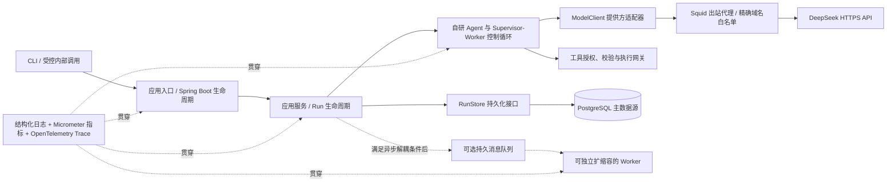

# 阶段 1–3 企业级架构升级方案

**文档状态：** 持续实施中（2026-11-14）。当前 `main` 已推送至 GitHub（`5c1c8e07e7d80b412657c153df38e14ee945d147`）。L5 当前运行 Worker `myai-agent:l5-20261114-runtime-current`（基于完整 Dockerfile 镜像叠加当前应用 JAR 层构建；2/2 Ready、0 次重启；manifest `sha256:0ce43b84944beac5d2895e1f7760d895680e151ed4cebb489ae64ce64edd7378`、config/imageID `sha256:2a96238b72f79da559e8770815a70f5ac95eec8ea500bcc81c6bfda8e141eaa3`、JAR 与本地工作区 SHA-256 均为 `2b0a037f94682528bd2b1c4b4caf5de92e239bf919d70d4dbe12a1a530e347e6`）、模型代理 `myai-model-egress-proxy:l5-20261113`（2/2 Ready）、PostgreSQL、Collector、Prometheus、Tempo、Grafana；Prometheus 10 条规则健康、2 个抓取目标为 UP、无活动告警。第三方镜像引用已固定为 Registry 可验证的 `linux/amd64` manifest digest；Grafana、Tempo、PostgreSQL 已按该摘要滚动部署，Collector/Prometheus 原运行摘要已匹配。Worker 基础镜像完整 Dockerfile 构建 manifest 为 `sha256:9bb463f87263bc8dfcf82ca71d69a57e2b8bb26c1aad81afe591e5ea16f08f22`。GitHub Actions 对提交 `5c1c8e0` 的 `verify` Job 已通过；`publish-images` 在 GHCR 写入时收到 `denied`，所以应用镜像与代理镜像均未完成发布：`myai-agent` 仅留下无标签版本，代理镜像包尚未创建。待在 GHCR 包的 Manage Actions access 中向仓库 `ly416123/myai` 授予 Write 后重跑发布。数据库和 Trace 备份/恢复能力已从本地期望状态及 L5 移除，单节点 local-path PVC 不提供节点恢复保障。详细证据按日期记录在本文件末尾；较早记录为对应时点的历史事实。

**范围决定：HTTP API/生产认证授权、告警通知投递、CA 签名密钥托管/故障轮换、数据库/Trace 备份与异地恢复当前不交付；Prometheus v3.16.0 按用户决定保留。项目当前迭代约束：以功能实现和运行流程验证为验收重点，忽略 PostgreSQL、Prometheus、Tempo、Grafana 等中间件镜像 CVE；不为这些发现投入版本升级或自维护派生镜像工作，除非用户之后另行要求。扫描结果仅为信息性运维记录，不是本阶段功能交付阻塞项或待办事项，也不据此宣称漏洞已修复或项目通过安全认证。** 当前仍需跟进 GHCR 包授权、镜像发布与拉取验证、业务 SLO 和数据分类/保留策略。当前三项演示工具不产生外部副作用；未知工具结果不会自动重放。

**远端同步状态（2026-11-14）：** 只读 `git ls-remote origin refs/heads/main` 返回 `5c1c8e07e7d80b412657c153df38e14ee945d147`，与本地 `main` 一致。该推送包含本地备份/恢复移除和本轮部署更新。GitHub Actions run `43556974597` 的 `verify` Job 全部通过（Maven、Gitleaks、Prometheus 规则、镜像摘要、Docker 构建及 Trivy 扫描）；`publish-images` 因 GHCR Registry 拒绝写入失败。包版本检查显示 `myai-agent` 新版本没有 tags，`myai-model-egress-proxy` 包尚不存在；目前没有从 GHCR 拉取验证。恢复镜像发布的条件是 GHCR 包对仓库 `ly416123/myai` 授予 Actions Write 权限。不要将 GHCR 发布失败描述为 CI 验证失败，也不要宣称镜像已发布。
## 1. 结论

MyAi 的目标是企业级 Agent Runtime。阶段 1–3 形成了可运行的核心循环、运行状态和 Supervisor–Worker 协作，但早期为控制复杂度采用的 CLI、本地 JSON Store、单进程调度和本地日志，不具备多实例生产运行所需的持久化一致性、集中可观测和运维能力。

建议升级为**模块化单体 + PostgreSQL + Micrometer/OpenTelemetry 可观测 + K3s 部署**。继续保留自研 Agent 控制循环，Spring Boot 负责应用容器、配置、健康检查和生命周期；短期仅支持 CLI/受控内部调用，HTTP API 与生产认证授权暂不交付，但保留后续接入所需的应用服务和身份上下文边界，并用 Fake/Mock 验证这些边界。不因为企业化而直接拆微服务，也不立即强制加入 MQ。只有在任务交付需要跨进程解耦、独立扩缩容或可靠事件投递时，才增加消息队列。

测试中的 Fake/Mock `ModelClient` 不应移除。它是隔离外部模型、复现错误和稳定验证控制流程的必要测试替身；需要补齐提供方协议测试、PostgreSQL 集成测试和受控的真实模型评测，避免把 Fake 测试当作模型质量证明。

## 2. 当前架构与目标形态

当前实现包括：Spring Boot 负责配置绑定与生命周期，CLI、一次性 Run 和后台 Polling Worker 共享应用服务；L5 Worker/任务出站通过 NetworkPolicy 默认拒绝并强制经 Squid 精确域名白名单访问 DeepSeek；`AgentRuntime` 和 `CollaborativeWorkflow` 仍持有手写控制循环；PostgreSQL/Flyway 是应用主存储，RunStore 通过事务、乐观版本、租约和 fencing 保护并发写入；协作流程的模型/工具预算通过 PostgreSQL 行锁和稳定 reservation ID 原子预留，避免幂等重试重复计数；InMemory/JSON Store 继续提供相同契约用于测试与早期回归；日志使用结构化 Logback 输出，Micrometer/OTel 提供埋点与可选 OTLP 导出；DeepSeek 通过 Provider Adapter 接入，测试覆盖 Fake、HTTP Stub 与 Testcontainers PostgreSQL。L5 Worker 和任务 Job 的出站通过 NetworkPolicy 默认拒绝，并强制经仅允许 `api.deepseek.com:443` 的 Squid 代理访问 Provider。持久 Worker 可由多实例领取不同父 Run；启用 `AGENT_SEPARATE_TASK_WORKERS=true` 后，独立子任务 Worker 可按数据库租约领取任务，Supervisor 读取持久状态等待任务完成。HTTP API 与生产认证授权短期不支持。

建议目标结构：

首期按模块化单体部署在 K3s。逻辑分层不要求一层一个进程；持久化、并发边界和可观测契约先稳定，再按容量数据决定是否将 Worker 拆为独立 Deployment。

## 3. 按阶段梳理现有选型与企业级改造

| 阶段 | 现状及早期简化 | 企业级目标 | 处理建议 |
|---|---|---|---|
| 阶段 1：应用入口与 Agent 基础循环 | CLI 作为唯一入口；`Main` 同时负责密钥读取、依赖组装和交互；使用 `slf4j-simple`；模型接入目前只有 DeepSeek 适配器；工具以本地 Java 方法为主。 | Spring Boot 模块化单体；配置绑定与启动校验；CLI/受控内部调用；健康检查和优雅停机；结构化日志和外部配置。HTTP API、生产认证授权短期不交付，但应用服务不与 CLI 耦合，并预留身份上下文扩展点。 | 保留手写控制循环与 `ModelClient`/`AgentTool` 边界；将入口、配置和生命周期移入应用框架。生产密钥经 Kubernetes Secret 或组织密钥系统注入，不把密钥文件作为部署配置。测试使用 Fake/Mock 调用方及身份，不把 Mock 身份机制接入生产装配。 |
| 阶段 1：工具协议 | 工具参数使用 Jackson 树结构；自定义校验器只覆盖根级字段类型/required/min/max/enum，嵌套与组合约束未生效。 | 已改用 Draft 2020-12 校验器，支持嵌套和组合约束；本地 `$ref` 可用，远程 Schema 引用在执行侧拒绝。ToolRegistry 提供静态工具 allowlist；PostgreSQL `tool_execution_audit` 追加记录工具步骤状态变化并提供 CLI 查询，不保存参数、结果正文或异常原文。外部副作用工具仍需逐工具定义幂等键或补偿协议。短期不提供 HTTP API 和生产认证授权；工具权限仍由服务端静态策略约束。 | Fake/Mock 仅用于测试边界和拒绝路径，不接入生产装配。生产身份认证、租户隔离及用户级授权待未来 API/真实调用方需求确定后实施。需要外部副作用的工具必须定义幂等或补偿方式。 |
| 阶段 2：Run 状态与 Checkpoint | `InMemoryRunStore` 用于测试；`JsonFileRunStore` 每 Run 一个 JSON 文件。文件原子替换只解决单文件写入完整性，不提供多进程锁、事务、多副本协调或查询治理。 | PostgreSQL 作为 Run 主数据源；使用事务、版本号/乐观锁、租约与状态迁移约束；Flyway 管理版本；可恢复任务由数据库统一认领。 | 以 `agent_run`、`run_message`、`run_step`、`child_task` 等表保存状态和关联；模型消息/计划等变化字段可使用 JSONB。避免把整个 Run 作为无版本大 JSON 覆盖写入。 |
| 阶段 2：日志与监控 | 仅本地 SLF4J 日志和 `/runs` 摘要；没有集中指标、分布式 Trace、告警和 SLO。 | JSON 结构化日志、Micrometer 指标、OpenTelemetry Trace/OTLP；统一关联 `runId`、`stepId`、`taskId`、`traceId`；设定仪表盘和告警。 | 日志和 Trace 可带 Run 标识；指标标签不得使用 `runId` 等高基数值。记录模型/工具耗时、失败类别、Token 可用性、队列等待时间和恢复情况。 |
| 阶段 2：副作用与恢复 | 已区分 PENDING/IN_PROGRESS/INDETERMINATE，但没有工具端幂等协议；取消线程不能撤销外部操作。 | 数据库状态迁移、租约、幂等键/去重表、事务 Outbox 和补偿流程；重启与重复消息可安全收敛。 | 对每种副作用工具单独定义交付语义。没有目标系统幂等/事务配合时，仍不得声称 exactly-once。 |
| 阶段 3：Supervisor–Worker 执行 | 默认 `CollaborativeWorkflow` 在单 JVM 固定线程池并行；Worker 和工具静态注册；单父 Run 保存子任务。 | 父 Run/子任务的数据库事务边界明确；任务可被多实例安全 claim/续租/恢复；可按容量独立扩缩容；Worker 权限、取消、重试和状态变更可审计。 | 已提供数据库轮询的独立子任务 Worker，可通过 `AGENT_SEPARATE_TASK_WORKERS=true` 启用；默认 CLI 仍使用本地线程池。L5 在途 Run 的 Worker SIGKILL/peer Pod 接管演练已于 2026-11-13 完成，Testcontainers 另覆盖跨 Runtime PostgreSQL 检查点恢复和未知工具结果不重放。单节点/存储故障与外部工具副作用尚未演练；未来增加副作用工具前仍须定义幂等/补偿协议。 |
| 阶段 3：测试与评测 | Fake ModelClient、固定 Fake 任务和内存 Store 验证确定性流程；没有真实模型质量基线。 | 分层测试：单元 Fake、Provider HTTP 契约测试、PostgreSQL 集成测试、并发/故障测试、版本化 Agent 评测集和受控真实模型评测。 | Fake 保留在测试代码中；新增 HTTP Mock Server 验证 SDK 适配器协议，Testcontainers 验证迁移和数据库并发，真实模型评测独立运行并控制费用/数据。 |

## 4. 存储、队列与恢复的方案与决策

### 4.1 PostgreSQL 当前主存储

生产装配已使用 PostgreSQL 作为 Run 与 Checkpoint 的主存储，并由 Flyway 管理 schema；`PostgresRunStore` 通过 Spring JDBC 执行显式 SQL 和短事务，避免把状态迁移交给 JPA 实体隐式处理。InMemory/JSON Store 仅作为测试和本地开发替代实现，不是生产数据源。

当前持久化实体边界：

- `agent_run`：`run_id`、`run_type`、状态、用户输入、最终回答、deadline、版本号、fencing token、租约持有者与过期时间、创建/更新时间。
- `run_message`：按顺序以 JSONB 保存消息与必要的工具调用上下文，并通过 Run 外键级联删除。当前不提供字段级静态加密或消息读取审计；Run 自动清理配置为 `PT0S` 时不会自动删除。是否保存原文、字段保护、访问审计及保留期限需待业务数据分类和责任流程确认后确定。
- `run_step`：模型、工具、规划、汇总等步骤的状态、耗时、失败类别和 Token 用量。
- `tool_execution_audit`：工具步骤状态变化的追加式安全审计元数据；仅保存 Run/步骤/工具调用标识、工具名、状态、失败类别、Worker 和时间，不复制参数、结果或异常内容；通过外键随 Run 保留清理级联删除。
- `child_task`：父 Run、任务/Worker ID、依赖、状态、尝试次数、租约和交付结果引用。
- `outbox_event`：当前未实现；只有需在提交 Run 事务后可靠通知队列/其他服务时才启用。

`PostgresRunStore` 已实现原子 claim、租约续期、乐观版本更新和 fencing 条件写入；父/子任务 claim 与状态写回均由数据库条件更新约束，不依赖跨实例 JVM 锁。模型和工具调用在数据库事务之外执行，调用意图/步骤状态先持久化，再单独保存结果。若租约过期时外部调用仍在运行，fencing 只能阻止旧执行者覆盖数据库状态，不能撤销外部副作用；当前未知结果步骤不会自动重放。没有外部事件/消息代理需要与 Run 事务原子发布，因此当前不启用 `outbox_event`；若未来增加可靠事件发布，再将事务 Outbox 纳入对应交付范围。

子任务租约持久化其父 Run fencing token。父 Run 被新 Supervisor 认领后，即使旧子任务租约的时间尚未到期，也可立即被重新认领；子任务 fencing 序号递增，旧执行者会被拒绝。此机制解决崩溃恢复时父租约和子租约期限错位。启用独立任务 Worker 后，Worker 按轮询周期续租子任务并单独保存任务消息/步骤；Supervisor 从 PostgreSQL 刷新任务状态。父 Run 重新 fencing 时，旧子 Worker 写入会被拒绝。租约和 fencing 只能阻止陈旧状态写入，不能撤销已经开始的外部副作用。

当前处于开发阶段，不要求兼容或迁移既有 JSON 检查点。切换到 PostgreSQL 时允许清理本地开发 Run 数据；仍应保留数据库 schema 的 Flyway 版本迁移与应用升级验证；数据库备份/恢复当前按用户决策不在项目支持范围，运行数据没有应用级灾备保障。

Run 消息和工具参数可能包含个人信息、密钥或业务数据。当前没有数据库备份/恢复流程或 L5 归档数据；PostgreSQL 数据卷或节点故障可能导致 Run 数据不可恢复。PostgreSQL 与 Worker 使用证书链及主机名校验 TLS；CA 签名密钥故障/组织托管方案仍暂缓，当前 TLS 证书链验证正常不代表已建立私钥恢复能力。终态 Run 可按配置定期删除，默认关闭并保留无敏感内容的清理批次审计。用户已选择继续关闭自动清理（`AGENT_RUN_RETENTION_PERIOD=PT0S`）；在数据分类、法规/合同要求和删除流程确认前不启用自动删除。仍需定义组织级数据分类、实际保留期限和用户删除请求流程；数据库备份仍不在支持范围；CA 签名密钥故障/托管按用户决定短期暂缓；日志中不写完整提示词、密钥或敏感工具参数。

### 4.2 MQ 是条件性组件，不是本轮强制项

当前只有单节点 K3s，l5 上原有 NATS、PostgreSQL、Redis、MinIO、Keycloak 工作负载均已停止，数据卷保留。存在镜像或 PVC 不代表服务已可用，也不代表配置满足生产要求。2026-11-12 检查到 4 CPU、7.2 GiB 内存、根卷可用约 87 GiB；停掉应用工作负载后 available 内存约 5.5 GiB（停机前约 1.0 GiB）。复用前仍要检查实际负载、存储与配置。

建议先使用 PostgreSQL 持久任务表和租约完成可恢复任务调度。出现以下需求之一后再评估 MQ：

- Worker 需要独立部署、扩缩容或跨节点消费；
- 峰值任务需要排队削峰，且数据库轮询不满足吞吐/延迟目标；
- 需要把状态变化可靠发布给多个系统。

引入 MQ 后使用事务 Outbox 防止数据库提交成功但消息未发布。Outbox/消息代理提供的是至少一次交付语义，消息可能重复；消费者必须按稳定事件 ID 或业务幂等键去重，不能宣称端到端 exactly-once。选择一个消息系统即可：优先评估 l5 已存在过的 NATS JetStream 是否满足持久化、重投递、消费组和运维要求；若不满足，再比较 RabbitMQ/Kafka 的业务语义和资源成本。不要同时部署多个队列，也不要把 MQ 当作 Run 的唯一事实来源。

## 5. 监控、MockClient 与企业级测试

### 5.1 监控目标

- **日志：** SLF4J 门面配 JSON 格式后端，输出到标准输出，由 K3s/日志平台采集；统一携带 `runId`、`stepId`、`taskId`、`workerId` 和失败类别，敏感内容按字段拒绝或脱敏。
- **指标：** Micrometer 统计 Run 成功/失败/部分成功、阶段耗时、模型和工具调用数、Token 用量未知比例、预算耗尽、队列深度与租约过期；Spring Boot 自动绑定 Hikari 活跃/最大连接数等指标。指标标签使用有限枚举，不使用 Run/用户 ID。
- **追踪：** OpenTelemetry Trace 串联入口、规划、Worker、模型适配器、工具和数据库调用；模型提示词/响应默认不作为 Span 属性。
- **告警：** 先基于服务可用性、错误率、P95 延迟、数据库连接池、任务积压/租约超时和模型失败率定义 SLO 与告警阈值，再决定 Prometheus/Grafana 或现有集中平台。

L5 部署单副本 OTel Collector、Prometheus、Tempo 和 Grafana，Service 均为 ClusterIP；Prometheus 持久化 7 天，Tempo 以单节点本地 PVC 保存 Trace 7 天。Collector Trace exporter 使用 1 GiB 文件队列，单批发送重试最多 1 小时；这不能替代节点级灾备。移除备份功能后，KSM、备份抓取目标和备份告警均不存在；Prometheus 当前规则源包含十条规则，覆盖 Collector/Tempo 可用性、队列等待、过期租约、近期失败 Run、连接池容量、Worker JVM Heap 占用、轮询失败计数、队列深度指标缺失和单个 Worker 副本失联。告警表达式使用 Collector 实际导出的 `myai_` 指标前缀；内置控制台 `/consoles/agent-overview.html` 显示队列深度、最老等待时间、过期租约数、近期失败 Run 数和连接池用量。Grafana 已配置 Prometheus/Tempo 数据源并通过 provisioning 加载 MyAI Runtime Overview 仪表盘，当前包含 7 个队列、租约、失败、数据库连接池、Collector 与 Tempo 健康面板；面板查询已通过 L5 Prometheus 实际执行验证。L5 Prometheus 抓取的 Collector/Tempo 指标带 `environment=l5` 标签，进入 Tempo 的 spans 带 `deployment.environment.name=l5` 资源属性；多副本 Worker 暴露的是相同数据库全局队列快照，聚合仍应使用最大值或单实例代表，不能求和。合成 Trace 已通过 Collector 接收并按 Trace ID 在 Tempo 查询，Grafana Tempo 数据源健康检查正常。当前仍没有节点级 HA、外部集中指标后端或告警接收端；通知按用户决定暂缓。生产命名约定、跨环境聚合与告警阈值/SLO 尚未定稿。L5 运维手册覆盖只读诊断、告警查看、Trace 检查、租约恢复、Worker 回滚及无数据库备份/恢复能力的边界。中间件镜像扫描结果按项目约束只作信息记录，不作为功能验收阻塞项；Prometheus v3.16.0、Tempo 2.10.10 与 Grafana 12.4.15 继续按既定版本运行，运行状态不代表通过安全认证。

Run Observation 已在单 Agent 与 Supervisor 执行期间保持 scope；模型调用的虚拟线程显式恢复步骤上下文。本地并行 Worker 有独立步骤 Observation，模型与工具 span 可形成 `Run → Worker → Model/Tool` 层级；确定性回归测试验证 Run/Worker/Model 父子关系。独立 `separateTaskWorkers` 已在子任务检查点中持久化 W3C `traceparent`/`tracestate`；领取任务的新 Worker 恢复远端父上下文，使 `Run → Worker → Model/Tool` 跨进程保持同一 Trace。实现不传播 baggage，以免把业务敏感值写入任务元数据。JDBC 查询已通过 Datasource Micrometer 1.5.0 与 OpenTelemetry 语义映射生成 query span，仅开启 QUERY 观测，参数值明确关闭导出，SQL 字面量分析和脱敏开启，查询日志关闭；Testcontainers 集成测试检查 Collector 确实收到数据库 span 并且敏感参数/字面量没有出现在导出 Trace 中。跨进程 Trace Context 已在本次迭代实现并经确定性 Trace 层级与 PostgreSQL JSONB 往返测试验证。

已实现的 Worker Gauge 为 `agent.worker.queue.depth`、`agent.worker.lease.expired`、`agent.worker.queue.oldest`（秒）和近 5 分钟失败 Run 数，由 Worker 每轮轮询时读取 PostgreSQL 聚合快照；Hikari 指标由 Spring Boot 自动绑定。所有 Worker 副本观测相同的数据库全局队列快照，因此多副本指标后端必须按最大值或单实例读取，不能求和。Worker 通过 `/tmp/myai-worker-live` 和 `/tmp/myai-worker-health` 时间戳提供无 HTTP 的 Kubernetes liveness/readiness exec probe：轮询线程停止时重启，数据库轮询失败时只退出就绪状态。Prometheus 当前规则源的唯一文件为 `deploy/k8s/base/agent-alerts.yaml`，由 Kustomize 生成运行时 ConfigMap；`promtool` 测试使用同一源文件。备份专用的 KSM 目标与两条备份状态规则已移除。规则阈值不是已确认 SLO。规则测试已纳入 CI，覆盖当前规则的触发延迟和阈值边界；L5 当前部署的十条规则均健康，包含 Worker JVM Heap 高占用、持久队列轮询失败、队列深度指标缺失和单副本失联告警。JDBC query span、跨进程 W3C Trace Context 与单副本心跳监控已部署到 L5，Worker 镜像 `myai-agent:l5-20261114-runtime-current` 已于 2026-11-14 基于完整 Dockerfile 镜像叠加当前应用 JAR 构建并部署，2/2 Ready；Collector → Tempo → Grafana 查询链路已用合成 Trace 端到端验证。L5 Prometheus scrape 与 Trace resource 均带稳定的 `l5` 环境标识；运维手册见 `docs/operations/l5-runbook.md`。生产环境分类、命名规范、多环境聚合方式、业务 SLO 和正式运维目标仍需业务确认。告警通知投递按用户决定短期暂缓，Prometheus 仍保留规则和本地告警状态。数据库备份功能已按用户决定移除。CA 签名密钥故障/托管方案仍按用户明确决定短期暂缓。

### 5.2 Fake/Mock ModelClient 的正确定位

当前测试里的 Fake ModelClient 是 `src/test` 中的测试替身，不是生产模型客户端。它应该保留并整理成 `ScriptedModelClient`/记录型测试工具：按预设响应、错误和延迟驱动流程，支持断言请求历史、工具定义、调用次数和取消行为。生产装配必须只接受真实 Provider Adapter，不能通过配置把 Fake 误启用。

当前已补充本地 HTTP Stub 的 Provider 契约测试，覆盖请求路径、鉴权头不泄漏、模型与工具映射、多个工具调用解析、Token 用量，以及 401/408/429/503 和真实请求超时的失败分类、重试属性与敏感正文隔离；没有读取真实 API Key。受控评测能力如下：

1. **Provider 契约测试：** 本地 HTTP Stub 验证 DeepSeek 请求路径、鉴权头存在但不泄漏、模型/工具 Schema 映射、多个工具调用解析、Token 用量、超时和错误分类；无需真实 API Key。
2. **Agent 评测：** 版本化合成场景集与显式启用的真实评测入口已提供，记录任务结果、协作计划摘要、工具选择、调用次数、Token 用量、可按配置单价估算的费用及人工评分字段。v2 场景可用必需/禁止短语对明确的回答事实做大小写敏感子串断言；没有配置断言的自由文本仍不做自动语义评分。普通 CI 只运行确定性样例；真实模型评测需要人工显式触发，并受样例数、模型/工具总调用和总时限限制。2026-11-12 已对 DeepSeek Flash 连续运行两轮各 5 个合成样例，两轮均 5/5 符合工具/计划预期，各调用 9 次模型与 3 次工具，Token 分别为 4329/451 和 4329/426；调用单价未配置，费用未知。对既有报告复核发现，时间查询样例回答误将 Java 系统时钟称为模拟数据；工具结果现明确提供 `source` 与 `simulated` 标志，v2 对时区信息、当前时间和已观察到的误述增加短语断言。2026-11-14 使用 DeepSeek Flash 对 v2 五个合成样例复测，5/5 符合已编码检查，共 9 次模型调用、3 次工具调用、4,447 输入 Token 与 406 输出 Token；时区回答短语断言匹配，费用未知。默认报告目录 `var/agent-evaluations` 下保留受限本地报告；尚无人工回答评分或生产质量结论。

数据库集成测试已使用 Testcontainers PostgreSQL 验证 Flyway 初始化、运行记录往返、并发 claim、fencing token、版本冲突与取消请求、工具审计状态追加及父/子任务检查点路径，以及终态 Run 的消息/步骤/子任务/工具审计级联删除；此前曾以真实 PostgreSQL 16 临时容器验证过备份恢复到隔离库，该验证属于功能移除前的历史结果。需要可用的 Docker API 或受支持容器环境；CI 使用 Docker-enabled runner，本地 Colima 通过其 Docker socket 执行。当前数据库没有应用级备份/恢复保障；CA 签名密钥故障/托管仍暂缓。

## 当前决策：移除 PostgreSQL 备份功能（2026-11-13）

用户要求移除 MyAI 的备份功能。仓库期望状态已移除自动/手动 PostgreSQL 备份和恢复脚本、镜像构建、Kubernetes CronJob、备份 ConfigMap、保留清理流程、专用 KSM 监控、告警和 CI 步骤。L5 已删除 CronJob、备份 ConfigMap、KSM Deployment/RBAC/Service/NetworkPolicy，并重新应用 Prometheus 五条应用规则。后续用户要求彻底移除备份残留后，历史备份 Job/Pod、`myai-postgres-backups` PVC 及其 Delete 回收策略 PV 均已删除；PostgreSQL 数据 PVC 与 Prometheus PVC 保留。当前没有数据库级备份或恢复保障，单节点/同节点 PVC 不能提供节点故障恢复。

## 6. 实施状态与剩余交付

| 优先级 | 交付项 | 状态与证据 |
|---|---|---|
| P0：架构基线 | 模块边界、Run 状态迁移、副作用恢复语义和 HTTP/认证短期范围已明确；目标并发、可用性、RPO/RTO、数据保留和 SLO 尚无业务数值。 | 现有设计记录见本文件；容量与 SLO 决策待业务侧给定后补 ADR。 |
| P1：应用与部署 | Spring Boot 模块化单体、CLI/`once`/`worker` 入口、外置配置、K3s Job/多副本 Worker、PostgreSQL 轮询、RunType 恢复分派、Secret 文件挂载、非 root 与无 ServiceAccount Token Pod、默认拒绝出站并强制经 DeepSeek allowlist 代理均已实现。HTTP API/生产认证授权按范围决定暂不交付。 | L5 Worker 当前部署的 `myai-agent:l5-20261114-runtime-current` 基于完整 Dockerfile 基础镜像并叠加当前工作区 JAR 构建；2/2 Ready、0 重启，manifest 为 `sha256:0ce43b84944beac5d2895e1f7760d895680e151ed4cebb489ae64ce64edd7378`，Pod imageID/config digest 为 `sha256:2a96238b72f79da559e8770815a70f5ac95eec8ea500bcc81c6bfda8e141eaa3`，两个 Pod `/app/app.jar` SHA-256 均与本地 target 一致。OCI 构建在临时 L5 BuildKit 0.34.2 中完成；构建工具和临时 Pod 已清理。此前完整 Dockerfile 基础镜像 manifest 为 `sha256:9bb463f87263bc8dfcf82ca71d69a57e2b8bb26c1aad81afe591e5ea16f08f22`。第三方 PostgreSQL、OTel Collector、Prometheus、Tempo、Grafana 已固定并校验 Registry 的 `linux/amd64` manifest digest；L5 Grafana、Tempo、PostgreSQL 已滚动到对应 digest，Collector/Prometheus 原 imageID 已匹配。Kubernetes 应用只使用 `deploy/overlays/l5`，通用 `deploy/k8s` 仍含占位镜像。当前应用镜像尚未发布 GHCR：远端 `verify` Job 通过，但 `publish-images` 遇到包授权拒绝；已创建的 `myai-agent` 版本没有 tag，代理镜像包尚未创建。需授予 `ly416123/myai` 对 GHCR 包的 Actions Write 权限，再重跑并验证拉取。Worker 回滚演练已完成，不覆盖数据库 schema 回滚。
| P1：运行存储与基础观测 | PostgreSQL/Flyway、事务写入、乐观版本、原子 claim、租约/fencing、取消标志、结构化日志、Run/step 与队列指标、Hikari 指标、OTel/OTLP 已接入。终态 Run 清理能力存在，但默认关闭；数据库/Trace 备份与恢复功能已按用户决定从本地源码期望状态和 L5 移除。 | Testcontainers 覆盖迁移、读写、并发 claim、旧 fencing token 拒写、版本冲突、事务回滚、清理级联与审计；OTLP Collector 集成验证 traces/metrics 和指标命名。L5 PostgreSQL 启用 TLS，Worker 通过 `verify-full` 校验；Prometheus/Tempo 本地 PVC 均为单节点存储。当前 Prometheus 十条规则健康、无活动告警；通知接收端暂缓。节点或 PVC 故障可能造成持久 Run/Checkpoint/Trace 丢失。|
| P2：协作调度 | 子任务表有数据库原子 claim、父/子 fencing 及父 Run 更换 owner 后立即重领；Run 级共享模型/工具预算使用数据库事务、父 Run 行锁与稳定 reservation ID 做原子、幂等预留，避免过量分配和重复计费。持久 Run Worker 和子任务 Worker 均可跨实例轮询领取工作；Supervisor 以 PostgreSQL 中的任务状态等待结果。CLI 默认本地执行，Worker 部署可显式切换数据库队列路径。 | Fake Store、PostgreSQL 和确定性模型测试覆盖活跃父 Run 扫描、竞争 claim、续租、父 Run refence 后立即重领和旧 token 失效、子任务依赖/检查点/取消以及共享预算。L5 在途 Run 多 Pod 崩溃恢复演练已通过；当前工具仅有本地计算、时间查询和模拟天气，没有外部副作用工具；未来添加此类工具前须逐项定义幂等、补偿和审计策略。MQ 按负载条件评估，不默认部署。 |
| P2：可靠性与数据治理 | 工具调用未知副作用不自动重放；终态 Run 可按配置保留周期清理，删除操作有不含敏感运行数据的审计记录。工具调用状态变更已有独立追加式审计表及 CLI 查询，审计记录不含参数、结果或异常原文，并与 Run 保留删除级联。按用户当前决策，不重建数据库备份/恢复能力；L5 既有归档 PVC/PV 和归档数据已删除。当前没有外部副作用工具；未来此类工具的幂等/补偿协议须作为上线门槛。技术字段与存储流向已盘点，业务数据分类、删除请求流程尚未确认；详见[技术数据盘点](../security/data-inventory.md)。节点/数据卷损坏可能造成持久 Run 数据丢失。 | Run 清理单元与 PostgreSQL 级联/审计集成测试通过。备份/恢复脚本与保留测试已随用户决策移除，之前的手动加密备份与隔离恢复仅属于历史验证。继续明确 exactly-once 限制，并按工具逐项定义幂等、补偿或人工核对方式。 |
| P2：评测与交付验收 | Fake/Provider Stub、固定评测集与显式真实评测 Runner 已提供；CI 工作流含全历史凭据扫描、测试、告警规则测试、容器构建/扫描、配置扫描和默认分支推送后的镜像发布；Action SHA、基础镜像 digest 与 Dependabot 更新监测已配置。 | 固定 CI 样例不依赖真实模型；本地全量 `clean verify` 最近一次 178 项通过，失败/错误/跳过均为 0。GitHub run `43556974597` 的 `verify` Job 全部通过，包括远端 Maven/Testcontainers、Gitleaks、告警、digest、镜像构建和扫描。GHCR `publish-images` 尚未通过：已确认包侧需要授权仓库 `ly416123/myai` 的 Actions Write；该配置后需重跑发布并确认两个带 SHA 标签的镜像可拉取。GitHub `main` 未启用分支保护，CI 工作流本身不构成合并门禁。真实模型评测 5/5 只匹配编码断言，不构成整体质量证明，人工评分和业务单价仍缺。|

不要把 4 CPU 单节点 L5 宣称为高可用生产集群。它适合当前开发、集成或受控验证；节点故障时不中断需要多节点 K3s/Kubernetes 和具备故障切换能力的持久存储。数据库与 Trace 备份/恢复已按项目决策移除，不属于当前交付；因此单节点或 PVC 损坏可能造成 Run、Checkpoint 与 Trace 不可恢复。若未来业务提出灾难恢复目标，须另行明确范围和责任后再决策，不应将其表述为本方案当前待实现功能。

l5 没有 Docker/Compose 命令不妨碍 K3s 运行容器：GitHub Actions 的 verify Job 已通过；默认分支 GHCR 发布 Job 在镜像包写入阶段被拒绝，GHCR 拉取尚未验证；L5 目前继续使用节点 containerd 中的本地镜像。Job/Worker 清单通过只读 Secret 文件挂载 Provider Key，Pod 禁止自动挂载 ServiceAccount Token；当前默认 ServiceAccount 的 `get/list secrets` 授权检查为 `no`。但 l5 `agentteams` 命名空间仍存在一个既有 token-refresh ServiceAccount RoleBinding，允许其 `get/patch secrets`，这属于集群范围 Secret 治理与本应用隔离验收的待审项。2026-11-13 已在 l5 启用 Kubernetes Secret 静态加密并完成既有集群密钥轮换；`k3s secrets-encrypt status` 返回 `Enabled / reencrypt_finished` 且所有 Server 密钥哈希一致。轮换前已创建并本地 age 加密控制面恢复包，包含 SQLite 一致性副本、Server token、加密配置及 systemd 配置；解密到临时文件核验归档内容与 SQLite `integrity_check=ok` 后删除临时明文。轮换后通过只读 SQLite 一致性副本再次核验 `integrity_check=ok`，28 个当前 Secret 对象的 value 与 old_value 均带 `k8s:enc:` 前缀；没有读取或输出 Secret 内容。K3s 官方对既有集群启用及密钥轮换的步骤见[官方流程](https://docs.k3s.io/cli/secrets-encrypt)。后续只读审查确认，token-refresh Role 仅允许对 `agentteams-chatgpt-oauth-session` 命名 Secret 执行 get/patch；对应 Helm CronJob 已 suspended，当前无活动 Pod。RBAC 的具体 Secret 访问通过 `kubectl auth can-i` 验证为允许，访问另一个 Secret 为拒绝。由于这是其他 Helm release 管理的配置且作用范围已限定，予以保留，不与 MyAI Secret 混用。只有确有 l5 本地构建需求时，才评估 BuildKit 等工具及其磁盘/内存占用。

## 7. 后续工作分类与验收边界

本路线图的后续项按当前授权与输入划分，避免将已明确排除的能力列成未完成实现：

### 当前可继续实施

- 完成并持续维护本地 CI 门禁、测试、镜像可复现构建和 L5 功能回归；远端代码推送已恢复并完成。下一项是补齐 GHCR 包对仓库 Actions 的写权限，重跑镜像发布并核对可拉取性。
- 继续验证现有单 Agent/协作任务流程、数据库租约恢复、可观测链路与确定性评测；任何发现的功能缺陷仍按常规修复。
- 为未来新增的每个外部副作用工具，在实现前定义幂等、补偿、审计和未知结果处理；当前工具集均为本地计算、时钟查询与模拟天气，不需要虚构外部副作用协议实现。

### 用户已明确暂缓或移除

- HTTP API 与生产认证授权、告警通知投递、CA 签名密钥托管/故障轮换：短期不支持，当前没有待实现的本阶段交付。
- PostgreSQL/Trace 备份与恢复：已按用户决定从代码、部署和 L5 移除，不重建。
- 中间件镜像 CVE：仅作为既有扫描信息，不升级版本、不构建自维护派生镜像、不阻挡功能验收。
- GitHub 推送：用户已授权并完成；当前远端 CI 验证已通过，GHCR 发布仍受包 Actions Write 权限阻塞。

### 需要业务输入后再定

- 目标并发/峰值、可用性目标、业务 SLO、数据分类、Run/消息实际保留期、删除请求流程、模型数据出境策略和预算单价。
- 这些数据会影响后续部署容量、留存配置和业务验收阈值；在得到明确值前不擅自设定业务承诺。Run 自动清理继续关闭（`AGENT_RUN_RETENTION_PERIOD=PT0S`）。

L5 当前是单节点开发/集成环境，不是 HA 生产集群；没有数据库/Trace 灾备保障。该限制是已知运行边界，不作为当前备份功能待办。

## 8. 本次不做的事情与待确认业务指标

**当前环境快照（2026-11-14）：** L5 单节点 K3s v1.36.4+k3s1 作为开发/集成环境，Worker 2/2（`l5-20261114-runtime-current`）、出站代理 2/2，PostgreSQL、Collector、Prometheus、Tempo、Grafana 均 Ready。PostgreSQL schema v6；Prometheus 10 条规则健康、无活动告警，通知投递暂缓；Tempo 到 Grafana 的合成 Trace 查询通过。数据位于同节点 local-path PVC，没有数据库/Trace 备份恢复或节点级恢复保障。当前 Worker 镜像与镜像摘要详见文档开头和 [L5 运维手册](../operations/l5-runbook.md)。

**当前明确不交付：** HTTP API 与生产认证授权、告警通知投递、CA 签名密钥托管/故障轮换；PostgreSQL/Trace 备份恢复已移除；中间件镜像 CVE 不触发版本升级或自维护派生镜像。远端 GitHub 仓库已验证可访问，当前 `main` 为 `5c1c8e07e7d80b412657c153df38e14ee945d147`，未启用分支保护。该提交的 `verify` Job 已通过；GHCR `publish-images` 因包未授权该仓库进行 Actions 写入而失败，恢复所需的包设置尚未完成。当前完整 Maven 构建和工作流验证结果见验收记录。

目标并发/峰值、可用性目标、业务 SLO、数据分类、Run/消息实际保留期、删除请求流程、模型数据出境策略和成本单价仍需业务输入；在收到明确值前不设定业务承诺，Run 自动清理继续关闭（`AGENT_RUN_RETENTION_PERIOD=PT0S`）。Fake/Mock 仅为测试替身，不代表生产身份认证或授权能力。

## 9. 官方技术资料

- [Spring Boot 系统要求](https://docs.spring.io/spring-boot/system-requirements.html)：当前参考文档涵盖 Java 21；实施时按团队支持周期选择受支持版本和统一 BOM。
- [PostgreSQL 事务隔离](https://www.postgresql.org/docs/current/transaction-iso.html)：事务隔离和显式锁行为需按具体状态迁移设计验证。
- [Micrometer Tracing](https://docs.micrometer.io/tracing/reference/) 与 [OpenTelemetry Bridge](https://docs.micrometer.io/tracing/reference/tracers.html)：用于 JVM 统一追踪门面与导出器。
- [Testcontainers PostgreSQL 模块](https://testcontainers.com/modules/postgresql/)：用于真实 PostgreSQL 集成测试，不替代单元测试。
- [GitHub Actions 发布和安装容器包](https://docs.github.com/en/packages/managing-github-packages-using-github-actions-workflows/publishing-and-installing-a-package-with-github-actions)：GHCR 工作流通过 `GITHUB_TOKEN` 和 job 级 `packages: write` 发布镜像。

## 10. 本轮验收记录

**当前状态优先规则：** 本节按时间顺序追加，早期记录描述的是当时状态，不能覆盖本文件开头、`docs/operations/l5-runbook.md` 与现场核对得到的最新状态。当前 L5 Worker 为 `myai-agent:l5-20261114-runtime-current`，当前工作负载均 Ready。备份已按用户决定移除；中间件 CVE 处置不属于功能验收；GitHub 推送已完成，CI 验证通过，GHCR 包写权限仍待配置。

- 2026-11-13 GitHub Actions 供应链收敛：发现 CI 对 `actions/checkout`、`actions/setup-java` 与 `aquasecurity/trivy-action` 使用可移动版本标签。根据各项目正式 Release 提交固定至 `actions/checkout` v7.0.1、`actions/setup-java` v6.1.0 和 `trivy-action` v0.36.0 的完整 40 位提交 SHA；checkout 设置 `persist-credentials: false`，减少仓库 Git 配置中保留工作流 Token 的时间；新增 Dependabot 每周检查 Actions 依赖更新。`ContainerDeploymentContractTest#githubActionsDependenciesArePinnedToFullCommitShasAndAutoUpdated` 先按预期失败，再以固定引用通过（1/1）；Ruby YAML 解析和 `git diff --check` 通过。Action 版本与 SHA 依据 [checkout v7.0.1 发布提交](https://github.com/actions/checkout/commit/3d3c42e5aac5ba805825da76410c181273ba90b1)、[setup-java v6.1.0 发布提交](https://github.com/actions/setup-java/commit/b843ebf9b913146b38da2eaa7aeddf76074ae1ad) 和 [trivy-action v0.36.0 发布提交](https://github.com/aquasecurity/trivy-action/commit/ed142fd0673e97e23eac54620cfb913e5ce36c25) 核实。没有运行 GitHub-hosted workflow；远端行为仍待后续获准推送后验收。

- 2026-11-12 本地验收复核：重新运行 `MYAI_BACKUP_IMAGE=myai-postgres-backup:acceptance-2026-11-12 bash ops/tests/postgres-backup-restore-smoke.sh`，最终通过：备份容器按保留策略删除过期归档，生成加密备份，并恢复到隔离数据库读回探针数据。首次复验失败的根因由临时 PostgreSQL 容器日志确认是 Colima Docker 虚拟机数据盘空间耗尽（`initdb: ... No space left on device`），不是备份脚本错误；仅清理该 Docker 环境 BuildKit 构建缓存后，PostgreSQL 探针和完整 smoke 均通过。该验证仍是本地手动恢复测试，不替代 l5 CronJob、异地副本、密钥轮换或生产恢复演练。
- 2026-11-12 OTLP 配置复核：新增 `OtlpEndpointConfigurationTest` 先验证失败，再修正 Spring Boot 3.5 traces exporter 的属性路径，并加入独立的 metrics/traces endpoint 配置：`AGENT_OTLP_METRICS_ENDPOINT`、`AGENT_OTLP_TRACES_ENDPOINT`；两路开关默认关闭。完整 `clean verify` BUILD SUCCESS，133 项测试通过，0 失败、0 错误、0 跳过。参考 [Spring Boot 3.5 OTLP 属性](https://docs.spring.io/spring-boot/3.5/appendix/application-properties/)；Collector 连通性、后端落盘、告警路由仍未验证。
- 2026-11-12 l5 Secret RBAC 只读核验：`agentteams` 默认 ServiceAccount 对 Secret 执行 `get/list` 均被拒绝；本项目 Job、Worker 模板也显式关闭 ServiceAccount Token 自动挂载。命名空间 RoleBinding 仍授予既有 token-refresh ServiceAccount `get/patch secrets`；当日集群静态加密尚未启用。
- 2026-11-13 l5 控制面保护与基础设施准备：轮换前 K3s SQLite/Server token/配置的恢复包经 age 加密保存并校验；启用 `--secrets-encryption` 后按官方顺序执行 enable、重启、`rotate-keys`、重启，最后状态 `Enabled / reencrypt_finished` 且所有 hashes match。恢复归档中的 SQLite 与轮换后只读一致性快照均通过 `PRAGMA integrity_check=ok`；快照统计 28/28 当前 Secret value 和 28/28 old_value 为 `k8s:enc:`，未读取 Secret 内容。导入 Temurin 21 amd64 基础镜像后 K3s node Ready，CoreDNS/local-path-provisioner/metrics-server 均为 1/1。l5 OCI 镜像构建仍受本地 BuildKit VM 代理指向不可达地址影响，应用 Worker 镜像未部署。旧 token-refresh RoleBinding 未改。
- 2026-11-13 OTLP 端到端复核：严格样本断言发现租约 Gauge 的 Prometheus 名称为 `agent_worker_lease_expired_leases`（包含 `leases` 单位后缀），原告警查询名错误，已修正规则。`OtlpExporterIntegrationTest` 使用固定版本 OpenTelemetry Collector Testcontainer，将真实 Micrometer metrics 和 Observation trace 推送至 OTLP/HTTP，抓取 Prometheus exporter 样本并与告警表达式逐项核对；当时 Hikari 样本由未连接数据库的测试池提供。后续严格复验发现此测试池未触发 Spring Boot Hikari metrics tracker，已于 2026-11-13 改为连接临时 PostgreSQL 的真实 Hikari 池并重新通过。Collector debug exporter 确认收到 trace。`DOCKER_HOST=unix:///Users/gecko/.colima/default/docker.sock TESTCONTAINERS_RYUK_DISABLED=true mvn --batch-mode --no-transfer-progress clean verify` BUILD SUCCESS，134 项测试通过，失败/错误/跳过均为 0。此项验证本地 Collector 的 OTLP 接收及 Prometheus 指标映射，不代表已部署长期存储、告警接收端或生产监控后端。
- 2026-11-12 部署凭据收敛：Agent Job 与 Worker 不调用 Kubernetes API，Pod 模板现关闭 ServiceAccount Token 自动挂载；`ContainerDeploymentContractTest` 先因两个模板缺少该限制而按预期失败，补充配置后 5 项契约测试通过。Job 和 Worker 的 `kubectl create --dry-run=client --validate=false --context kind-agentteams` 客户端解析通过；未向 kind 或 l5 提交资源。
- 2026-11-12 镜像发布链路：CI 增加默认分支 push 专用 GHCR 任务，依赖完整 `verify`，使用仅该 Job 持有的 `packages: write` 权限；发布 Job 对 SHA 标签镜像执行 Trivy HIGH/CRITICAL 扫描，通过后只推送不可变 commit SHA 标签，并附 OCI source/revision 标签。三个 K8s Pod 模板引用 `myai-registry` imagePullSecret。契约测试先因发布任务与镜像拉取凭据缺失按预期失败，补齐后验证通过；工作流 YAML 解析通过；远端 GitHub Actions 尚未运行，实际包创建、权限和集群拉取仍未验证。
- `DOCKER_HOST=unix:///Users/gecko/.colima/default/docker.sock TESTCONTAINERS_RYUK_DISABLED=true mvn --batch-mode --no-transfer-progress clean verify`：本轮 BUILD SUCCESS，132 项测试，失败 0、错误 0、跳过 0；包括 PostgreSQL Testcontainers 集成测试和 GHCR 发布契约测试。这个结果验证本地构建和测试，不代表镜像发布、远端 CI 或 l5 部署已完成。
- `DOCKER_HOST=unix:///Users/gecko/.colima/default/docker.sock TESTCONTAINERS_RYUK_DISABLED=true mvn --batch-mode --no-transfer-progress clean verify`：此前验收 BUILD SUCCESS；131 项测试，失败 0、错误 0、跳过 0。覆盖调度器 daemon 属性及保持 Spring 上下文打开时子 JVM 自行退出、评测报告目录默认值、Provider 密钥文件配置和 K8s Secret 挂载契约、真实模型评测 Runner 的 Fake 边界、PostgreSQL 工具审计、父/子租约、Schema、DeepSeek HTTP Stub、共享预算、备份模板和部署契约。此前生成在 `target/` 的真实评测报告被 `clean` 清理；默认路径随后移至 `var/agent-evaluations` 并加入 Git 忽略规则，后续报告不受 Maven clean 影响。
- `mvn --batch-mode --no-transfer-progress -Dtest=AgentSchedulingConfigurationTest test`：先因待测调度配置不存在而按预期编译失败；实现后测试通过，实际调度任务在线程上断言 `isDaemon=true`。此修复针对真实评测中观察到的 `eval` 输出结果后 JVM 被 Spring `scheduling-1` 非 daemon 线程挂住的问题。
- Java 21 executable 启动当前应用 JAR，连接临时 PostgreSQL 并通过标准输入发送 `/exit`：进程退出码 0，观察到 Spring 启动与 CLI 退出标记。首次冒烟误用了 PATH 中 Java 17 并得到 `UnsupportedClassVersionError`，确认是验证命令选错 JVM 后改用 Maven 的 Java 21 重跑成功；该 Java 17 结果不是应用失败。
- 受控真实模型评测：对版本 `2026-11-v1`、模型 `deepseek-flash` 连续执行两轮各 5 个样例，均 5/5 通过；每轮 9 次模型调用、3 次工具调用，Token 分别为 4329 prompt / 451 completion 与 4329 / 426。未配置单价，费用未知；每轮均使用临时 PostgreSQL，第二轮进程退出码 0，报告保存于 `var/agent-evaluations/evaluation-3355224007298720591/report.json`（目录 0700、文件 0600，Git 忽略）。样例回答未进行人工质量打分。
- `docker build --build-arg UBUNTU_REPOSITORY=mirrors.aliyun.com/ubuntu-ports --tag myai-agent:eval-check .`：本地构建成功；从镜像提取应用 JAR 并确认含 `AgentSchedulingConfiguration`，容器内确认评测数据集存在，运行用户为 `10001:10001`。未部署集群。
- `trivy image --scanners vuln --severity HIGH,CRITICAL --ignore-unfixed --exit-code 1 myai-agent:eval-check`：当前重建镜像扫描通过；Ubuntu 26.04 系统包 0 项、应用 JAR 0 项 HIGH/CRITICAL 漏洞。
- K8s Provider 凭据安全：Job/Worker 清单使用 `DEEPSEEK_KEY_FILE` 指向 Secret 只读卷，Secret 文件模式 `0440` 并设置 Pod `fsGroup: 10001`；测试确认不再把 Provider Key 注入环境变量，配置测试使用合成 key 验证文件路径覆盖，不访问模型。
- `kubectl create --dry-run=client --validate=false --context kind-agentteams -f deploy/k8s/base/agent-task-job.yaml -o name` 与 Worker Deployment 同样 dry-run：客户端解析通过；`trivy config --severity HIGH,CRITICAL --exit-code 1 deploy/k8s`：3 个 K8s 清单均 0 项 HIGH/CRITICAL 配置发现。均为本地只读验证，未向 kind 或 l5 提交资源。
- `mvn -q -DskipTests package`：BUILD SUCCESS，供镜像打包阶段复用已构建 JAR。
- Jackson BOM 升级到 2.22.3 并接入 NetworkNT JSON Schema Validator 2.0.8 后，重建 `myai-agent:enterprise-check` 镜像并用 Trivy 扫描 HIGH/CRITICAL：Ubuntu 系统包 0 项、应用 JAR 0 项；中间版本 2.22.1 曾报告 5 项可修复 Jackson HIGH，已升级到 Trivy 标记的修复版本后复扫通过。
- `docker build --build-arg UBUNTU_REPOSITORY=mirrors.aliyun.com/ubuntu-ports --tag myai-agent:enterprise-check .`：本地构建成功；升级 Ubuntu 基础层安全更新并移除未使用且含旧 Go 标准库的 `/usr/bin/pebble`，镜像仍使用 Java 21、UID/GID 10001。Docker build context 忽略 `.env` 与 `deepseek.key`。
- `trivy image --java-db-repository ghcr.io/aquasecurity/trivy-java-db:1 --scanners vuln --severity HIGH,CRITICAL --ignore-unfixed --exit-code 1 myai-agent:enterprise-check`：修复前发现 8 个 Ubuntu 系统包 HIGH 项、8 个 Java 依赖 HIGH 项和 12 个 `pebble` Go 标准库 HIGH 项；重建后 Ubuntu 系统包与 Java JAR 均为 0 个 HIGH/CRITICAL 项，`pebble` 已从最终镜像移除。
- `docker image inspect ...` 与容器内 `java -version`：确认运行用户为 10001，镜像 Java 版本为 21.0.12。
- `kubectl create --dry-run=client --validate=false -f deploy/k8s/base/agent-task-job.yaml -o name`：客户端解析通过。未向 l5 或其他 Kubernetes 集群提交资源。
- `kubectl create --dry-run=client --validate=false -f deploy/k8s/base/agent-worker-deployment.yaml -o name`：输出 `deployment.apps/myai-agent-worker`。只做本地客户端解析，未部署到 l5。
- `kubectl create --dry-run=client --validate=false -f deploy/k8s/base/postgres-backup-cronjob.yaml -o name`：输出 `cronjob.batch/myai-postgres-backup`。只做本地客户端解析，未部署。
- `trivy config --severity HIGH,CRITICAL --exit-code 1 deploy/k8s` 和相同参数扫描 `ops`：部署清单及备份 Dockerfile 均无 HIGH/CRITICAL 配置发现。
- `bash -n ops/run-scheduled-backup.sh ops/postgres-backup.sh ops/postgres-restore.sh ops/prune-postgres-backups.sh ops/tests/postgres-backup-retention-test.sh ops/tests/postgres-backup-restore-test.sh ops/tests/postgres-backup-restore-smoke.sh`：脚本语法通过。
- `bash ops/tests/postgres-backup-retention-test.sh`：通过，覆盖默认不清理、保留天数校验、仅清理目标数据库的完整超期归档，以及对近期、校验文件缺失、活动锁和其他数据库归档的保护。
- `bash ops/tests/postgres-backup-restore-test.sh`：脚本安全契约通过，覆盖不覆盖已有归档、SHA-256 校验、目标库确认和密码文件权限/转义。
- `bash ops/tests/postgres-backup-restore-smoke.sh`：实际备份容器按 30 天策略删除命名卷中已过期且完整的加密归档，再创建加密归档；恢复脚本经临时 PostgreSQL 容器的 `pg_restore` 恢复到隔离数据库并读回数据，成功。使用 Docker 命名卷，不依赖本机 libpq 或 macOS bind mount 同步；临时容器和卷由脚本退出 trap 删除。
- `docker build --build-arg ALPINE_MIRROR=mirrors.aliyun.com/alpine --file ops/backup.Dockerfile --tag myai-postgres-backup:enterprise-check .`：最终 PostgreSQL 16 Alpine 备份镜像构建成功；`apk upgrade` 将基础包更新到当时仓库版本并移除未使用的 `gosu`。Dockerfile 默认仍使用官方 Alpine 仓库，镜像参数只为本地网络不可达时提供覆盖方式。
- `trivy image --scanners vuln --severity HIGH,CRITICAL --ignore-unfixed --exit-code 1 myai-postgres-backup:enterprise-check`：最终备份镜像扫描为 0 个 HIGH/CRITICAL 系统包或 Go 二进制漏洞。
- `MYAI_BACKUP_IMAGE=myai-postgres-backup:enterprise-check bash ops/tests/postgres-backup-restore-smoke.sh`：实际运行备份镜像，在非 root 用户和只读根文件系统下创建加密 PostgreSQL 归档，并恢复到独立数据库读回验证成功。Smoke 使用 Docker 命名卷和 `docker cp`，避免依赖宿主机对容器 bind mount 的文件同步行为。
- `docker build --build-arg ALPINE_MIRROR=mirrors.aliyun.com/alpine --file ops/backup.Dockerfile --tag myai-postgres-backup:retention-check .`：新增清理脚本后的备份镜像构建成功；`trivy image --scanners vuln --severity HIGH,CRITICAL --ignore-unfixed --exit-code 1 myai-postgres-backup:retention-check` 扫描系统包和 age 二进制均为 0 个 HIGH/CRITICAL 漏洞。
- `MYAI_BACKUP_IMAGE=myai-postgres-backup:retention-check bash ops/tests/postgres-backup-restore-smoke.sh`：容器以非 root/只读根文件系统运行，删除命名卷中一个 30 天以上、带校验文件的归档，生成新加密备份并成功恢复到隔离数据库；输出 `deleted=1`。
- GitHub Actions 现先构建备份镜像，再使用该镜像运行加密备份/恢复 smoke，随后扫描镜像；远端 CI 结果尚未取得。

- 2026-11-13 L5 企业部署续验：确认 L5 为 K3s 单节点 amd64；Worker/PostgreSQL/OTel Collector/Prometheus 全部 Ready。Worker 已运行 Flyway 至 schema v6，Prometheus 查询 `up{job="myai-otel-collector"}` 返回 1，并查询到 `myai_agent_worker_queue_depth_runs`。L5 overlay 经 `kubectl kustomize deploy/overlays/l5` 渲染成功，客户端 dry-run 输出 Worker、Collector、Prometheus、PostgreSQL、PVC 与备份 CronJob 资源。Trivy config 扫描 `deploy/k8s` 无 HIGH/CRITICAL。该次检查时备份 amd64 镜像尚未构建；后续记录已完成镜像构建、导入、CronJob 部署、备份和恢复演练，取代本段中“尚未部署”的历史状态。`DOCKER_HOST=unix:///Users/gecko/.colima/default/docker.sock TESTCONTAINERS_RYUK_DISABLED=true mvn --batch-mode --no-transfer-progress clean verify` BUILD SUCCESS，134 项通过，0 失败/错误/跳过。

- 2026-11-13 L5 加密备份落地及恢复演练：Go 工具链通过固定 SHA-256 校验，使用 `GO_TOOLCHAIN_BASE_URL=https://mirrors.aliyun.com/golang GOPROXY=https://goproxy.cn,direct bash ops/fetch-age.sh amd64` 构建 linux/amd64 age 1.3.2；PostgreSQL 16 Alpine 备份镜像以 UID 10001 构建，Trivy image HIGH/CRITICAL 扫描为 0。实际镜像的加密备份/隔离恢复 smoke 成功。镜像导入 L5 containerd 后，CronJob manifest 使用 `myai-database` 凭据、30 天保留及 age 公钥；CronJob 每日 02:00（Asia/Shanghai）启用。L5 手动 Job 输出加密归档及 SHA-256，Job Complete；独立只读 PVC Reader 取回归档，本机 SHA-256 校验成功后由 age 解密流恢复至独立 PostgreSQL 容器，Flyway v6 与 4 张核心表存在。临时恢复容器、Reader Pod、本地归档和未加密流均已清理。PostgreSQL 当前未启用 TLS，备份数据库连接为集群内明文；备份与主库 PVC 均为单节点 local-path，异地复制、TLS 和恢复告警仍待完成。

- 2026-11-13 L5 备份及 OTLP 回归复验：`GO_TOOLCHAIN_BASE_URL=https://mirrors.aliyun.com/golang GOPROXY=https://goproxy.cn,direct bash ops/fetch-age.sh amd64` 使用 SHA-256 校验的 Go 1.26.11 工具链构建 linux/amd64 age；备份镜像扫描 0 个 HIGH/CRITICAL，真实镜像加密备份/隔离恢复 smoke 通过。L5 手动备份 Job Complete，归档 SHA-256 校验通过；age 解密流恢复到隔离 PostgreSQL 后确认 Flyway v6 和四张核心表。每日 CronJob 已启用、备份 PVC Bound。随后启用数据库 TLS：独立 PostgreSQL 客户端以 `verify-full` 连接成功，Worker/Flyway 启动及备份 CronJob 完成验证，且备份脚本确认 30 天保留清理已生效。Prometheus 告警规则已加载；告警接收路由未配置。严格 OTLP 回归发现原 Hikari 测试池未连数据库，因此缺少真实 Spring Boot Hikari tracker；测试改用 PostgreSQL Testcontainer 与已连接 Hikari 池后通过。完整 `DOCKER_HOST=unix:///Users/gecko/.colima/default/docker.sock TESTCONTAINERS_RYUK_DISABLED=true mvn --batch-mode --no-transfer-progress clean verify` BUILD SUCCESS，134 项通过、0 失败/错误/跳过。`bash -n`、备份安全/保留契约测试、Trivy config (`deploy/k8s` 与 `ops`) 和 `git diff --check` 均通过。Prometheus v3.16.0 仍有一项可修复 HIGH（CVE-2026-78661）；截至复核日上游最新仍为 v3.16.0，暂无上游修复版。

**历史状态快照（2026-11-13，已被 2026-11-14 的移除决策取代）：** L5 备份 CronJob 当时每日 02:00 运行并保留 30 天；使用 Go 1.26.11 官方固定 SHA-256 工具链（阿里云镜像源内容哈希一致）构建 `linux/amd64` 备份镜像，Trivy 报告 0 项 HIGH/CRITICAL。L5 手动备份 Job Complete，归档 SHA-256 验证通过，并用 age 解密管道恢复到隔离 PostgreSQL；Flyway schema v6、4 张核心表存在。备份 PVC 当时为 Bound。L5 Worker、TLS PostgreSQL、OTel Collector、Prometheus 与每日备份 CronJob 已部署，Flyway v6、Provider Secret 文件挂载、CA/主机名校验数据库连接、备份加密及 Collector 抓取应用/Hikari 指标均已核验；Prometheus 四条告警规则已加载。备份 PVC 与 PostgreSQL 数据 PVC 均为单节点 local-path；异地复制、节点故障恢复演练、CA 签名密钥托管/轮换和告警通知路由未完成；L5 单节点恢复演练已完成，但不是生产灾备演练。Prometheus v3.16.0 存在一项未修复 HIGH（CVE-2026-78661）；按用户决定保留当前版本，不再投入升级。远端 CI 仍未验证；本地 OTLP 集成测试继续覆盖 Collector 接收和 Prometheus 指标映射。真实模型评测已完成两轮合成基线，但仍需人工回答质量评价和费用策略验证。l5 的 Kubernetes Secret 静态加密/轮换和 SQLite Secret 加密标记已于 2026-11-13 验收。旧 token-refresh RoleBinding 已核查为只允许访问一个命名 Secret，相关 CronJob suspended 且无活动 Pod；RBAC 正反向授权检查符合该范围，因此保留 Helm 管理对象。密钥扫描方面，本地 Gitleaks 检查了 Git 历史和工作区，均无命中；Trivy 配置扫描覆盖 `deploy/k8s` 与 `ops`，无 HIGH/CRITICAL 项。当前 Trivy 对 Prometheus v3.16.0 镜像另报告一项可修复 HIGH 漏洞 CVE-2026-78661，该项不属于 Kubernetes 配置扫描。**当前 MyAI 不提供数据库备份/恢复能力；运行状态以本文件开头的范围决定及最近实施记录为准。**

- 2026-11-13 最终 TLS/部署回归：L5 PostgreSQL 服务端已启用 TLS，PostgreSQL 客户端以 `sslmode=verify-full` 对 `myai-postgres.myai.svc.cluster.local` 完成 CA 与主机名验证；应用 Worker 经 JDBC/Hikari 建立 TLS 连接并完成 Flyway v6 校验。CronJob 使用同一信任 CA、age 加密及 30 天保留，`myai-postgres-backup-final-check` Job Complete，日志确认 `retentionDays=30 deleted=0`。L5 双副本 Worker、PostgreSQL、Collector、Prometheus 均 Ready。确认没有活动 Run 后，将 Worker 从 1 副本扩为 2，删除一个空闲 Pod 后 Deployment 自动补建，两个副本最终 Ready；这只验证空队列进程恢复，不代表在途 Run 故障恢复。Prometheus Rules API 返回 `MyAiCollectorTargetDown`、`AgentWorkerQueueStalled`、`AgentExpiredRunLeases`、`AgentDatabasePoolNearCapacity` 四条规则。单节点 Prometheus 的更新策略设为 `Recreate`，避免滚动更新时两个进程争用同一个 RWO TSDB PVC。新增 Worker 启动探针以容纳 Spring/Flyway 冷启动。`mvn --batch-mode --no-transfer-progress -Dtest=ContainerDeploymentContractTest test` 6/6 通过；`DOCKER_HOST=unix:///Users/gecko/.colima/default/docker.sock TESTCONTAINERS_RYUK_DISABLED=true mvn --batch-mode --no-transfer-progress clean verify` 134/134 通过。备份 Shell 安全与保留测试、`kubectl kustomize deploy/overlays/l5`、L5 server-side dry-run、Trivy K8s/ops HIGH/CRITICAL 配置扫描和 `git diff --check` 通过。远端 `gh run list --repo ly416123/myai --limit 10 --json ...` 返回空列表；尚未向 GitHub 推送本工作区改动，因此远端 CI/镜像发布未验收。Prometheus 官方发布页截至本记录最新正式版本为 [v3.16.0](https://github.com/prometheus/prometheus/releases)，当前镜像 Trivy 报告一项 HIGH（CVE-2026-78661）；没有扫描为零漏洞的结论。仍待异地备份目的地、告警接收端、CA 签名密钥的组织托管/轮换、节点级故障恢复演练（多 Pod 在途 Run 崩溃演练已完成，见 2026-11-13 记录）、业务 SLO/保留策略确认及远端 CI 验收。

- 2026-11-13 Prometheus 指标与本地控制台复核：发现 Collector 为 Micrometer 指标增加 `myai_` 前缀，而三条 Worker/数据库告警规则此前未使用该前缀，已修正 `ops/monitoring/agent-alerts.yaml` 与 L5 Prometheus ConfigMap，并在 `ContainerDeploymentContractTest` 增加实际指标名契约。新增 `myai-agent-overview` ConfigMap，Prometheus 部署只读挂载自定义控制台模板并启用 templates/libraries 路径；未增加额外仪表盘容器。`mvn --batch-mode --no-transfer-progress -Dtest=ContainerDeploymentContractTest test` 7/7 通过；`kubectl kustomize deploy/overlays/l5` 和 `git diff --check` 通过；L5 server-side dry-run 通过，Prometheus Deployment 更新成功。现场 API 检查中 Collector target 为 `up`、四条规则健康状态为 `ok`，队列查询成功并返回 0；`/consoles/agent-overview.html` 返回已渲染的队列与 Hikari 指标页面。可用 `kubectl --kubeconfig ~/.kube/l5-k3s.yaml --context l5 -n myai port-forward svc/myai-prometheus 9090:9090` 后访问 `http://localhost:9090/consoles/agent-overview.html`。该控制台是本地只读观察页面，不提供 Grafana 的历史图表、用户权限或外部告警路由。官方 Releases 页面复核当前最新 Prometheus 正式版仍为 v3.16.0；镜像的可修复 HIGH CVE-2026-78661 仍待上游修复版本，未升级到非正式镜像。其余异地备份、接收端、CA 密钥轮换、在途任务故障演练、SLO 与远端 CI 缺口仍未解决。

- 2026-11-13 父 Run 租约续期与崩溃恢复：新增 `RunLeasePolicy`（默认租期 30 秒、每 10 秒续租）和 `RunLeaseHeartbeat`，覆盖 AgentRuntime 与 CollaborativeWorkflow；存储续租错误会重试至已确认租约有效期结束，续租确认失效后停止模型推进并中断活动请求，已启动工具仍按结果未知处理。`AGENT_RUN_LEASE_DURATION` 与 `AGENT_RUN_LEASE_RENEWAL_INTERVAL` 外置配置。新增测试覆盖长模型/规划调用期间续租、旧 fencing owner 被拒绝、失租通知只触发一次。L5 实际崩溃演练：Run `f4225e88-dee3-4790-a766-030c3eb7ce02` 在 Worker 等待合成模型响应期间，经 containerd SIGKILL 终止持租 Pod；数据库保持 RUNNING，租约过期后另一 Pod 以 fencing token 2 恢复，最终 SUCCEEDED（2 次模型调用、0 次工具调用、resumed=true，Token 总用量因中断步骤记为未知）。Provider 使用仅限演练的合成 Key，演练后已恢复默认 DeepSeek ConfigMap 端点并移除 Stub。另一次 Kubernetes 强删 Pod 触发正常取消，已明确排除为崩溃恢复证据。

- 2026-11-13 租约到期监视与 OTLP 集成回归：为 `RunLeaseHeartbeat` 增加独立的本地单调时钟到期监视任务，避免数据库续租调用阻塞心跳线程时延迟通知 Runtime；续租在本地有效期限之后才返回成功也按失租处理。新增阻塞续租确定性测试，定向 `RunLeaseHeartbeatTest` 2/2 通过。全量验收首次发现 `OtlpExporterIntegrationTest` 等待条件仅检查队列指标，可能在 Hikari 指标下一批导出前过早断言；已改为等待整组告警指标出现并保留整体超时，定向 OTLP Testcontainers 测试通过。最终执行 `DOCKER_HOST=unix:///Users/gecko/.colima/default/docker.sock TESTCONTAINERS_RYUK_DISABLED=true mvn --batch-mode --no-transfer-progress clean verify`，144 项通过、0 失败/错误/跳过，BUILD SUCCESS。该本地到期监视降低了阻塞续租调用造成的陈旧执行窗口，但数据库租约仍可能受进程暂停/主机时钟和网络故障影响；fencing 仍是最终写入保护，工具外部副作用不因中断而回滚。

- 2026-11-13 L5 租约到期监视版本部署：构建 `myai-agent:l5-20261113-runlease-watchdog`（linux/amd64），Trivy 扫描 Ubuntu 系统包与 JAR 均为 0 个 HIGH/CRITICAL；经 SSH 导入 L5 K3s containerd，Kustomize server-side dry-run 通过后应用 overlay。Worker Deployment 已滚动更新至新镜像并达到 2/2 Ready；PostgreSQL、Collector、Prometheus 和备份资源未变。
- 2026-11-13 PostgreSQL 暂时不可用时的 Run 恢复处理：故障演练首次发现，旧版 `checkCancelled()` 在模型请求等待期间读取 PostgreSQL 出错会让执行 Job 失败；持久 Run 随租约到期后由 Worker 恢复并最终完成，但额外发起了模型调用。新增 `RunStoreUnavailableException`，`PostgresRunStore.find()` 只将资源故障、瞬时及可恢复的数据访问错误包装为临时存储不可用；AgentRuntime 与 CollaborativeWorkflow 在取消轮询读取暂时失败时继续等待，由独立租约心跳作为唯一执行权依据，超过最后确认租期仍会停止执行。新增 Fake Store 测试及 PostgreSQL 离线连接/永久 SQL 错误分类测试。随后在 L5 使用合成 Provider Stub、45 秒受控响应完成 PostgreSQL Pod 重启演练：数据库约 9 秒恢复，同一 Run `569cadc5-88fd-417c-8319-77bf9771cc4a` 最终 `SUCCEEDED`，1 次模型调用、0 次工具调用、未从 Checkpoint 重放，Stub 只收到 1 次请求。最终版本 v2 部署后再次执行同一重启演练：Run `5527484b-e934-44a1-93f3-87ba64512787` 在 `myai-agent:l5-20261113-store-outage-v2` 中遇到一次 `CannotGetJdbcConnectionException` 心跳失败，数据库约 9 秒恢复后同一 Run 以 1 次模型调用、0 次工具调用完成，未恢复重放，Stub 仍只收到 1 次请求。最终执行 `DOCKER_HOST=unix:///Users/gecko/.colima/default/docker.sock TESTCONTAINERS_RYUK_DISABLED=true mvn --batch-mode --no-transfer-progress clean verify`，148 项通过、0 失败/错误/跳过；构建 `myai-agent:l5-20261113-store-outage-v2` 并经 Trivy 扫描，Ubuntu 系统包与应用 JAR 均为 0 个 HIGH/CRITICAL，Kustomize server-side dry-run 通过，L5 Worker 已滚动至该版本并为 2/2 Ready。演练后删除了临时 Job、合成 Provider Stub 和临时配置/归档；Worker 恢复为 Secret 文件 Key 与 ConfigMap Provider URL。此结果只证明一次短暂数据库重启期间的模型等待与持久 Run 保存，不证明节点级灾备、长时间数据库不可用恢复或外部工具副作用 exactly-once。
- 2026-11-13 外部依赖与 TLS 密钥边界盘点：L5 `lsblk`/`df` 显示只有一块 233.8 GiB 系统盘（根卷可用约 85 GiB），没有独立挂载的备份盘；节点未安装 rclone、AWS CLI、MinIO Client 或 restic。当前进程环境未配置 S3、邮件、Slack、Teams 或 webhook 接收端变量，GitHub 仓库 `ly416123/myai` 的 Actions 运行列表为空，本地工作区改动未发布到远端。L5 `myai-postgres-tls` Secret 只包含 `ca.crt`、`tls.crt`、`tls.key`，未包含 CA 签名私钥；工作区未发现 CA 密钥文件。当前 CA 有效期至 2036-11-10，PostgreSQL 服务器证书至 2029-02-15。不能据此声称 CA 密钥已完成组织托管或轮换；执行轮换前需先确定私钥保管位置、双 CA 信任切换/回滚安排。异地备份与告警通知还需实际外部存储和接收端，单节点本地软件不能替代故障域隔离。

- 2026-11-13 近期失败 Run 指标实现：RunStore 队列快照增加近 5 分钟 FAILED Run 数，PostgreSQL 按 `updated_at` 窗口聚合，Micrometer 暴露 Gauge `agent.worker.run.failed.recent`，Prometheus 模板新增 `AgentRecentRunFailures` 告警，控制台增加对应展示。测试覆盖内存/JSON/PostgreSQL 快照、OTLP 实际导出指标名与清单契约；全量 `DOCKER_HOST=unix:///Users/gecko/.colima/default/docker.sock TESTCONTAINERS_RYUK_DISABLED=true mvn --batch-mode --no-transfer-progress clean verify` 为 149 项通过、0 失败/错误/跳过。新版本镜像 `myai-agent:l5-20261113-runfailure-metric` 已构建并部署，Trivy 对 Ubuntu 系统包和 Java 依赖的 HIGH/CRITICAL 均为 0；Worker 2/2 Ready。ConfigMap 更新后重启 Prometheus，Rules API 确认五条规则均已加载且健康；失败 Run Gauge 返回 0，内置控制台已渲染新增行。用户明确短期不建设异地备份、CA 签名密钥故障/托管方案和告警通知投递；Prometheus 五条规则与告警状态保留，但不配置接收端或发送通知。

- 2026-11-13 Provider 出站域名收敛（已交付并通过 L5 验收）：Worker 与任务 Job 配置 OpenAI Java SDK HTTP 代理，Kubernetes namespace 增加出站默认拒绝；仅放行到 PostgreSQL、OTel Collector、DNS 和专用 Squid 代理，Squid CONNECT ACL 仅允许 `api.deepseek.com:443`，代理自身只允许公网 HTTPS 且排除 RFC1918、CGNAT、回环和链路本地网段。新增非 root/只读根文件系统代理 Deployment/Service、HTTP CONNECT 配置和 L5 本地镜像 overlay；代理镜像纳入 GitHub Actions 构建、Trivy HIGH/CRITICAL 扫描及 SHA 标记发布。客户端契约测试覆盖代理请求经过、不允许 SOCKS/非法地址；清单契约覆盖网络边界。16 项定向测试通过，Kustomize server-side dry-run 通过，Trivy 对 `deploy/k8s` 配置扫描为 0 项。代理镜像以 linux/amd64 构建并导入 L5 containerd；Trivy Ubuntu 26.04 系统包及镜像文件 HIGH/CRITICAL 为 0。L5 server-side dry-run 通过后应用策略与部署，Squid 2/2、Worker 2/2 Ready；Worker 标签探测 Pod 经代理请求 `https://api.deepseek.com/v1/models` 返回 Provider 的未认证响应 HTTP 401（表明 CONNECT 已获准并到达 Provider），代理请求 `https://example.com` 与 `https://example.api.deepseek.com` 均被拒绝 HTTP 403，直连公网 HTTPS 在 NetworkPolicy 下失败，临时探测 Pod 已删除。Squid 官方 ACL 规则确认无前导点的 `dstdomain api.deepseek.com` 仅匹配精确主机名；部署配置契约测试锁定此行为，防止放宽到子域。Prometheus readiness 为 Ready，OTel Collector target 为 up；部署日志未暴露模型请求正文、API Key 或工具参数。随后 `DOCKER_HOST=unix:///Users/gecko/.colima/default/docker.sock TESTCONTAINERS_RYUK_DISABLED=true mvn --batch-mode --no-transfer-progress clean verify` 为 151 项通过、0 失败/错误/跳过。应用实际 Run 的 Provider 请求尚未在 L5 发起，本验证覆盖代理连通和网络策略，不代表模型端到端业务调用。
- 2026-11-13 L5 入站网络隔离：新增 `myai` namespace 默认拒绝入站的 NetworkPolicy，并仅允许 Worker、一次性任务和备份 Job 访问 PostgreSQL 5432；Worker 访问 Collector OTLP 4317/4318；Prometheus 抓取 Collector 9464，Collector 抓取 Prometheus 9090。一次性 Job 增加 `component=task` 标签供策略精确选择。契约测试先因策略文件缺失而失败，新增策略后定向 `ContainerDeploymentContractTest` 8/8 通过；Kustomize 渲染和 L5 server-side dry-run 通过；Trivy K8s HIGH/CRITICAL 配置扫描 0 项。策略已应用 L5，Worker 2/2、PostgreSQL、Collector、Prometheus 均 Ready；Prometheus 仍能读取队列与近期失败指标，PostgreSQL 接受连接，Prometheus 端口转发的 readiness 检查通过。临时未授权 Pod 对 PostgreSQL 的连接探测得到 `no response`，随后删除探测 Pod。此次只限制入站，未限制 Worker/Job 出站；应用所需 Provider 出站目标尚未通过 FQDN 感知的 egress 控制收敛。Prometheus 官方 Releases 页面仍显示 v3.16.0 为最新正式版；Go 当前源码主线仍固定 `golang.org/x/net v0.61.0`。在 checksum 校验的 Go 1.26.11 工具链下，对官方 v3.16.0 源码运行 Go 官方 `govulncheck v1.9.0`（`./cmd/prometheus`）报告 0 个调用可达漏洞、5 个模块级漏洞未发现被源码调用；详细刷新因 vuln.go.dev 网络超时失败。该源码级静态结果不等同于二进制不可受影响，Trivy 仍报告镜像 HIGH（CVE-2026-78661），故未豁免扫描结果，也未部署未经上游验证的自定义二进制。

- 2026-11-13 收敛后续范围与策略：用户确认 Prometheus 继续使用 L5 当前 v3.16.0，不再投入版本升级，CVE-2026-78661 保留为已知未修复风险；Run 自动清理继续关闭，配置保持 `AGENT_RUN_RETENTION_PERIOD=PT0S`。近期用户暂缓远程推送，GitHub Actions 远端验收留待后续发布授权。精确 Provider egress 复验使用持久到检查结束的受限测试 Pod：`api.deepseek.com` CONNECT 到达 Provider 并返回无凭据 HTTP 401；`example.com` 和 `example.api.deepseek.com` 均由代理 403 拒绝；公网直连连接失败。临时 Pod 已删除。新增清单契约锁定 Squid `dstdomain api.deepseek.com` 精确主机名规则，定向清单测试 8/8 通过；完整 Maven clean verify 151/151 通过。
- 2026-11-13 L5 Worker 回滚与恢复演练：在确认无 RUNNING Run 后，将 `myai-agent-worker` Deployment 从 `l5-20261113-egress-proxy` 临时回滚到上一修订 `l5-20261113-runfailure-metric`，Deployment 达到 2/2 Ready；随后重新应用 `deploy/overlays/l5`，Worker 恢复至当前 `l5-20261113-egress-proxy` 并再次达到 2/2 Ready。恢复期间新 Pod 的 startup probe 曾短暂失败，随后通过探针并完成滚动更新；未观察到持续故障。复验时 PostgreSQL 1/1、Squid 代理 2/2、OTel Collector 1/1、Prometheus 1/1 Ready，Prometheus readiness 返回 Ready、Collector target 为 UP；数据库 Run 状态为 CANCELLED 1、FAILED 1、SUCCEEDED 5，无 RUNNING Run。该演练验证了 Worker Deployment 的版本回滚与清单恢复，不覆盖数据库 schema 回滚、节点故障、备份异地恢复，也不证明外部副作用工具具备 exactly-once。Prometheus 仍按用户决定保持 v3.16.0，已知 CVE 风险未改变。
- 2026-11-13 Prometheus 告警规则行为回归：新增 `ops/monitoring/agent-alerts-test.yaml` 和 `ops/tests/prometheus-alerts-test.sh`，调用与 L5 相同的 `prom/prometheus:v3.16.0` 容器内 `promtool test rules`；固定覆盖四条告警的 firing 延迟、注释内容与阈值边界，共 12 个状态断言，不启动监控服务、不发送通知。使用 v3.16.0 镜像本地执行脚本返回 `SUCCESS`；将队列阈值临时变异为 999 后，相同测试按预期失败，确认用例可捕获规则回归。CI workflow 增加同一测试入口，README 记录运行方式和覆盖边界。L5 只读查询 Prometheus Rules/Alerts API：五条规则（包括 Collector target）健康状态均为 `ok`，当前无 active Agent 告警。另执行 `ContainerDeploymentContractTest` 8/8 通过、`kubectl kustomize deploy/overlays/l5`、Ruby YAML 语法解析、全量 Maven clean verify（151/151）和 Trivy 配置扫描（0 项 HIGH/CRITICAL）通过；`git diff --check` 通过。`actionlint` 未安装，本次没有运行 GitHub Actions 专用 linter，也未触发远端 CI（用户暂缓推送）。该验证只证明固定指标样例下的规则表达式和状态延迟，不证明告警阈值是业务 SLO，也不验证 Alertmanager/通知投递或真实生产指标分布。
- 2026-11-13 L5 运维手册：新增 `docs/operations/l5-runbook.md` 并从 README 链接，覆盖当前拓扑边界、只读健康/Run/告警检查、Worker/数据库/Provider/监控排障、已验证 Worker 回滚、备份检查和隔离恢复安全边界。命令以 L5 当前 `l5` context 与 `myai` namespace 为依据，明确告警无通知接收端、Run 自动清理关闭、同节点 PVC 非异地备份以及未决 Run/工具副作用的恢复限制。文档撰写前复核 L5：K3s 单节点 Ready；Worker 与 egress proxy 各 2/2，PostgreSQL、Collector、Prometheus 各 1/1；3 个备份 Job 均 Complete；Run 汇总为 CANCELLED 1、FAILED 1、SUCCEEDED 5，无 RUNNING；Prometheus 5 条规则均健康且当前无 active 告警。备份 Job 结果证明当前可检查到的作业已完成，不代表 CronJob 此刻具有最近一次按期执行记录；恢复流程仍要求独立授权及 age 身份文件。该手册面向 L5 集成操作，不能代替经业务 SLO、组织数据策略和正式灾备目标审定的生产运行手册。
- 2026-11-13 Prometheus 告警规则单源化与 L5 部署：发现 CI 的 `promtool` 测试使用 4 条规则文件，而 L5 ConfigMap 另有未测试的 `MyAiCollectorTargetDown` 规则。将五条规则收敛到 `deploy/k8s/base/agent-alerts.yaml`；Kustomize 从该文件生成带内容哈希的 ConfigMap，Prometheus 从独立只读挂载目录读取 `alerts.yml`，规则测试脚本将同一源文件暂存后交给 `promtool`，OTLP 指标契约解析器忽略 PromQL 标签选择器并识别内建 `up` 指标。新增部署契约测试锁定单一来源与五条告警，`promtool` 固定样例覆盖 15 个状态断言。一次全量验收先发现两项旧契约假设与新格式冲突，更新后再次执行 `DOCKER_HOST=unix:///Users/gecko/.colima/default/docker.sock TESTCONTAINERS_RYUK_DISABLED=true mvn --batch-mode --no-transfer-progress clean verify` 为 152 项通过、0 失败/错误/跳过；`promtool test rules` 返回 SUCCESS，Trivy 配置扫描 0 项 HIGH/CRITICAL，Kustomize 渲染和 L5 server-side dry-run 均通过。变更已应用 L5，Prometheus 重建后 Ready；Rules API 返回预期五条规则且健康状态均为 `ok`，当前无 active 告警；Worker 2/2、egress proxy 2/2、PostgreSQL 1/1、Collector 1/1 Ready。只验证固定规则输入和当前加载状态，不验证告警通知、阈值 SLO 或生产指标分布；通知仍按用户决定暂缓。

- 2026-11-13 L5 CronJob 定时执行状态核对：15:14（Asia/Shanghai）检查 `myai-postgres-backup`，`suspend=false`，创建时间为 2026-11-13 03:12:03 UTC（11:12:03 本地），晚于当日 02:00 计划触发点；`lastScheduleTime` 为空。可见的三个备份 Job（`manual-20261113`、`tls-check`、`final-check`）均 Complete，但属于手动/验证任务，不能作为 CronJob 定时执行证据。若 CronJob 保持启用且控制面正常，下一计划触发为 2026-11-14 02:00（Asia/Shanghai）；需之后检查 `lastScheduleTime` 和由 CronJob 创建的 Job，才能确认定时路径。

- 2026-11-13 L5 定时备份连接启动竞态修复与调度验收：15:18 和 15:22 两次受控调度均在容器启动时遭遇 PostgreSQL TCP connection refused，三次快速 Job 尝试未覆盖网络就绪延迟。诊断 Pod 首次 `pg_isready` 无响应、稍后同一 Pod 经相同 Service 成功；据此为 `ops/postgres-backup.sh` 增加 `pg_isready` 有界重试（默认 60 秒，每 2 秒，限制参数范围），超时或不可重试调用不创建归档。`ops/tests/postgres-backup-restore-test.sh` 新增首次两次失败后成功和持续失败超时用例；修改前测试按预期失败，修改后备份/恢复安全契约与保留测试通过。新镜像 `myai-postgres-backup:l5-20261113-db-ready` 为 linux/amd64，Trivy 镜像扫描 HIGH/CRITICAL 为 0；清单契约 9/9 通过，Kustomize 渲染和 L5 server-side dry-run 通过。L5 临时设置 15:39 调度后由控制器生成 Job `myai-postgres-backup-29909259`，Job 1/1 Complete；日志记录连接第二次探测成功、age 加密归档生成及保留处理，PVC Reader 对归档 SHA-256 校验为 OK。CronJob 已恢复 `0 2 * * *` / `Asia/Shanghai`，仍启用，镜像指向新版本；下一自然每日周期待观察。L5 Job 失败根因由启动时序证据支持为连接探测早于可达性就绪，等待逻辑已缓解该窗口，但该验证不替代后续每日运行监控或节点故障恢复演练。

- 2026-11-13 L5 备份发布后复核与全量验收：通过现有 SSH key 非交互连接 L5，确认 K3s 节点 Ready，Worker 与 egress proxy 均 2/2，PostgreSQL、Collector、Prometheus 均 Ready；Prometheus Rules API 中五条规则均为 `health=ok`，Alerts API 返回空列表。CronJob 保持 `0 2 * * *` / `Asia/Shanghai`、未 suspend，最新控制器任务 `myai-postgres-backup-29909259` 使用 `l5-20261113-db-ready` 并 Complete；日志显示数据库第二次探测成功、加密归档创建和 `retentionDays=30 deleted=0`。之前 Job `29909238`、`29909242` 和人工 `recovery-check` 使用旧镜像 `l5-20261113`，失败为启动时 PostgreSQL connection refused；不能将其归因于新镜像，失败 Job 受 TTL 保留。该次临时调度成功不代表下一次自然每日 02:00 已验证。随后运行 `DOCKER_HOST=unix:///Users/gecko/.colima/default/docker.sock TESTCONTAINERS_RYUK_DISABLED=true mvn --batch-mode --no-transfer-progress clean verify`，BUILD SUCCESS，153 项通过、0 失败/错误/跳过，含 PostgreSQL 和 OTLP Collector Testcontainers；远端 GitHub Actions 仍因用户暂缓推送而未触发。

- 2026-11-13 L5 备份状态可观测性：新增 kube-state-metrics v2.20.0，源码固定在上游提交 `4ffeda2ef866b0fef372849825a803296483b336`。由于 L5 节点无法访问 `registry.k8s.io`，按固定源码构建 linux/amd64、scratch、非 root 镜像并导入节点 containerd。首次扫描发现 Go 1.26.3 标准库及上游依赖含 22 项 HIGH 漏洞，该镜像未留在 L5；随后固定 Go 1.26.10，并在 `ops/kube-state-metrics-go-overrides.txt` 将 x/crypto、x/net、x/text、gRPC 升至修复版本。重建镜像 `v2.20.0-my.2` 后 Trivy HIGH/CRITICAL 扫描为 0。CI 已配置 Go 1.26.10 构建、Trivy 扫描和默认分支 GHCR 发布，本次未推送 GitHub，因此未执行远端 CI。KSM 使用 namespace Role，仅对 `myai` 中 CronJob、Job 具有 `list/watch` 权限；NetworkPolicy 将 KSM 入站限制为 Prometheus 的 8080，出站限制为 L5 API Service/节点地址与集群 DNS。Prometheus 新增 KSM 抓取目标和两条本地告警：KSM target 不可用、PostgreSQL 最近成功备份超过 30 小时，或成功指标缺失持续 5 分钟。`promtool` 固定测试覆盖 7 条规则的触发延迟、注释和边界，返回 `SUCCESS`；脚本为临时 TSDB 使用 256 MiB `/tmp` tmpfs，避免本地 Colima Docker VM 根文件系统已满。`ContainerDeploymentContractTest` 通过，`kubectl kustomize deploy/overlays/l5` 与 L5 server-side dry-run 成功。变更已应用：KSM 1/1 Ready，日志确认只启用 cronjobs/jobs 并成功连接 K3s v1.36.4；Prometheus Targets API 两个抓取目标均 `up`，Rules API 7 条均 `health=ok`，最近成功备份指标可见，Alerts API 无 active 告警。告警无外部通知，30 小时阈值并非业务 SLO；KSM 无法抓取 API 时，必须同时检查其 target 状态。Prometheus 保持 v3.16.0，不做版本升级；远端 GitHub CI 尚未运行。Maven 完整 `clean verify` 在本机 Colima VM 磁盘耗尽时运行 136 项，0 失败、3 个 PostgreSQL Testcontainers 错误（`No space left on device`）；随后排除这 3 个环境依赖用例执行 `mvn --batch-mode --no-transfer-progress -Dtest='*,!AgentApplicationContextTest,!OtlpExporterIntegrationTest,!PostgresRunStoreTest' clean verify`，133 项通过、0 失败/错误/跳过、BUILD SUCCESS。该次未重跑 3 个 PostgreSQL 集成用例；之前记录的 153 项全量通过属于本次 KSM 变更之前。
- 2026-11-13 kube-state-metrics 探针恢复：首次 L5 部署发现 v2.20.0 的 `/livez` 由 metrics 端口 8080 提供，而 `/readyz` 属于 telemetry 端口 8081；错误地将 readiness 配到 8080 导致 404、Pod 无法 Ready。依据固定上游源码核对职责后，将 readiness 改为 8081，保留 liveness 在 8080；先验证部署契约测试由失败转为通过，再通过 L5 server-side dry-run 并应用。滚动更新成功，Pod 连续观察约 75 秒为 1/1 Ready、0 次重启；Prometheus 两个目标均 `up`，七条规则 `health=ok`、无活动告警，最近成功备份时间指标可查询。`ContainerDeploymentContractTest` 全部通过，Prometheus `promtool test rules` 返回 `SUCCESS`，KSM 镜像 Trivy HIGH/CRITICAL 为 0，`git diff --check` 通过。该问题修复不改变 Prometheus v3.16.0、告警投递延期或备份保留策略；远端 CI 仍未执行。
- 2026-11-13 L5 资源范围复核：通过 `l5` context 检查所有 namespace 的 Deployment、StatefulSet、DaemonSet、CronJob 与 Pod。`agentteams` 中所有 Deployment 和 StatefulSet 均为 0 副本，两个既有 CronJob 为 suspended；`agentteams-new-validation` 无活动工作负载。当前运行的业务工作负载仅在 `myai` namespace，K3s 核心组件在 `kube-system` 保持运行。历史完成/失败 Job Pod 仍保留作审计和排障记录，不是活动工作负载。此核验符合“保留 L5 给 MyAI、关闭其他应用负载”的范围要求，不删除其他 namespace 的配置或持久数据。
- 2026-11-13 Testcontainers 磁盘占用治理与全量 Maven 验收：前一轮全量测试的 PostgreSQL 容器在 Docker writable layer 初始化 `pg_wal` 时因 Colima 数据盘已满报 `No space left on device`。Colima 分配 20GB 磁盘且当前无可用空间；Docker 中另有其他项目的活动容器和持久卷，未清理这些资源。将三个测试类共用的 PostgreSQL Testcontainers 配置改为将 `/var/lib/postgresql/data` 挂载到 512MiB 有界 tmpfs；测试数据只在容器生命周期内存在，不影响生产清单。第一次定向运行成功启动三个原先受阻的容器测试，并揭示 OTLP 告警指标契约没有区分 KSM 指标与应用 OTLP 指标，补充外部指标集及 PromQL `absent`/`time`/`or` 符号后复测，三类容器测试 21/21 通过。随后执行 `DOCKER_HOST=unix:///Users/gecko/.colima/default/docker.sock TESTCONTAINERS_RYUK_DISABLED=true mvn --batch-mode --no-transfer-progress clean verify`，154 项测试通过、0 失败/错误/跳过，`BUILD SUCCESS`。Testcontainers 标记容器在运行后已自动清理；其他项目的活动容器保持运行。该措施仅降低临时数据库测试的磁盘写入，不替代 Docker 主机容量治理，也不改变应用和 L5 PostgreSQL 的数据持久性配置。

- 2026-11-13 OTel Observation 上下文传播回归：新增真实 ObservationRegistry 的运行时测试，先复现单 Agent 模型虚拟线程中无当前 Observation，再修复为 Run scope 覆盖执行循环、模型 FutureTask 在线程内恢复步骤 scope；协作流程同步保持 Run scope、把本地并行 Worker 包成 Worker 步骤 Observation，并在线程间恢复模型步骤上下文。两个回归测试先失败后通过，另有委派 Worker 测试验证 `Run → Worker → Model` 父子层级。`DOCKER_HOST=unix:///Users/gecko/.colima/default/docker.sock TESTCONTAINERS_RYUK_DISABLED=true mvn --batch-mode --no-transfer-progress clean verify` BUILD SUCCESS，157 项通过、0 失败/错误/跳过。此修复尚未部署到 L5：检查本机 Colima Docker root 为 99 GiB、已用约 94 GiB、可用 0；为避免影响其他项目镜像、容器和卷，本次未启动构建或清理。数据库调用 span 与独立子任务 Worker 的跨进程 W3C trace context 仍是待办。

- 2026-11-13 用户决定移除 PostgreSQL 备份功能：新增部署契约断言，验证备份/恢复脚本、镜像、CronJob、KSM、备份专用网络策略与两条备份告警不再进入源码期望状态；清理 CI 构建/扫描/发布步骤及当前 README、L5 Runbook 和路线图说明。删除 `myai-postgres-backup` CronJob（先 suspend，再删除并 orphan 历史 Job）、备份 ConfigMap、KSM Deployment/Service/RBAC/NetworkPolicy；重新应用 L5 overlay。历史 `myai-postgres-backups` PVC 保持 Bound、从 Kustomize 清单移出，不删除归档数据；既有 Job 记录保留。Prometheus 当前只有 Collector、队列、租约、失败 Run、数据库连接池 5 条规则，Rules API 返回五条健康规则，Targets API 仅有健康的 Collector 目标。`ContainerDeploymentContractTest` 先因旧部署配置仍包含备份/KSM 资源而失败（5 项失败），清理后定向测试 11/11 通过。全量测试首次暴露 `OtlpExporterIntegrationTest` 仍要求已移除的 `kube_cronjob_status_last_successful_time`，移除过期外部指标契约后定向 OTLP 集成测试通过。最终 `DOCKER_HOST=unix:///Users/gecko/.colima/default/docker.sock TESTCONTAINERS_RYUK_DISABLED=true mvn --batch-mode --no-transfer-progress clean verify` BUILD SUCCESS，157 项通过、0 失败/错误/跳过；`promtool test rules` SUCCESS；Kustomize server-side dry-run 成功。当前 MyAI 不提供数据库备份/恢复保障；旧归档 PVC 与数据留存但未经当前恢复流程验证，单节点故障可能导致 Run 数据不可恢复。远端 GitHub CI 未触发，未推送。

- 2026-11-13 JDBC 查询 Trace：接入 Datasource Micrometer 1.5.0 与 OpenTelemetry 语义映射，仅导出 QUERY span；关闭绑定参数值和查询日志，并启用 SQL 字面量分析/脱敏。OTLP Collector Testcontainers 回归执行一条绑定参数查询和一条含敏感字面量查询，确认 Collector 收到 `db.query.text` 且导出日志不含两类敏感值。定向 `OtlpExporterIntegrationTest` 通过；随后 `DOCKER_HOST=unix:///Users/gecko/.colima/default/docker.sock TESTCONTAINERS_RYUK_DISABLED=true mvn --batch-mode --no-transfer-progress clean verify` BUILD SUCCESS，157 项通过、0 失败/错误/跳过。README 与本路线图已更新。尚未部署到 L5：本机 Colima Docker 数据盘此前已满，且包含其他项目容器和数据卷；为避免触碰这些资源，本次不清理、不启动依赖 Docker 的远端镜像构建。独立子任务 Worker 的 W3C trace context 持久化仍待实现。

- 2026-11-13 独立子任务 Worker 的 W3C Trace Context：为 `ChildTaskRecord` 增加只含 `traceparent`/`tracestate` 的上下文字段；Supervisor 在任务持久化前捕获当前 Trace Context，领取任务的 Worker 在创建 `agent.step` 前恢复远端父上下文，模型/工具步骤因此挂在同一 trace 下。W3C propagator 不包含 baggage，避免把业务值一并持久化。TDD 回归先因空上下文失败，再在接入捕获逻辑后通过；OTel SDK 测试验证跨边界后的 `Run → Worker → Model` span parent ID 和 trace ID，Fake Workflow 测试验证完成后的任务记录保留上下文，PostgreSQL Testcontainers 测试验证 JSONB 往返。`DOCKER_HOST=unix://$HOME/.colima/default/docker.sock TESTCONTAINERS_RYUK_DISABLED=true mvn --batch-mode --no-transfer-progress clean verify` BUILD SUCCESS，159 项通过、0 失败/错误/跳过。此改动尚未部署到 L5；远端 GitHub CI 仍未触发（按用户决定不推送）。

- 2026-11-13 L5 JDBC/Trace Context 镜像发布尝试：本地 Colima 数据盘仍受其他项目工作负载影响，因此没有清理或使用 Docker VM；SSH 传输到 L5 本轮连接超时，但 Kubernetes API 可用。通过 GitHub Release API 核验 BuildKit v0.34.2 Linux amd64 归档 SHA-256 与资产摘要一致（`b9f18b8e37eb450e9e5df03117045237cdd12d3c4a0034ffeeaa857852a15e13`）。在 `myai` namespace 建立的临时构建 Pod 使用 root 用户，但未启用 privileged、hostPID 或额外 Linux capabilities；先仅挂载 containerd socket/CLI，BuildKit 成功发现 `k8s.io` worker 和 MyAI 基础镜像。初次构建因 Pod 看不到快照目录失败；随后只读并最终读写挂载 K3s containerd 的 `/var/lib/rancher/k3s/agent` 路径后，Dockerfile context 可定位，但 BuildKit 需要在 Pod mount namespace 执行 bind mount，因缺少 `CAP_SYS_ADMIN` 报 `operation not permitted`。没有继续授予该 capability，也没有生成或导入新镜像。先对该临时 BuildKit 的本地构建缓存执行 prune，再删除临时 Pod；Worker 仍为 2/2 Ready，PostgreSQL Run 汇总仍为 CANCELLED 1、FAILED 1、SUCCEEDED 5，无 RUNNING。L5 Worker/数据库/部署版本未修改。JDBC span 与跨进程 Trace Context 改动已在源码和本地测试验收，但尚未部署 L5；后续需要恢复 SSH 传输或准备隔离的节点构建器。

- 2026-11-13 CI 工作流静态校验：在 `verify` Job 的 Java 构建前加入 Actionlint v1.7.12 检查，下载固定 Linux amd64 发布归档并验证 SHA-256 `8aca8db96f1b94770f1b0d72b6dddcb1ebb8123cb3712530b08cc387b349a3d8`，避免工作流语法/常见配置错误只能等远端运行发现。官方校验和文件与其发布 API 摘要核对，下载归档实测 SHA-256 一致；本机 macOS arm64 Actionlint 对 `.github/workflows/ci.yml` 检查无发现。`ContainerDeploymentContractTest#githubActionsDependenciesArePinnedToFullCommitShasAndAutoUpdated` 1/1 通过，锁定工具版本、摘要和执行入口。未推送 GitHub，因此此 CI 步骤尚未在 GitHub-hosted runner 上实际执行。参考：[Actionlint v1.7.12 release](https://github.com/rhysd/actionlint/releases/tag/v1.7.12)。

- 2026-11-13 彻底清理 PostgreSQL 备份残留：用户要求移除备份功能后，清理了 `.gitignore`/`.dockerignore` 中备份归档路径规则，并在部署契约测试中断言两个忽略文件不再包含备份路径。L5 中确认 `myai-postgres-backups` PVC 对应 PV 的回收策略为 `Delete`，删除该 PVC 后由 local-path provisioner 删除 PV 与归档数据；随后删除带 `component=backup` 标签的历史 Job/Pod。复核 PV 已 NotFound，`myai-postgres-data` 与 `myai-prometheus-data` PVC 未删除，备份 Job/Pod 和 CronJob 均不存在。定向 `ContainerDeploymentContractTest` 11/11 通过；全量 `DOCKER_HOST=unix://${HOME}/.colima/default/docker.sock TESTCONTAINERS_RYUK_DISABLED=true mvn --batch-mode --no-transfer-progress clean verify` BUILD SUCCESS，159 项通过、0 失败/错误/跳过；Actionlint 和 `git diff --check` 均通过。README 与 Runbook 改为只说明当前数据丢失风险，不再保留过期的归档卷现状。早先带时间戳的实施记录仍保留为历史事实。当前不提供数据库备份/恢复能力。

- 2026-11-13 L5 JDBC/Trace Context 部署复核：本地 SSH 再次超时，但现有 `~/.kube/l5-k3s.yaml` context 可访问集群。部署前查询 Run 状态为 CANCELLED 1、FAILED 1、SUCCEEDED 5，无 RUNNING；Worker 使用 `maxUnavailable=0/maxSurge=1`。在 `myai` namespace 创建临时镜像导入 Pod，复用已存在的 `myai-agent:l5-20261113-egress-proxy` 基础镜像层，将当前构建 JAR 作为新 OCI 层写入容器镜像；验证导入归档 SHA-256 为 `7698e17a7d393bc8bc9ece7fb83583a5bd7982efc15ec3e3c70620dbe56615e7`，新层中的 JAR SHA-256 与 `target/minimal-agent-runtime-1.0-SNAPSHOT.jar` 均为 `a067ed704ff623fe4dd38d3f7b919ae27c56f42df1fb12c3bf04b2ebd1a17037`。导入镜像 `myai-agent:l5-20261113-jdbc-trace` manifest digest 为 `sha256:61006c7aaa4f3ad519f8c1bd301e83cc429dc583f07286f2b931389f8f0782fd`；更新 L5 Kustomize overlay 并滚动部署成功，Worker 2/2 Ready、0 重启，Flyway v6 校验通过且无迁移。Collector debug exporter 日志持续确认收到 Trace 信号（每批 2–6 spans）。当前 `mvn --batch-mode --no-transfer-progress clean verify` BUILD SUCCESS，159 项通过、0 失败/错误/跳过；Testcontainers PostgreSQL 与 OTLP Collector 均执行成功。逐项比较镜像内与新构建 JAR 的 335 个归档条目，条目名称和内容完全一致（ZIP 元数据导致整个 JAR 文件 SHA-256 不同）；本地 PostgreSQL/OTLP 集成测试仍是 JDBC span 属性脱敏的验证依据。临时 Pod 在镜像导入后删除；没有修改其他 namespace、数据库/PVC 或其他项目容器。L5 Run 汇总复核仍为 CANCELLED 1、FAILED 1、SUCCEEDED 5。L5 仍为单节点，当前 Collector 只输出调试日志而无持久 Trace 后端；这次验证不构成集中追踪、节点 HA 或业务 SLO 验收。

- 2026-11-14 L5 Trace 查询后端实施进度：新增 Tempo 2.10.10 单节点本地存储（7 天保留、10 GiB PVC）、Grafana 12.4.15 内部 ClusterIP 与 Secret 注入管理员密码；Grafana 禁用匿名访问，NetworkPolicy 限制 Tempo OTLP 入口为 Collector，查询入口仅允许 Grafana/Prometheus。Collector Trace exporter 改为带文件发送队列的 OTLP/HTTP，并申请 1 GiB 同节点队列 PVC。部署契约测试 12/12 通过，`kubectl kustomize deploy/overlays/l5` 渲染、L5 API server dry-run 与 `git diff --check` 通过。镜像由 Docker Hub 检查得到的多架构 manifest digest 固定；但 L5 containerd 拉取 Tempo/Grafana 标签及 digest 均返回 `not found`，新 Pod 未 Ready，因此尚未验收 Trace 持久写入、Grafana 登录或按 Trace ID 查询。L5 Secret 已生成且未输出凭据。README/Runbook 已标注当前不可查询状态和同节点 PVC 无备份/节点恢复能力；用户已明确不实现 PostgreSQL 备份，告警通知短期暂缓并仅保留规则与状态，未推送 GitHub。下一步需核实 L5 节点 containerd 的 registry mirror/出站访问，再完成镜像拉取和端到端 Trace 查询验收；不要把清单通过 dry-run 描述为服务上线。

- 2026-11-14 L5 Trace 查询后端部署及合成 Trace 端到端验收：确认官方 Tempo 2.10.10 amd64 manifest SHA-256 `2cd56a993318ae307f58289ebc89ae6cb5edc7e82c069371fd5225c393aca867` 与 Grafana 12.4.15 amd64 manifest SHA-256 `e8e2751f6d838529b13c5f876791404d0e2c35171f9638ee3ae56835e34226a9`；L5 外部拉取持续返回 NotFound，因此通过临时镜像导入 Pod 直接从官方 Registry 流式下载 OCI config/layers，逐 blob 校验内容摘要后写入节点 K3s containerd。导入器只存在于 `myai` namespace，未启用 privileged 或 Linux capabilities，临时挂载了只读 K3s 二进制/数据目录与 containerd socket；操作结束后 Pod 已删除。部署改用已导入的精确 release tags（`IfNotPresent`），兼顾当前节点缓存命中和其他环境从官方 Registry 拉取。Tempo/Grafana 均 1/1 Ready，Tempo/Collector PVC 均 Bound；Grafana 匿名访问关闭，管理员密码仅存在 `myai-grafana-admin` Secret，默认插件预装/插件更新及启动时公钥下载关闭，未放宽网络策略。通过 port-forward 发送无业务内容的固定 synthetic OTLP span，Collector 返回 HTTP 200；Tempo `/api/traces/<traceId>` 返回 HTTP 200 且含 1 个 batch；Grafana `/api/health` 返回 200，未认证 datasource API 为 401，使用 Secret 凭据的 Tempo datasource health 为 OK。Collector 在 Tempo 不可用超过当前 5 分钟 retry horizon 的启动窗口记录过 span batch dropped；这些 span 不会重放或恢复。既有 Trivy 镜像扫描对 Tempo/Grafana 各报告 2 个 HIGH：Tempo CVE-2026-116587 与 CVE-2026-78661；Grafana bundled Tempo plugin CVE-2026-21728 与 CVE-2026-28377。NetworkPolicy、认证与关闭插件预装限制了 L5 暴露面，但这些 CVE 尚未修复，也不等于生产安全验收；生产使用需升级修复镜像或由风险责任人接受剩余风险。Runbook/README 更新为实际部署与验收结果，明确单节点 PVC 无备份和节点恢复保证。全量 `verify` 与最终部署契约回归、告警规则测试、Kustomize 渲染、L5 server-side dry-run 已通过；未推送 GitHub。

- 2026-11-14 Trace 后端最终回归：启用 Colima/Testcontainers 后执行 `DOCKER_HOST="unix://$HOME/.colima/default/docker.sock" TESTCONTAINERS_RYUK_DISABLED=true mvn --batch-mode --no-transfer-progress verify`，BUILD SUCCESS，160 项通过、0 失败/错误/跳过；`bash ops/tests/prometheus-alerts-test.sh` SUCCESS；Kustomize 渲染、L5 API server dry-run、`git diff --check` 均通过。现场确认 Worker 2/2，Collector、Tempo、Grafana、Prometheus 各 1/1 Ready，Tempo 10Gi 与 Collector queue 1Gi PVC 均 Bound；`myai-tempo-image-import` 临时 Pod 不存在。阶段内修改尚未提交或推送，GitHub CI 仍待后续推送授权。

- 2026-11-14 Trace 队列重试窗口加长与备份功能现状复核：部署契约测试先新增 `max_elapsed_time: 1h` 断言并按预期失败，随后将 Collector 文件队列单批重试窗口从 5 分钟延长到 1 小时，更新 README 和 L5 Runbook。Kustomize 渲染与 L5 API server dry-run 成功，配置已应用；Collector 滚动更新完成且 Pod Ready，队列 PVC 仍 Bound，集群 ConfigMap 确认为 1 小时。发送当前时刻的合成 Trace，Collector 接收 HTTP 200，Tempo Trace ID 查询 HTTP 200 并返回 1 个 batch。第一次请求使用不在当前时间窗口的固定时间戳，查询 404；改用当前时间重新发送后验收成功。重新核对源码、CI 与 L5 `all/pvc/configmap/networkpolicy`、CronJob/Job/Pod 清单，没有备份/KSM 资源；旧备份执行历史只保留在本路线图审计记录中。定向 `ContainerDeploymentContractTest` 12/12 通过；完整 Maven `verify` 160 项通过、0 失败/错误/跳过，`promtool test rules`、Kustomize 渲染、L5 server-side dry-run 与 `git diff --check` 均通过。Trace/数据库仍没有备份与节点恢复能力；单节点 PVC 丢失风险不变。

- 2026-11-14 可观测性环境标签补齐：部署契约测试先增加 Trace resource 与 Prometheus Collector/Tempo scrape 的环境标签断言并按预期失败；Collector traces pipeline 现通过 `resource/l5` processor 写入低基数 `deployment.environment.name=l5`，Prometheus 两个监控目标均配置 `environment=l5`。Collector 容器内 `otelcol-contrib validate` 成功，Prometheus 容器内 `promtool check config` 确认配置有效且加载 5 条规则。L5 Collector 与 Prometheus 滚动更新后均 1/1 Ready；Prometheus Targets API 两目标均 `health=up` 且活动标签含 `environment=l5`。新合成 Trace 从 Collector 返回 HTTP 200，Tempo 查询返回 HTTP 200、1 个 batch，Trace resource 中环境值为 `l5`。Contract 测试 12/12 通过；完整 Maven `verify` 为 160 项通过、0 失败/错误/跳过，告警 promtool 测试、Kustomize 渲染、L5 server-side dry-run 和 `git diff --check` 均通过。此标签仅标识当前 L5 环境，不代表生产标签规范、多集群聚合或业务 SLO 已确定。

- 2026-11-14 Grafana Agent 运行概览仪表盘：以测试先行增加部署契约，失败时确认仓库缺少可部署的 Grafana dashboard JSON/provider。新增 Prometheus 默认数据源和只读 file provisioning，仪表盘以 Git 管理，包含队列深度、最老等待、过期租约、近期失败、Hikari 连接池使用率和 Collector 健康 6 个面板，所有 PromQL 固定筛选 `environment=l5`。首次 L5 数据源健康检查发现 NetworkPolicy 两端均未放行 Grafana→Prometheus，分别为 Grafana 增加到 Prometheus 9090 的出站许可，并在 Prometheus 入站 9090 许可 Grafana Pod；Tempo OTLP 仍只允许 Collector。Grafana 配置通过 Kustomize 生成带内容哈希的只读 ConfigMap，部署后 Pod 1/1 Ready；Dashboard API 返回预期 UID 和 6 个面板，Prometheus datasource health `OK`，6 条查询均返回成功且各有一个时序。契约测试检查 datasource、provider、JSON dashboard、面板指标与双向 NetworkPolicy；README/Runbook 已记录访问方式。完整 Maven `verify` 161 项通过、0 失败/错误/跳过；promtool 告警测试、Kustomize 渲染、L5 server-side dry-run 和 `git diff --check` 均通过。仅属 L5 运行观察面板，阈值不构成业务 SLO，也不增加告警投递能力。

- 2026-11-14 Tempo 健康告警、仪表盘与持久队列恢复验收：新增 `MyAiTempoTargetDown` 规则，在 Tempo 抓取目标连续不可用 2 分钟后于 Prometheus 记录 warning；规则不配置通知路由，符合通知投递暂缓决定。promtool 样例覆盖延迟触发、注释与恢复边界，`bash ops/tests/prometheus-alerts-test.sh` SUCCESS；`ContainerDeploymentContractTest` 13/13 通过。Grafana Runtime Overview 从 6 个扩充为 7 个面板，加入 Tempo backend health。L5 已应用变更；Prometheus Rules API 返回 6 条规则且全部 `health=ok`，Tempo 告警处于 inactive；Grafana `/api/health` 返回数据库正常，Dashboard API 确认 UID `myai-runtime-overview` 与 7 个面板；Prometheus、Grafana、Tempo 和其余应用 Deployment 均 Ready，PostgreSQL、Tempo、Collector 队列及 Prometheus PVC 均 Bound。另执行合成数据故障演练：将 Tempo 暂停，Collector 接受 Trace `d547c3f8514d4bb088303aed58d71a11`（HTTP 200）；Tempo 仍关闭时重启 Collector，恢复 Tempo 后 Trace ID 查询返回 HTTP 200 和 1 个 span。此单次演练证明限定场景下文件队列跨进程重启后继续投递，不证明节点/磁盘故障恢复、普遍零丢失或 exactly-once；Tempo 停止时长未达到 2 分钟告警延迟。全量 `DOCKER_HOST=unix://$HOME/.colima/default/docker.sock TESTCONTAINERS_RYUK_DISABLED=true mvn --batch-mode --no-transfer-progress verify` BUILD SUCCESS，161 项通过、0 失败/错误/跳过；promtool 测试、Kustomize 渲染（39 个资源）、L5 API server dry-run、`git diff --check` 均通过。复查源码部署和 CI：备份执行程序、CronJob、PVC、监控及 CI 任务均不存在，L5 无 backup 组件；无备份/恢复能力和自动清理保持关闭。全集群盘点发现 agentteams 等其他业务资源均为零副本或 CronJob suspended，系统级 CoreDNS、metrics-server、local-path-provisioner 正常；节点当前约 11% CPU、41% 内存使用，MyAI Deployment 正常。数据库与 Trace 数据仍无备份或单节点恢复保障。尚未推送 GitHub.

- 2026-11-14 可观测性镜像漏洞复核：使用 Trivy v0.76.1 重新扫描当前 Tempo 2.10.10 与 Grafana 12.4.15，均为 2 项可修复 HIGH、0 CRITICAL；Tempo 命中 CVE-2026-116587/go-jose 4.1.4（修复版 4.1.6）及 CVE-2026-78661/x/net 0.60.0（修复版 0.62.0），Grafana 命中 Tempo datasource 插件的 CVE-2026-21728、CVE-2026-28377。为评估升级是否能消除风险，另扫描上游 Tempo 3.0.5（仍有相同两项 HIGH）与 Grafana 13.3.1（20 项 HIGH，仍包括这两个 Tempo 插件 CVE）；仅升级版本没有清除相关风险，且 Grafana 大版本变更会扩大验证范围。因此保留当前 L5 镜像并在 Runbook 记录风险，未擅自替换镜像或改变 Prometheus v3.16.0。当前镜像仍可在 L5 集群内访问，仍需生产风险责任人接受风险，或等待上游提供扫描通过的依赖修复镜像后再验证升级。参考：[Grafana 12.4.15 下载与发布信息](https://grafana.com/grafana/download/12.4.15)、[Tempo 官方 Releases](https://github.com/grafana/tempo/releases)。同轮 `trivy config --severity HIGH,CRITICAL --exit-code 1 .` 检查 11 个 Dockerfile/Kubernetes 文件，0 项 HIGH/CRITICAL；Trivy 无法访问策略镜像站时回退到内置检查集。Gitleaks 扫描 Git 历史无命中。Actionlint 本地命令缺失，Go 模块下载超时，本轮未能重新执行该本地校验；CI 中 Actionlint 步骤仍保留，但因用户决定暂不推送，远端工作流尚未触发。

- 2026-11-14 本地 CI 工作流语法复核：从 Actionlint v1.7.12 官方 GitHub Release 下载 macOS arm64 二进制，先用同一 Release 的 checksums 文件校验归档 SHA-256 `aba9ced2dee8d27fecca3dc7feb1a7f9a52caefa1eb46f3271ea66b6e0e6953f`，再对 `.github/workflows/ci.yml` 执行 `actionlint -color`，无诊断输出且退出码为 0。工具仅解压到临时目录并在进程退出时清理；没有修改 CI 或推送 GitHub。因此本地静态检查已通过，GitHub-hosted runner 的真实执行结果仍待用户恢复推送后确认。

- 2026-11-14 Agent 工具数据来源标识：复核第二轮受限 DeepSeek Flash 评测报告，`timezone-current-time` 工具选择正确，但回答把 Java `ZonedDateTime.now(ZoneId)` 返回的本地系统时钟值称为模拟数据。新增 `ToolDataProvenanceTest` 后先运行 `mvn --batch-mode --no-transfer-progress -Dtest=ToolDataProvenanceTest test`，2 项按预期失败（时间工具缺 `source`/`simulated` 字段，天气工具缺 `simulated=true`）；随后为时间工具增加 `source=java.time.ZonedDateTime.now(ZoneId)`、`simulated=false` 和明确工具描述，并给模拟天气结果加 `simulated=true`。相同定向测试 2/2 通过；随后运行 `mvn --batch-mode --no-transfer-progress "-Dtest=*,!AgentApplicationContextTest,!OtlpExporterIntegrationTest,!PostgresRunStoreTest" test`，142 项通过，0 失败/错误/跳过；该命令明确排除 3 个容器集成测试，不能替代完整 `verify`。测试确认时间 ISO 值仍保留请求时区。此修正只明确工具结果来源，不证明模型会遵循新元数据；未再次调用真实模型，人工回答评分仍未完成。

- 2026-11-14 评测回答事实短语断言：把默认数据集切换到 `eval/scenarios-v2.json`，保留 v1 作为历史基线；时区样例要求回答明确保留 `Asia/Shanghai` 与“当前时间”，并禁止复现已观察到的“模拟数据工具”误述。`AgentEvaluationRunner` 对声明断言的样例执行大小写敏感的必需/禁止短语检查，将 `answerAssertionsMatched` 写入报告并纳入 case 通过条件；未声明断言时结果为 `null`，不把自由文本误包装成语义质量评估。新增确定性测试覆盖错误误述、正确短语、时区标识大小写及无断言兼容；Docker 镜像打包 v2 数据集。定向评测与部署契约测试 23/23 通过；使用 `DOCKER_HOST=unix://$HOME/.colima/default/docker.sock TESTCONTAINERS_RYUK_DISABLED=true mvn --batch-mode --no-transfer-progress verify`，167 项通过、0 失败、0 错误、0 跳过（含 PostgreSQL 与 OTel Collector Testcontainers 集成）。`git diff --check` 通过。未调用真实模型重新评测，短语断言不能代替人工语义评分；GitHub CI 仍按用户决定未推送。

- 2026-11-14 PostgreSQL Runtime 崩溃检查点恢复回归：新增 Testcontainers 集成样例，先持久化 RUNNING Run、assistant 工具请求和 `IN_PROGRESS` 工具步骤，再用另一个 `PostgresRunStore`/`AgentRuntime` 实例接管过期租约。断言新 Runtime 将工具结果标为 `INDETERMINATE`，向模型说明结果未知，工具执行计数保持为 0，随后完成 Run。定向命令 `DOCKER_HOST=unix://$HOME/.colima/default/docker.sock TESTCONTAINERS_RYUK_DISABLED=true mvn --batch-mode --no-transfer-progress -Dtest=PostgresRunStoreTest#anotherRuntimeResumesPersistedUnknownToolOutcomeWithoutReplayingIt test` 通过（1/1）；随后同一 Docker 环境下完整 `mvn --batch-mode --no-transfer-progress verify` 为 168 项通过、0 失败/错误/跳过。该测试覆盖数据库持久状态与 Runtime 的恢复集成，不等价于真实 JVM/Pod 被强制终止；L5 SIGKILL/peer Pod 演练已于 2026-11-13 完成，证据见对应历史记录。L5 单节点/存储故障恢复与外部工具副作用仍未演练。

- 2026-11-14 Tempo/Grafana 候选镜像漏洞复扫：从官方仓库确认 Tempo v3.1.1 是当前最新正式版，并用 Trivy v0.76.1 扫描 `grafana/tempo:3.1.1`（amd64 manifest digest `sha256:64e2fbd56d9c2b3412a4b430a58ea59e91a670b1e75f920a0c702213ad145044`），仍报告 2 项 HIGH：`go-jose/v4 v4.1.4` 命中 CVE-2026-116587（修复版 4.1.6），`golang.org/x/net v0.60.0` 命中 CVE-2026-78661（修复版 0.62.0）；官方 v3.1.1 `go.mod` 也声明上述依赖版本。扫描 Grafana v13.3.1 镜像同样保留 20 项可修复 HIGH，包括 CVE-2026-21728、CVE-2026-28377 与 CVE-2026-78661。候选升级未清除既有 CVE 且 Grafana HIGH 数更多，因此未更改 L5 部署；继续记录这些镜像风险，等待相关依赖修复后再评估。参考：[Tempo 官方 Releases](https://github.com/grafana/tempo/releases)、[Tempo v3.1.1 go.mod](https://github.com/grafana/tempo/blob/v3.1.1/go.mod)、[Grafana 官方 Releases](https://github.com/grafana/grafana/releases)。

- 2026-11-14 DeepSeek Flash v2 真实模型回归：使用合成数据集 `2026-11-v2` 有界运行 5 个样例，5/5 完成并通过；共 9 次模型调用、3 次工具调用，Token 用量为输入 4,447、输出 406，费用因未配置单价记为未知。普通回答、计算器、模拟天气、当前时区时间与协作规划均满足当前工具/路由断言；时区回答短语断言为匹配。每个 case 的 `manualRating` 仍为空，因此这只能说明当前固定样例符合已编码检查，不能证明整体回答质量。报告保存在默认忽略目录 `var/agent-evaluations`，未提交；评测 Run 按既有设置持久化到 L5 PostgreSQL，自动清理保持关闭，未删除数据。执行过程使用本地已配置凭据直接访问 Provider，不验证 L5 出站代理策略；未推送 GitHub。

- 2026-11-14 本地企业验收复核：`DOCKER_HOST="unix://$HOME/.colima/default/docker.sock" TESTCONTAINERS_RYUK_DISABLED=true mvn --batch-mode --no-transfer-progress verify` BUILD SUCCESS，168 项通过、0 失败/错误/跳过，包含 Testcontainers PostgreSQL 与 OTel Collector 集成。`gitleaks detect --source . --no-banner --redact` 扫描 46 个 Git 提交、约 1.25 MB，无密钥命中。Trivy 0.76.1 使用本地缓存策略运行 `trivy config --skip-check-update --severity HIGH,CRITICAL --exit-code 1 .`，扫描 11 个 Dockerfile/Kubernetes 文件，未发现 HIGH/CRITICAL 配置项；由于网络策略更新请求挂起，结果基于已缓存检查集，不代表本次已刷新策略包。当前默认 kube context `kind-agentteams` 不含 `myai` namespace。另有 L5 只读 context `readonly-pod-logs`，其 exec 凭据插件通过 SSH 请求短时 `pod-logs-reader` Token；该 SSH 请求 30 秒后超时，Kubernetes API 调用因此无法完成。旧只读 context 的 API 连接也超时。本轮没有重新确认 L5 资源状态或修改任何集群/namespace。Git 工作区干净；远端 GitHub CI 按用户决定仍未触发。

- 2026-11-14 本地 CI 其余门禁复核：从 Actionlint 官方 v1.7.12 release 下载 macOS arm64 工件，SHA-256 与官方校验文件一致（`aba9ced2dee8d27fecca3dc7feb1a7f9a52caefa1eb46f3271ea66b6e0e6953f`），本地 `.github/workflows/ci.yml` lint 退出码 0；`bash ops/tests/prometheus-alerts-test.sh` 使用 CI 同版 Prometheus v3.16.0 执行 `promtool test rules`，SUCCESS。尝试按 CI Dockerfile 构建 runtime image 时，基础镜像 `eclipse-temurin:21-jre` 的一个 19.95 MB 层两分钟内仅下载约 1.05 MB，构建尚未进入 Dockerfile 步骤；为避免持续占用共享 Colima 已中止。故本轮没有形成当前源码对应的新 runtime/egress-proxy 镜像，也没有为该构建产物运行 Trivy image scan；此前已有镜像不是当前源码构建证据。未清理或修改共享 Docker 中其他项目的容器、镜像或卷。

- 2026-11-14 Maven 依赖漏洞补充扫描：当前构建生成的项目依赖清单通过 `trivy fs --skip-db-update --skip-java-db-update --scanners vuln --severity HIGH,CRITICAL --exit-code 1 pom.xml` 扫描，识别 1 个 Maven POM，0 项 HIGH/CRITICAL。扫描使用本机 Trivy 0.76.1 数据库（Vulnerability DB 于 2026-11-13 00:58 UTC 更新，Java DB 于 2026-11-12 00:58 UTC 更新；扫描时均未到各自 NextUpdate）。直接把 Spring Boot 可执行 JAR 作为 `trivy fs` 输入时 Trivy 未识别支持文件，未将该次输出计为扫描通过。POM 依赖扫描不覆盖容器操作系统层，不能替代尚未完成的当前 runtime/proxy 镜像扫描。

- 2026-11-14 容器基础镜像供应链固定：新增部署契约回归，先确认其因基础镜像仍使用可变标签而失败；随后将 `Dockerfile` 的 Temurin 21 JRE 与 `ops/egress-proxy.Dockerfile` 的 Ubuntu 26.04 固定到已核对的多架构 OCI manifest digest，并在 Dependabot 中为 `/`、`/ops` 配置每周 Docker 更新检查。定向 `mvn -Dtest=ContainerDeploymentContractTest test` 14/14 通过；全量 `DOCKER_HOST="unix://$HOME/.colima/default/docker.sock" TESTCONTAINERS_RYUK_DISABLED=true mvn --batch-mode --no-transfer-progress verify` 169/169 通过，包含 PostgreSQL 与 OTel Collector Testcontainers 集成；`git diff --check` 通过。Digest pinning 提高相同源码在不同机器上的基础镜像可复现性，Dependabot 用于发现上游更新，但更新仍须经代码审阅和镜像扫描。由于此前拉取基础镜像层速度过低，本轮未完成当前 Docker 镜像构建与 Trivy 镜像扫描；不将此项记为镜像漏洞验收。远端 GitHub CI 未触发，遵从暂不推送决定。

- 2026-11-14 L5 运行状态与备份残留清理：通过专用 `~/.kube/l5-k3s.yaml` 直连 Kubernetes API（默认 kubeconfig 中的只读 SSH 凭据代理仍超时），只读确认单节点 K3s `ly-macbookair7-2` 为 Ready；MyAI Worker 2/2、egress proxy 2/2、PostgreSQL、Collector、Prometheus、Tempo、Grafana 均 Ready。MyAI 的 PostgreSQL 5Gi、Prometheus 5Gi、Tempo 10Gi、Collector queue 1Gi PVC 均 Bound；`myai` 无 CronJob，PV 列表无 MyAI 备份卷。Prometheus Rules API 返回 6 条规则且全部 `health=ok` / `inactive`，Alerts API 0 条活动告警。集群盘点未发现 `myai` 与 `kube-system` 之外的运行中 Pod；其他 namespace 的 Deployment/StatefulSet 均为 0 副本，CronJob suspended，既有配置和 PVC 均保留未动。确认没有容器引用后，删除本机 Colima 中 6 个 `myai-postgres-backup` 镜像标签及已不再部署的 `myai-kube-state-metrics:v2.20.0-my.2`。Colima `/var/lib/docker` 数据盘仍为 99Gi、已用约 94Gi、可用 0；宿主数据盘约余 4.9Gi。为避免影响共享容器、镜像和卷，本轮未清理其他 Docker 资源，也未尝试当前 Dockerfile 镜像构建/扫描；镜像漏洞验收仍待可用的隔离构建空间。

- 2026-11-14 Kubernetes 镜像依赖更新监测：按 Dependabot 对 Docker ecosystem 的支持，为 `/deploy/k8s/base` 中 Kubernetes manifests 配置每周镜像 tag 更新检查，并补充 `ContainerDeploymentContractTest` 回归。测试先因清单目录尚未配置而失败，再通过新增配置后定向 `mvn --batch-mode --no-transfer-progress -Dtest=ContainerDeploymentContractTest test` 14/14 通过。该监测只创建待审阅 PR，不会自动改动或部署镜像。没有把 `prom/prometheus` 加入 `ignore`：官方文档说明忽略规则也会屏蔽安全更新 PR，因此 Prometheus 继续按用户决定使用 v3.16.0，同时保留将来安全修复建议的可见性。README 和本路线图已同步；未推送 GitHub，远端 Dependabot 尚未实际运行验证。依据：[GitHub Dependabot 支持 Kubernetes manifests 镜像更新](https://docs.github.com/en/enterprise-cloud%40latest/code-security/reference/supply-chain-security/supported-ecosystems-and-repositories)、[Dependabot ignore 规则说明](https://docs.github.com/en/code-security/how-tos/secure-your-supply-chain/manage-your-dependency-security/controlling-dependencies-updated)。

- 2026-11-14 当前源码容器构建复试：确认 Colima 已缓存 Dockerfile 固定的 Temurin 21 JRE 镜像后，以临时标签 `myai-agent:enterprise-scan` 有界运行 Docker 构建。BuildKit 仍从上游拉取 19.95 MB 基础层，约 120 秒完成；`apt-get update` 成功拉取 27.6 MB 元数据，但 `apt-get upgrade` 因 `/var/cache/apt/archives/` 无足够空间失败（需要下载 9.63 MB）。实时核对 Colima `/var/lib/docker` 为 99 GiB 总量、95 GiB 已用、可用 0；宿主数据卷剩余约 4.9 GiB。失败后无 `myai-agent:enterprise-scan` 成品镜像，没有运行本轮 Trivy 镜像扫描；未执行全局 prune，避免删除其他项目共享的 BuildKit 缓存/镜像。L5 当前节点为 Ready，MyAI Pod 正常；从 Worker 容器只读查看节点文件系统为 227 GiB 总量、133 GiB 已用、82 GiB 可用，CPU 约 9%、内存约 42%。下一步评估在 `myai` namespace 使用受限临时构建器的方案，需先解决 BuildKit 所需挂载权限与 apt 域名受限出站；本轮未修改 L5 或其他 namespace。

- 2026-11-14 当前源码容器镜像构建与扫描验收：默认共享 Colima profile 有 4 GiB 内存且 Docker 数据盘已满；一次临时 BuildKit 尝试触发容器 OOM，并观察到 Docker API 健康检查超时。停止并清理仅由本轮创建的构建容器后，现有容器仍运行，Docker 内存恢复；未执行全局 prune，也未修改其他 profile。L5 临时构建器无法直连 Docker Hub；为该 Pod 临时创建的代理、ConfigMap、Service 与两条网络策略已全部删除，L5 原有 Worker/数据库/观测 Pod 仍 Ready。随后创建独立 `myai-buildkit` Colima profile（3 CPU、6 GiB 内存、12 GiB 数据盘；未切换全局 Docker context），BuildKit v0.34.2 从固定 digest 构建 runtime 与 proxy 镜像。Trivy v0.76.1 使用本地缓存漏洞库（Vulnerability DB 2026-11-13 00:58 UTC、Java DB 2026-11-12 00:58 UTC；本轮跳过数据库更新），扫描两个 linux/amd64 镜像的 HIGH/CRITICAL、ignore-unfixed 结果均为 0；runtime 以 UID 10001、只读 rootfs 启动，JAR/v2 评测数据可读，Squid 配置解析通过。隔离 profile 和构建临时文件已删除，宿主可用空间恢复至约 5.0 GiB；镜像未推送、未部署，GitHub CI 与 GHCR 实际发布/拉取仍待用户恢复推送授权。

- 2026-11-14 L5 企业部署续验：只读复核确认工作区干净、本地 `main` 领先远端 36 个提交；`git ls-remote origin refs/heads/main` 返回 `612810e3832bfdd09d0aea65122f8464cc9a215c`，未推送。L5 单节点 Ready，Worker/模型代理 2/2、PostgreSQL/Collector/Prometheus/Tempo/Grafana 均 Ready，MyAI PVC 全部 Bound；Run 状态汇总为 CANCELLED 1、FAILED 1、SUCCEEDED 10，未发现活动 Run。源码、部署清单、CI 与 L5 均无备份执行资源或备份卷。当前源码的部署清单仍引用 Worker `l5-20261113-jdbc-trace` 和代理 `l5-20261113`，因此当前源码镜像尚未部署。复验 `bash ops/tests/prometheus-alerts-test.sh` 成功、`kubectl kustomize deploy/overlays/l5` 成功，渲染结果确认上述旧镜像标签，`git diff --check` 通过。尝试重建隔离 amd64 构建环境时，x86_64 profile 因本机无 QEMU 不能启动；改用 ARM VZ profile 后需下载约 3.3 GiB 的 VM 镜像，下载失败且宿主剩余空间短暂降至 122 MiB。立即删除本轮创建的未启动 profile，宿主空间恢复至 3.3 GiB，未改动默认/其他 Colima profile 和 L5。故本轮没有镜像构建、扫描或部署结果；后续需先提供可用构建空间或使用经验证的远程构建流程，再更新 Worker/代理镜像并复验。

- 2026-11-14 当前源码 L5 Worker 更新：以已部署的 amd64 Worker 镜像为基础追加当前构建的 JAR 与 v2 评测数据 OCI 层，镜像 tag `myai-agent:l5-20261114-enterprise`，manifest digest `sha256:c4aa2bfaffb58b36d981667d64927c2f6d0076b02f90572571975d10107d30ee`，config digest `sha256:d132a4e80d5febb96e6f6928e0e819b026eb61120bdb883e99d08c0cda7222d7`。在 L5 临时隔离 namespace 中导入并校验镜像；临时构建/校验资源均已删除。导出镜像包 SHA 扫描结果未发现 HIGH/CRITICAL；Trivy 0.76.1 使用本地缓存漏洞库（跳过 DB 更新，漏洞库日期见前述扫描记录），因此不代表最新情报扫描。镜像导入 L5 containerd 后，通过无出站、非 root、只读根文件系统 Pod 核验 `/app/app.jar` 与 `/app/eval/scenarios-v2.json` 的 SHA-256 分别为 `92116714fbd9a3cb70797a346b442252f287a89986e9ba1aa273be6ee39f91b3`、`ce50ae8d304f98c1bfbdf874f4a280e3e7f3e12f28a8be3f3460e3134d86a5f7`，与本地产物一致。Worker Deployment 已滚动更新，2/2 Ready、0 次重启，两副本 imageID 均为上述 config digest；Worker 日志确认 Flyway schema v6 且无新迁移，PostgreSQL/Collector/Prometheus/Tempo/Grafana 与代理保持 Ready，代理镜像未变。Run 状态仍为 CANCELLED 1、FAILED 1、SUCCEEDED 10。`kubectl kustomize deploy/overlays/l5`、API server dry-run、`git diff --check` 均通过。此次为受限环境下的增量 OCI 层部署，底层历史镜像层仍保留；它证明当前 JAR 已在 L5 运行，不等于 Dockerfile 干净构建、远程 Registry 发布或 GitHub CI 验收。后续应在可用的正式构建/镜像发布流水线生成干净镜像。未修改其他 namespace 或业务资源，未启用备份功能，未推送 GitHub。

- 2026-11-14 路线图持续验收复核：本地 `main` 为 `c13d8dd`，工作区起始时干净；只读查询远端 `main` 仍为 `612810e3832bfdd09d0aea65122f8464cc9a215c`，本地领先 38 个提交。远端仍包含 `deploy/k8s/base/postgres-backup-cronjob.yaml` 与 CI 中备份/恢复测试、镜像构建/扫描/发布步骤；遵从不推送决定，未改变远端。L5 当前节点 Ready；Worker 2/2 使用 `l5-20261114-enterprise`，模型代理 2/2 使用 `l5-20261113`，PostgreSQL、Collector、Prometheus、Tempo、Grafana 均 Ready，相关 PVC 均 Bound。Prometheus Rules API 返回 6 条 `health=ok` 规则且均 inactive，Alerts API 为空。`DOCKER_HOST="unix://$HOME/.colima/default/docker.sock" TESTCONTAINERS_RYUK_DISABLED=true mvn --batch-mode --no-transfer-progress clean verify` BUILD SUCCESS，169 项通过、0 失败/错误/跳过，含 Testcontainers PostgreSQL 与 OTel Collector；`bash ops/tests/prometheus-alerts-test.sh` SUCCESS；`kubectl kustomize deploy/overlays/l5` 与 L5 API server dry-run 成功，`git diff --check` 通过。此次仅复验现有部署和规则，没有修改应用代码、数据库、L5 资源或备份状态；完整干净 Dockerfile 镜像构建、当前漏洞库扫描、远端 CI/GHCR 仍未由本次验证覆盖。

- 2026-11-14 发布前静态门禁复验：本次开始时本地 `main` 为 `e151473`、领先远端 39 个提交。Actionlint v1.7.12 macOS arm64 发布归档 SHA-256 与已固定摘要一致，当前 `.github/workflows/ci.yml` lint 通过。Gitleaks v8.30.1 扫描当前 Git 历史 60 个提交、约 1.29 MB，无凭据命中。Trivy v0.76.1 `config --skip-check-update --severity HIGH,CRITICAL --exit-code 1 .` 覆盖 11 个 Dockerfile/Kubernetes 文件，0 项 HIGH/CRITICAL；该结果使用缓存 misconfiguration bundle（digest `sha256:b591e9190cff4aa4e385b1a25bccfd9ecf178d3c77fd194e1410b7ce7e1df058`），不代表远端 CI 执行、当前容器镜像漏洞扫描或动态安全测试。README 当前部署说明由 5 条规则修正为 L5 当前 6 条规则。`git diff --check` 通过；未推送远端。

- 2026-11-14 Worker 持久队列轮询失败告警：为数据库队列快照轮询失败增加无标签 Micrometer counter `agent.worker.poll.failures`，仅记录失败次数，不附加异常正文或运行标识；轮询异常原有的 readiness 失败及安全日志行为保持不变。新增 Prometheus 告警 `AgentWorkerPollingFailures`，对 5 分钟内计数增长且持续 1 分钟的情况置为 warning；通知仍暂缓。先添加遥测、Worker、指标映射与部署契约测试，再完成实现。定向单测通过；`bash ops/tests/prometheus-alerts-test.sh` 成功；Testcontainers OTel Collector 集成测试确认导出名称为 `myai_agent_worker_poll_failures_total`。完整 `DOCKER_HOST=unix://$HOME/.colima/default/docker.sock TESTCONTAINERS_RYUK_DISABLED=true mvn --batch-mode --no-transfer-progress clean verify` BUILD SUCCESS，171 项通过、0 失败/错误/跳过。Kustomize 渲染与 L5 API server dry-run 通过。L5 已部署 Worker 镜像 `l5-20261114-poll-alert`，OCI manifest `sha256:5fecce3d18ddd729f8a9ae9cfcfb55f256db0033764f997514fb4dc23ff5284e`；隔离、非 root、只读文件系统 Pod 核验 JAR SHA-256 为 `6500f8ed794ac005b35847cde2387cbbd0bdc012e17045c38cbe6da3680ee71e`，与本地构建产物相同。Worker 滚动更新 2/2 Ready，Prometheus 滚动更新完成；Rules API 有 7 条 `health=ok` 规则，Alerts API 0 条活动告警，运行中的 Run 为 0。告警故障路径通过 promtool 合成规则测试验证，本次没有在 L5 人为破坏数据库来触发告警。备份功能保持移除，Run 自动清理保持关闭；未推送 GitHub。

- 2026-11-14 Worker 遥测链路缺失告警：L5 Prometheus 查询确认 MyAI 指标通过 OTel Collector 导出，Prometheus 的 `up` 目标只有 Collector 和 Tempo；现有 Worker 指标告警不能识别队列深度时间序列整体消失。增加 `AgentWorkerTelemetryMissing`，以 `absent(myai_agent_worker_queue_depth_runs)` 判断 Worker 队列遥测缺失并持续 2 分钟后记录 warning，不改变 Worker HTTP 面或网络策略。先将“缺失遥测时应触发”样例加入 promtool 测试，首次运行按预期因规则不存在失败；添加规则和健康边界样例后 `bash ops/tests/prometheus-alerts-test.sh` SUCCESS。`ContainerDeploymentContractTest` 14/14 通过，Kustomize 渲染与 L5 API server dry-run 成功。只更新 Prometheus rules ConfigMap 并滚动单副本 Prometheus，rollout 成功；L5 Rules API 返回 8 条规则且全部 `health=ok`，队列深度指标当前存在，`absent(...)` 查询无结果，Alerts API 0 条活动告警。Worker 仍为 2/2 Ready，镜像 `l5-20261114-poll-alert` 未变。Runbook、README 和本路线图已校准当前镜像及规则数量。该规则检查整个队列遥测是否存在，不识别某个 Worker 副本单独失联；本轮未人为停机验证 L5 firing，阈值/通知仍非已确认 SLO/告警接收流程。数据库/Trace 备份能力保持移除，自动清理保持关闭，未推送远端。

- 2026-11-14 Worker 遥测缺失告警回归与全量验收：为新增 `AgentWorkerTelemetryMissing` 更新 OTLP exporter 集成契约，将 `myai_agent_worker_queue_depth_runs` 纳入需由真实 Collector exposition 样本证明的 PromQL 指标集合。第一次全量 `clean verify` 明确失败于该指标未列入测试契约；`OtlpExporterIntegrationTest` 使用已有 `recordQueueSnapshot` 样本补齐指标名后，定向 Testcontainers Collector 集成测试 1/1 通过。随后完整 `DOCKER_HOST=unix://$HOME/.colima/default/docker.sock TESTCONTAINERS_RYUK_DISABLED=true mvn --batch-mode --no-transfer-progress clean verify` BUILD SUCCESS，171 项通过、0 失败/错误/跳过；`bash ops/tests/prometheus-alerts-test.sh` SUCCESS，`ContainerDeploymentContractTest` 14/14 通过，Kustomize 与 L5 server-side dry-run 成功，`git diff --check` 通过。L5 已加载 8 条健康规则且无活动告警；实际队列深度样本存在，`absent(myai_agent_worker_queue_depth_runs)` 查询为空。远端 `main` 只读核验仍为 `612810e3832bfdd09d0aea65122f8464cc9a215c`，本地领先 42 个提交；未推送。

- 2026-11-14 Worker 单副本可观测性：为 Run Worker 增加仅在成功完成数据库队列轮询后增长的 `agent.worker.poll.heartbeat` counter，并按固定 `worker_type=run` 分类；Worker Pod 名通过 Kubernetes Downward API 设置为 OpenTelemetry `service.instance.id`，Collector 只将该资源属性映射为 Prometheus `service_instance_id` 标签，不添加 Run、用户或工具参数。新增 `agent.worker.instances.expected` Gauge，Worker 模式启动时发布期望副本数（L5 配置为 2）；新增 `AgentWorkerInstanceMissing` 规则，当心跳序列数低于期望值并持续 2 分钟时进入 warning。由于 Collector 指标过期窗口是 5 分钟，Worker 停止后告警通常约 7 分钟触发，不能替代即时 Pod readiness。先补充固定单测、真实 Testcontainers Collector 标签映射断言、部署契约和 promtool 正反向案例；最终 `DOCKER_HOST=unix://$HOME/.colima/default/docker.sock TESTCONTAINERS_RYUK_DISABLED=true mvn --batch-mode --no-transfer-progress clean verify` BUILD SUCCESS，173 项通过、0 失败/错误/跳过；`bash ops/tests/prometheus-alerts-test.sh` SUCCESS，Kustomize 和 L5 API server dry-run 成功，`git diff --check` 通过。L5 部署镜像 `l5-20261114-worker-instance`，Worker 2/2 Ready、重启 0，Prometheus/Collector rollout 成功；Collector Prometheus exposition 已验证两个不同 Pod `service_instance_id` 心跳样本，期望实例 Gauge 为 2，Rules API 返回 9 条且全部 `health=ok`，`AgentWorkerInstanceMissing` 为 inactive，Alerts API 无 firing 告警，Run 汇总未变化。镜像由此前本地 amd64 应用镜像追加 JAR/评测资源层并导入 L5 containerd，不等同于干净 Dockerfile 重建或远端镜像发布。临时 `myai-build` namespace 已清理；随后用本地 Trivy 0.76.1 对实际导入 L5 的 amd64 Worker 镜像执行 HIGH/CRITICAL 漏洞扫描，Ubuntu 26.04 系统包和应用 JAR 均为 0 项。漏洞库快照为 Vulnerability DB 2026-11-13 00:58 UTC、Java DB 2026-11-12 00:58 UTC，均使用 `--skip-db-update`；该结果不代表最新漏洞情报，也不等于 Dockerfile 干净构建或 GHCR 发布。未推送 GitHub。备份能力保持移除，通知投递暂缓，自动清理继续关闭。

- 2026-11-14 企业升级本地与 L5 验收续跑：从当前源码执行 `DOCKER_HOST="unix://$HOME/.colima/default/docker.sock" TESTCONTAINERS_RYUK_DISABLED=true mvn --batch-mode --no-transfer-progress clean verify`，BUILD SUCCESS，173 项通过、0 失败/错误/跳过，包含 PostgreSQL 与 OTel Collector Testcontainers 集成；`bash ops/tests/prometheus-alerts-test.sh` SUCCESS。Actionlint v1.7.12 macOS arm64 发布包通过官方 SHA-256 校验并通过 `.github/workflows/ci.yml` lint；Gitleaks 扫描当前 66 个 Git commits、约 1.37 MB，无凭据命中；Trivy 0.76.1 配置扫描覆盖 11 个 Dockerfile/Kubernetes 文件，HIGH/CRITICAL 为 0（使用本地缓存 misconfiguration bundle）。`kubectl kustomize deploy/overlays/l5` 成功渲染 1,701 行；对 L5 使用受支持的 client-side `kubectl apply --dry-run=server -k deploy/overlays/l5` 成功，未修改资源。额外试验 server-side apply dry-run 时发现现有 `kubectl-client-side-apply` 与当前清单在 Worker Pod instance ID 字段和 Tempo 资源限制字段存在 managed-fields 冲突；该 dry-run 未写入资源，当前部署流程继续使用 client-side apply，切换 SSA 前必须单独迁移/协调字段所有权，不得用 `--force-conflicts` 绕过。L5 复核 Worker 2/2、egress proxy 2/2、PostgreSQL/Collector/Prometheus/Tempo/Grafana 均 Ready，MyAI 无 CronJob/Job；本地 overlay Worker tag 与集群一致。Trivy 的配置扫描不等于镜像漏洞扫描；由于宿主仅剩约 3.4 GiB 可用空间，本轮没有重建 OCI 镜像。Git 工作区在验收前干净；未推送 GitHub。

- 2026-11-14 L5 实际运行镜像漏洞复核：使用本机 Trivy 0.76.1 对当前运行 Worker `docker.io/library/myai-agent:l5-20261114-worker-instance` 与出站代理 `docker.io/library/myai-model-egress-proxy:l5-20261113` 执行与 CI 一致的 `HIGH,CRITICAL`、`ignore-unfixed` 扫描，两个镜像的 Ubuntu 26.04 系统包及应用 JAR/代理二进制均为 0 项可修复 HIGH/CRITICAL。扫描使用缓存 Vulnerability DB（2026-11-13 00:58 UTC）和 Java DB（2026-11-12 00:58 UTC），扫描时尚未到各自 NextUpdate。该结果只覆盖这两个当前镜像和该时点的数据库，且忽略未修复项；不等同于全部漏洞为零、最新情报扫描、Dockerfile 干净重建或 GHCR 发布验收。Prometheus/Tempo/Grafana 镜像风险另按前述记录处理。

- 2026-11-14 Tempo 搜索结果上限缓解：按 Grafana 对 CVE-2026-21728 的建议，在独立配置文件 `deploy/k8s/base/tempo-config.yaml` 显式设置 `query_frontend.search.max_result_limit: 262144`。测试先增加配置与 Kustomize 引用断言，再完成实现；定向 `ContainerDeploymentContractTest` 通过。Kustomize 渲染生成带哈希 ConfigMap `myai-tempo-d292m668d4` 并更新 Deployment 引用；L5 API server dry-run 成功。将配置应用到 `myai` 后，Tempo Deployment 成功滚动更新，新 Pod 1/1 Ready、无重启；运行时 `/status/config` 返回 `max_result_limit: 262144`，`/ready` 返回 HTTP 200，`/api/search?limit=262145` 返回 HTTP 400 和 `limit 262145 exceeds max limit 262144`。完整 `DOCKER_HOST="unix://$HOME/.colima/default/docker.sock" TESTCONTAINERS_RYUK_DISABLED=true mvn --batch-mode --no-transfer-progress clean verify` BUILD SUCCESS，173 项通过、0 失败/错误/跳过；`bash ops/tests/prometheus-alerts-test.sh` 成功，`git diff --check` 通过。该值是搜索资源限制/风险缓解，不会移除 Grafana bundled Tempo datasource 的漏洞扫描发现，也不替代升级到经验证的修复版本；Tempo 启动时报告一个不完整 WAL replay block 缺少 `meta.json` 并清理该临时目录，已有持久 block 正常加载，后续应持续观察 Trace 保留数据。没有修改其他 namespace，没有启用备份，也未推送远端。

- 2026-11-14 第三方镜像 digest 固定与备份镜像清理：先添加 `ContainerDeploymentContractTest.thirdPartyKubernetesImagesArePinnedToVerifiedDigests` 并确认因清单仍为 tag 而失败，再将 PostgreSQL、OTel Collector、Prometheus、Tempo、Grafana 引用固定为从 L5 containerd 核验的 `tag@sha256:digest`。PostgreSQL、Tempo、Grafana digest 与 L5 `imageID` 一致；Collector/Prometheus manifest digest 来自 L5 containerd 已有 amd64 image target；在节点中先为二者创建 digest 别名，确保 `IfNotPresent` 按 digest 命中缓存。保留 tag 供 Dependabot 识别版本更新，Dependabot 对 `deploy/k8s/base` 继续每周检查并可同步更新 tag/digest。`ContainerDeploymentContractTest` 定向 2 项通过；全量 `DOCKER_HOST="unix://$HOME/.colima/default/docker.sock" TESTCONTAINERS_RYUK_DISABLED=true mvn --batch-mode --no-transfer-progress clean verify` BUILD SUCCESS，174 项通过；告警规则测试成功；Trivy 0.76.1 配置扫描 9 个 Kubernetes 文件，0 项 HIGH/CRITICAL（使用本地缓存检查集）；Kustomize 渲染、L5 API server dry-run 和 `git diff --check` 均通过。应用后 PostgreSQL StatefulSet 与 Collector、Prometheus、Tempo、Grafana 均滚动成功；所有 MyAI Pod Ready、重启 0，运行 imageID 与锁定 digest 一致。PostgreSQL 查询确认 Run 汇总仍为 CANCELLED 1、FAILED 1、SUCCEEDED 10；Prometheus API 确认 9 条规则全部健康、0 条 firing，Collector 和 Tempo targets 均 up；Tempo 查询限制仍有效。移除 L5 containerd 中未被任何 Pod 引用的 `myai-postgres-backup` 两个历史镜像和备份监控专用 `myai-kube-state-metrics` 镜像，删除后 CRI 镜像列表无这些条目；没有碰其他 namespace，也没有清理其它 MyAI 历史镜像。备份能力保持移除，远端 GitHub 未推送。

- 2026-11-14 本地干净镜像构建容量复核：只读检查 Colima 默认 profile 的 Docker 数据盘 `/var/lib/docker` 为 99 GiB 总量、95 GiB 已用、0 可用；宿主根卷可用约 3.3 GiB。精确删除 12 个无本地容器引用的旧 MyAI 应用镜像 tag 后，Docker 镜像记录从 407 项/48.14 GB 降到 396 项/47.28 GB，但 Docker 数据盘可用空间仍为 0；当前不可回收构建缓存与卷为共享环境数据。没有运行全局 prune，也没有删除其他项目镜像、容器、卷或缓存。本轮不重复构建：第 293 行记录已证明完整 Dockerfile runtime/proxy 镜像构建和 Trivy 扫描在独立 `myai-buildkit` profile 中通过，之后临时 profile 与镜像产物已删除，镜像未推送或部署。默认 Colima 数据盘当前 0 可用只限制再次构建，不否定此前验收。当前 L5 Worker JAR 与本地目标 JAR 的 SHA-256 不同，但逐项比较 295 个 ZIP 文件内容无差异；`scenarios-v2.json` 两端 SHA-256 均为 `ce50ae8d304f98c1bfbdf874f4a280e3f7e3f12f28a8be3f3460e3134d86a5f7`。这证明应用归档的文件内容一致，不代表完整 Dockerfile 镜像已部署；远端 CI/GHCR 仍未验证，按用户指示未推送。

- 2026-11-14 路线图继续执行复核：本地 `main` 为 `42f0d21`、领先 `origin/main` 52 个提交；保留全部现有未提交修改，不推送。L5 实际 Worker 仍为 `myai-agent:l5-20261114-worker-instance`，2/2 Ready；本地 Docker 数据盘当前 `/var/lib/docker` 可用空间为 0，Docker 主机内存约 3.9 GiB，BuildKit 列出的缓存记录带 `Shared=true`，L5 无已配置的镜像构建服务。未清理共享缓存/卷或其他项目资源。当前可安全完成的镜像、规则和部署验证继续通过：`bash ops/tests/prometheus-alerts-test.sh` SUCCESS，`bash ops/tests/image-digests-test.sh` 五个 amd64 镜像 PASS，`kubectl kustomize deploy/overlays/l5` 渲染 39 个对象，`git diff --check` 通过；Colima socket 和 Ryuk VM socket override 下 `mvn --batch-mode --no-transfer-progress clean verify` BUILD SUCCESS，174 tests、0 failures/errors/skips。完整 Dockerfile 镜像 L5 部署、Trivy 最新库复扫、远端 CI/GHCR 仍未完成；不推送远端为用户当前决定，干净镜像构建需要新增隔离构建容量或在共享数据盘清理经授权的精确构建缓存后才能继续。本轮未修改 L5 资源、未启用备份、未清理共享 Docker 数据。

- 2026-11-14 运维/路线图文档一致性复核：`docs/operations/l5-runbook.md` 的 Colima Testcontainers 示例此前设置 `TESTCONTAINERS_RYUK_DISABLED=true`，与 README 和已通过的全量验证配置不一致；现改为 `TESTCONTAINERS_DOCKER_SOCKET_OVERRIDE=/var/run/docker.sock` 并明确保持 Ryuk 清理启用、检查 Surefire skipped 数。路线图开头第三方镜像摘要状态曾称尚未部署，与后续实际导入/滚动证据矛盾，已改为当前状态：Grafana、Tempo、PostgreSQL 已部署已验证 amd64 digest，Collector/Prometheus 原摘要匹配。该次复核时 Worker 完整 Dockerfile 镜像尚未部署；2026-11-14 后续记录已证实完整 Dockerfile 镜像成功构建并部署，当前 Worker 状态以本文最新部署记录和 L5 实际检查为准。阶段总结 HTML 静态解析确认阶段一、二各含一张 SVG 架构图，阶段三含两张 SVG 图，均无重复 ID。`git diff --check` 通过；本轮仅改文档，未修改运行资源或推送远端。

- 2026-11-14 第三方镜像 Registry digest 校正与安全复扫：复核发现此前 `thirdPartyKubernetesImagesArePinnedToVerifiedDigests` 只断言固定字符串，所谓“与 L5 imageID 一致”不能证明 digest 可从上游仓库解析。先新增 `ops/tests/image-digests-test.sh`，用 Docker Buildx 查询官方 Registry manifest index 并与 Kubernetes 引用逐一比对；新增 CI 检查后首次执行按预期失败，暴露 5 个引用均不匹配（PostgreSQL 也未固定确切 patch tag）。随后把 PostgreSQL 固定为 L5 当前运行的 `16.15-alpine`，并将 PostgreSQL、OTel Collector 0.165.0、Prometheus v3.16.0、Tempo 2.10.10、Grafana 12.4.15 引用改为从对应 Registry tag 实际读取的 index digest。`bash ops/tests/image-digests-test.sh` 对 5 个镜像全部 PASS；`ContainerDeploymentContractTest` 15/15 通过；`kubectl kustomize deploy/overlays/l5` 成功；L5 API server client-side dry-run 成功，未写入资源。Actionlint 不在当前 PATH，本次未声称通过该检查。

  对上述公开 Registry linux/amd64 镜像以 Trivy 0.76.1、`--ignore-unfixed` 复扫；使用 Vulnerability DB 2026-11-13 00:58 UTC、Java DB 2026-11-12 00:58 UTC。PostgreSQL 16.15 Alpine 报告 45 个可修复 HIGH/CRITICAL（含 gosu 内嵌 Go 1.24.6 的 1 个 CRITICAL CVE-2025-68121）；Collector 0 个；Prometheus v3.16.0 有 2 个 HIGH CVE-2026-78661；Tempo 2.10.10 有 2 个 HIGH（CVE-2026-116587、CVE-2026-78661）；Grafana 12.4.15 有 2 个 HIGH（bundled Tempo datasource 的 CVE-2026-21728、CVE-2026-28377）。候选 Tempo 3.1.1 扫描仍包含相同两项 HIGH，Grafana 13.3.1 扫描报告 20 个 HIGH/CRITICAL，未因此盲目升级。该扫描针对 Registry 上可获取的版本，不代表 L5 先前本地导入、无法由 Registry 解析的 digest 内容一致。

  L5 仍使用此前导入的 image reference，所有 MyAI Pod 在尝试前均 Ready；尝试从 L5 节点直接拉取 OTel Collector 正确 Registry digest 时，Docker Hub TLS 连接约 53 秒后超时。没有对 L5 应用新镜像清单，没有改动 PVC、数据库或其他 namespace；因此当前源码期望 digest 尚未部署，现有 Pod 继续依赖本地缓存。L5 主机磁盘约 82 GiB 可用；后续需通过受控镜像导入/传输链路，再逐个服务滚动、验证 imageID 与 Registry digest、运行状态及数据。由于用户已决定不推送 GitHub，本次远端 CI/GHCR 不运行。

- 2026-11-14 L5 amd64 镜像摘要修正与部署：将 CI 镜像校验改为验证每个 Registry tag 的 `linux/amd64` 子 manifest digest；`bash ops/tests/image-digests-test.sh` 五个镜像全部通过。L5 无 Docker Hub 出站，使用 Skopeo `dir` 传输保留原始 manifest 和压缩层，封装 OCI layout 后经 Kubernetes API 导入 containerd；PostgreSQL 归档传输前后 SHA-256 一致；三份新导入镜像的 manifest digest 与 Registry amd64 子 manifest 一致。SSH 临时不可达时创建了仅在 `myai` namespace 存活的短时检查/导入 Pod，只挂载 K3s CLI 和 containerd socket，完成后已删除。Grafana、Tempo 的同名旧 tag 曾遮蔽新导入内容；保留旧 Grafana 镜像为 `12.4.15-previous` 回退引用、移除冲突 alias 后，Pod imageID 才与新 digest 一致。只对比 L5 overlay 后按服务更新 Grafana、Tempo、PostgreSQL；Collector 和 Prometheus 原 imageID 已是对应 amd64 子 digest。最终 MyAI Pods 均 Ready、0 重启；PostgreSQL 16.15 查询成功，`agent_run` 仍有 12 条记录，PVC 未变。没有触碰其他 namespace、没有启用或创建数据库备份、未推送 GitHub；远端 CI 因不推送而未触发。
- 2026-11-14 本地完整验证：macOS/Colima 下先前 plain Maven 调用虽 BUILD SUCCESS，但 22 个 Testcontainers 集成测试因未配置 Ryuk 的 VM socket 而跳过。根因是 Testcontainers 将宿主机 macOS socket 路径挂载进 Linux VM；改用 `DOCKER_HOST=unix://${HOME}/.colima/default/docker.sock` 和 `TESTCONTAINERS_DOCKER_SOCKET_OVERRIDE=/var/run/docker.sock`，保持 Ryuk 清理机制启用。先确认 PostgreSQL/OTLP 22 个集成测试全部执行并通过，再运行 `DOCKER_HOST=... TESTCONTAINERS_DOCKER_SOCKET_OVERRIDE=/var/run/docker.sock mvn --batch-mode --no-transfer-progress clean verify`，BUILD SUCCESS：174 tests、0 failures、0 errors、0 skipped。README 已记录 Colima 配置并提醒检查 Surefire skipped 数。`bash ops/tests/image-digests-test.sh` 五个 amd64 digest 全部 PASS；`kubectl diff -k deploy/overlays/l5` 返回无差异，Kustomize 成功渲染 39 个资源；L5 没有遗留临时 Pod。

- 2026-11-14 L5 完整 Dockerfile Runtime 镜像构建与部署：为绕过本机 Colima 共享磁盘限制，使用 L5 临时 BuildKit 0.34.2（归档 SHA-256 `b9f18b8e37eb450e9e5df03117045237cdd12d3c4a0034ffeeaa857852a15e13`）及容器节点本地已校验的 Temurin 21 JRE digest，通过受限临时代理从 Ubuntu archive/security 仓库执行完整 Dockerfile 构建。OCI manifest SHA-256 为 `9bb463f87263bc8dfcf82ca71d69a57e2b8bb26c1aad81afe591e5ea16f08f22`，config/imageID 为 `d7612c547cb4fdc3fcc1d5266d0799f17f1c77067f799db16535304a306ba495`；导出归档 SHA-256 `689a59e459b5a8238d3cc377a1a3461e00b4283e51140170f26ee7cf328f9f63`。传回本地时按 61 个分块逐块校验后合并，总哈希与 L5 原归档一致。Trivy 0.76.1 扫描 Ubuntu 26.04 系统包 0 项、Java JAR 0 项 HIGH/CRITICAL；使用缓存 Vulnerability DB（2026-11-13 00:58 UTC）和 Java DB（2026-11-12 00:58 UTC），新漏洞库下载因本地网络访问 `mirror.gcr.io` 超时失败，因此结果不代表最新情报。镜像导入 L5 containerd；隔离 Pod 使用 `runAsUser=10001`、只读 rootfs，确认 Java 21.0.13、JAR SHA `3da1a188210e0f1aabeef4f39be2b07bab8001f13af76e830ae495eb0edc78e5`、v1/v2 评测数据 SHA 与本地产物完全一致。更新 `deploy/overlays/l5` 镜像 tag 后 Worker 2/2 Ready、0 重启，两个 imageID 均匹配 config digest；PostgreSQL Flyway 仍为 v6，Run 汇总为 CANCELLED 1、FAILED 1、SUCCEEDED 10、无 RUNNING。Prometheus 9 条规则 health 均为 `ok`，两个活动抓取目标 UP、无 firing 告警；PostgreSQL、Collector、Prometheus、Tempo、Grafana、出站代理均保持 Ready。临时构建/验证/代理 Pod、Service、ConfigMap、NetworkPolicy 和 BuildKit 缓存文件已清理，临时 Temurin tag 已移除。镜像只导入 L5 本地 containerd，未推送 GHCR；远端 GitHub CI 仍未触发（按用户决定不推送）。

- 2026-11-14 路线图与 L5 状态续核：修正文档中一条过时的历史实施记录，明确 Worker 完整 Dockerfile 镜像部署是在该次复核之后完成，并以较新的部署记录为准。只读检查确认 MyAI namespace 无 CronJob/Job，PVC 仅有 PostgreSQL、Prometheus、Tempo 和 Collector 队列；Worker 2/2、模型代理 2/2、Collector/Prometheus/Tempo/Grafana/PostgreSQL 均就绪。`bash ops/tests/prometheus-alerts-test.sh` 返回 SUCCESS，`bash ops/tests/image-digests-test.sh` 五个第三方 amd64 镜像全部 PASS，`git diff --check` 通过。尝试经 `mirror.gcr.io/aquasec/trivy-db:2` 更新 Trivy Vulnerability DB，约 3 分钟无响应后中止；本轮没有获得新的漏洞情报，也没有用旧缓存结果冒充最新扫描。未修改 L5 资源，未清理共享 Docker 数据，未推送远端。

- 2026-11-14 最新 Trivy 数据库镜像风险比较：依照 [Trivy 官方数据库配置](https://trivy.dev/docs/v0.76/configuration/db/)改从 GHCR 下载 `ghcr.io/aquasecurity/trivy-db:2`；metadata `UpdatedAt=2026-11-14T01:05:40Z`。使用 Trivy 0.76.1 对 Registry 中对应 L5 amd64 digest 执行 HIGH/CRITICAL、`ignore-unfixed` 扫描；本轮 Java DB 更新跳过，扫描目标为 Alpine/Debian/Go 二进制，不涉及 Java 制品。Tempo 2.10.10 报 2 HIGH（go-jose/v4 4.1.4、x/net 0.60.0）；候选 3.1.1 仍报相同两项，且大版本迁移未带来扫描改善，未部署候选。Grafana 12.4.15 主程序中的 Tempo 模块匹配 CVE-2026-21728 和 CVE-2026-28377；候选 13.3.1 报 20 HIGH，未升级。官方公告将 CVE-2026-21728 修复版本列为 Tempo >=2.10.2，L5 也把 `max_result_limit` 限为 262144；CVE-2026-28377 描述的是 Tempo S3 SSE-C 密钥经 `/status/config` 泄露，当前本地文件存储未启用该功能。这些上下文不构成供应商 VEX 或扫描豁免。PostgreSQL 16.15 Alpine 报 1 CRITICAL/44 HIGH，其中 19 HIGH 位于 OS 包、gosu 二进制有 1 CRITICAL/25 HIGH；官方当前候选 16.16 Alpine 的 OS 包扫描为 0 HIGH/CRITICAL，但 gosu 仍为 1 CRITICAL/25 HIGH，因此没有直接滚动数据库。Collector 0 HIGH/CRITICAL。PostgreSQL 的后续修复选项是等待官方 gosu 更新，或验证非 root 运行不依赖 gosu 后构建受控派生镜像，并完整演练启动、Flyway、读写与回滚。Prometheus 版本按用户决定不升级，本轮未额外复扫或改动。未修改 L5 资源；README、路线图和运维手册同步记录扫描范围和结论；未推送远端。

- 2026-11-14 项目约束更新：用户明确当前优先保证功能实现，忽略中间件镜像 CVE，不投入版本升级或派生镜像修复。根据此决定，撤回本轮未完成的 PostgreSQL 派生镜像、Kubernetes 镜像替换和 CI 修改；保持既有 PostgreSQL 16.15 运行路径和 L5 资源不变。Trivy 扫描结果作为运维记录保留，不列为当前功能交付阻塞项；Prometheus v3.16.0 仍按先前决定保持。`git diff --check` 通过；本轮不推送。

- 2026-11-14 路线图继续执行与当前状态复核：只读检查 L5 `myai` namespace，Worker 2/2、代理 2/2、PostgreSQL/Collector/Prometheus/Tempo/Grafana 均 Ready；PVC 仅有 PostgreSQL、Prometheus、Tempo 与 Collector 队列，无备份卷。现场 Worker 镜像为 `myai-agent:l5-20261114-clean-dockerfile`，与文档最新部署记录一致。`kubectl kustomize deploy/overlays/l5` 成功，`kubectl diff -k deploy/overlays/l5` 无差异；PostgreSQL 部署仍为当前运行的 `16.15-alpine` digest。`ContainerDeploymentContractTest` 15/15 通过，`git diff --check` 通过；未修改 L5 工作负载、未清理共享 Docker 数据、未推送 GitHub。新增后续工作分类，区分当前可继续实施、用户已暂缓/移除及需业务输入的项目；中间件 CVE 不列为当前待办，历史扫描保留为信息记录。

- 2026-11-14 GitHub 可用性与本地 CI 续验：`git ls-remote origin`、`gh repo view` 均成功；远端公开仓库默认分支为 `main`，当前授权账号为管理员。远端 `main` SHA 为 `612810e3832bfdd09d0aea65122f8464cc9a215c`，本地 `main` 比远端领先 52 个提交，工作区另有未提交改动。远端最后一次 `CI` 运行在上述 SHA 失败，失败步骤为旧的 `Check database backup and restore safeguards`；日志确认备份保留契约通过，随后备份恢复测试脚本退出码 1。备份功能移除后的本地工作流已删除备份测试、脚本、备份镜像扫描与发布步骤；远端旧失败仅代表旧代码/旧门禁，不能作为当前代码的 CI 结果。GitHub `main` 当前未启用分支保护，默认分支发布条件不构成必需状态检查或 PR 合并门禁。严格按此前“不推送”要求，本轮只读检查 GitHub，不创建远端分支、不推送、不触发工作流。当前源码全量 `DOCKER_HOST="unix://${HOME}/.colima/default/docker.sock" TESTCONTAINERS_DOCKER_SOCKET_OVERRIDE=/var/run/docker.sock mvn --batch-mode --no-transfer-progress clean verify` BUILD SUCCESS：174 项测试通过、失败/错误/跳过均为 0；Testcontainers Ryuk 清理启用。`bash ops/tests/prometheus-alerts-test.sh` 成功；`bash ops/tests/image-digests-test.sh` 的 5 个 Registry amd64 digest 全部匹配；Actionlint 1.7.12 对 CI 工作流校验退出码 0。运维手册当前摘要移除中间件 CVE 编号和处置建议；路线图将扫描留作历史信息。`git diff --check` 通过。

- 2026-11-14 部署契约续验：`ContainerDeploymentContractTest` 15 项通过、0 失败/错误/跳过；测试继续断言备份/恢复脚本、Kubernetes 资源和 CI 发布步骤不存在，并将 Tempo `max_result_limit` 断言说明改为查询响应上限的功能约束，不再引用中间件 CVE。`kubectl kustomize deploy/overlays/l5` 成功且与 L5 API server diff 为空；`git diff --check` 通过。未改动 L5 或 GitHub 仓库设置。

- 2026-11-14 CLI 工具审计命令参数校验：新增回归测试后先确认失败，复现输入裸 `/tool-audit` 会落入普通 Agent 输入、缺少用法提示的缺陷；随后在 `Main` 命令分派中识别缺少 Run ID 的命令并提示 `/tool-audit <runId>`，不启动 Runtime。`mvn --batch-mode --no-transfer-progress -Dtest=MainTest test` 4/4 通过；完整 `DOCKER_HOST="unix://${HOME}/.colima/default/docker.sock" TESTCONTAINERS_DOCKER_SOCKET_OVERRIDE=/var/run/docker.sock mvn --batch-mode --no-transfer-progress clean verify` BUILD SUCCESS：175 项通过、0 失败/错误/跳过，Testcontainers Ryuk 正常启用。该修复未更改已审计命令和存储协议。

- 2026-11-14 CLI 未知命令处理：新增回归测试确认 `/unkown-command`（测试中的拼写）之前会被当作用户问题发送给 Agent；在命令分派中增加未知斜杠命令提示并列出可用命令，避免误发模型请求。`mvn --batch-mode --no-transfer-progress -Dtest=MainTest test` 5/5 通过；完整 `DOCKER_HOST="unix://${HOME}/.colima/default/docker.sock" TESTCONTAINERS_DOCKER_SOCKET_OVERRIDE=/var/run/docker.sock mvn --batch-mode --no-transfer-progress clean verify` BUILD SUCCESS：176 项通过、0 失败/错误/跳过，PostgreSQL 与 OTLP Testcontainers 集成测试通过；`git diff --check` 通过。未推送远端。

- 2026-11-14 L5/远端续核：只读检查 L5 `myai` namespace，Worker 2/2、出站代理 2/2，PostgreSQL、Collector、Prometheus、Tempo、Grafana 均 Ready；PVC 仅包含 PostgreSQL、Prometheus、Tempo、Collector 队列，无备份卷；未修改运行资源。`kubectl kustomize deploy/overlays/l5` 成功且 `kubectl diff -k deploy/overlays/l5` 无差异；Prometheus 告警规则脚本成功；Registry 查询的 5 个第三方 `linux/amd64` manifest digest 全部匹配；`git diff --check` 通过。GitHub `origin/main` 仍为 `612810e3832bfdd09d0aea65122f8464cc9a215c`，本地领先 52 个提交；该 SHA 上的 CI 仍失败，远端没有包含当前工作区的 CI 结果。遵守用户暂缓推送的决定，本轮未推送或触发远端工作流。当前环境未安装 `actionlint`，本轮没有重复声称该项检查通过；本地 Maven 全量 `clean verify` 最近一次结果为 176 项通过，见上一条记录。

- 2026-11-14 CI 与中间件漏洞约束对齐：发现 CI 的模型出站代理镜像 HIGH/CRITICAL Trivy 扫描使用 `exit-code: 1`，会阻断 `verify` 并继而阻断 GHCR 发布，与“中间件镜像 CVE 不作为当前功能验收门槛”的项目约束不一致。先新增契约测试并确认其按预期失败，再将两个工作流 Job 中的代理镜像扫描改为 `exit-code: 0`（仍输出发现）；应用 Runtime 镜像扫描与仓库配置 misconfiguration 检查继续保持阻断门禁，Gitleaks、测试与镜像构建也不变。README 已说明差异，移除当前摘要中单独列出的 Prometheus CVE；历史实施记录仍保留为当时的扫描事实。定向 `ContainerDeploymentContractTest` 通过；`DOCKER_HOST="unix://${HOME}/.colima/default/docker.sock" TESTCONTAINERS_DOCKER_SOCKET_OVERRIDE=/var/run/docker.sock mvn --batch-mode --no-transfer-progress clean verify` BUILD SUCCESS：176 项通过、0 失败/错误/跳过；Ruby YAML 解析和 `git diff --check` 通过。本次不推送 GitHub，因此远端 Workflow 与 GHCR 行为仍待后续授权验证。

- 2026-11-14 CI 策略契约补充复验：将仓库配置 Trivy 检查也纳入断言，确保它继续以非零退出码阻断配置问题，而代理镜像漏洞报告为非阻断、Runtime 镜像漏洞扫描仍为阻断。策略契约定向测试通过；随后针对当前最终工作区再次运行完整 Maven `clean verify`，176 项通过、0 失败/错误/跳过，Ryuk 正常启用。未触发远端工作流，未推送。

- 2026-11-14 L5 Run 保留策略显式化：检查发现 `myai-runtime` ConfigMap 未配置 Run 清理周期，L5 实际依赖应用默认值 `PT0S`。新增部署契约测试并确认初次失败后，在 `myai-runtime` ConfigMap 显式设置 `run-retention-period: PT0S`，并让 Worker 与一次性 Job 将该值映射到 `AGENT_RUN_RETENTION_PERIOD`；这使既定的“自动清理关闭”不再依赖代码默认值。定向契约测试通过；全量 `DOCKER_HOST="unix://${HOME}/.colima/default/docker.sock" TESTCONTAINERS_DOCKER_SOCKET_OVERRIDE=/var/run/docker.sock mvn --batch-mode --no-transfer-progress clean verify` BUILD SUCCESS：177 项通过、0 失败/错误/跳过，Testcontainers Ryuk 正常启用。L5 `kubectl apply -k deploy/overlays/l5` 后 Worker 完成滚动，2/2 Ready，新 Pod 重启数为 0；两个 Pod 实际环境变量均为 `PT0S`。PostgreSQL、代理及观测组件 Ready，PVC 未变；Tempo Pod 未滚动，`kubectl diff -k deploy/overlays/l5` 最终为空。README 已说明该显式配置；未推送 GitHub。

- 2026-11-14 Docker build context 数据排除：检查发现 `.dockerignore` 仅排除 `.env` 和 `deepseek.key`，没有排除证书/其他私钥、评测输出、Run 检查点及本地数据目录；Dockerfile虽只复制显式目标文件，Docker 客户端仍会把未忽略的 context 内容交给 builder。扩展 `.dockerignore` 忽略 `*.key`、`*.pem`、`*.crt`、`*.csr`、`*.srl`、`/.agent-runs/`、`/var/agent-evaluations/`、`/data/`、`/runtime-data/`；新增部署契约并确认旧规则下测试失败、补齐规则后通过。README 和数据盘点明确评测报告同时排除 Git 与 Docker build context。完整 `DOCKER_HOST="unix://${HOME}/.colima/default/docker.sock" TESTCONTAINERS_DOCKER_SOCKET_OVERRIDE=/var/run/docker.sock mvn --batch-mode --no-transfer-progress clean verify` BUILD SUCCESS：177 项通过、0 失败/错误/跳过，Testcontainers Ryuk 启用；未触发 Docker 镜像构建或远端 CI，未推送。

- 2026-11-14 CI 工作流本地静态检查：工作机为 macOS arm64，因此使用 Actionlint 1.7.12 官方 Darwin arm64 发布包，并先按发布校验清单核对 SHA-256，再检查 `.github/workflows/ci.yml`；校验通过。只读检查确认 GitHub `main` 仍停留在 `612810e3832bfdd09d0aea65122f8464cc9a215c`，唯一可见的 CI 运行针对该旧提交且结果失败；当前工作区比 `origin/main` 多 52 个提交，尚无当前工作区 CI/GHCR 验证。遵守暂缓推送决定，未推送、未触发远端运行；远端发布链路仍属未验收项。

- 2026-11-14 当前工作区综合复验：`DOCKER_HOST="unix://${HOME}/.colima/default/docker.sock" TESTCONTAINERS_DOCKER_SOCKET_OVERRIDE=/var/run/docker.sock mvn --batch-mode --no-transfer-progress clean verify` BUILD SUCCESS，177 项通过、失败/错误/跳过均为 0，PostgreSQL 与 OTLP Testcontainers 集成测试执行；`bash ops/tests/image-digests-test.sh` 的 5 个第三方 amd64 manifest digest 均匹配；`kubectl kustomize deploy/overlays/l5` 与 `git diff --check` 通过。告警规则脚本最初与 Maven `clean` 并行执行时因共享 `target/` 临时目录被删除而失败；Maven 完成后串行重跑 `bash ops/tests/prometheus-alerts-test.sh` 通过。尝试经 SSH 只读核对 L5 时连接 `192.168.122.55:22` 超时，本轮未修改 L5；该结果不更新此前记录的现场状态。未触发远端 CI、未推送。

- 2026-11-14 L5 SSH 连接诊断续查：本机到 `192.168.122.55` 有直连路由；TCP 22 探测曾成功一次，但多次 SSH 均在握手前超时，绕过本机 SSH 配置后结果相同，尚未进入用户认证，因此未执行任何远端命令或修改。L5 当前运行状态继续以此前现场证据为准，本轮无法重新核验。

- 2026-11-14 使用项目指定的 `/Users/gecko/.kube/l5-k3s.yaml` 恢复 L5 只读核验：Worker 2/2、模型代理 2/2、PostgreSQL/Collector/Prometheus/Tempo/Grafana 均 Ready；PVC 仅含 PostgreSQL、Prometheus、Tempo、Collector 队列，无备份卷。`kubectl diff -k deploy/overlays/l5` 无差异，Worker 实际环境变量确认 `AGENT_RUN_RETENTION_PERIOD=PT0S`、`AGENT_EXECUTION_MODE=worker`、代理地址与配置一致。将当前 Worker `/app/app.jar` 复制至本地临时构建目录，与 `mvn clean verify` 生成的 JAR 按 ZIP 条目内容比较：两边均 295 个文件，仅 3 个 `Main` CLI class 不同，对应当前源码中新增的 `/tool-audit` 参数提示和未知斜杠命令拒绝；Worker 的 `AGENT_CLI_ENABLED=false`，差异不涉及运行循环、存储、Provider、工具或 Worker 调度类。故不为非 Worker CLI 差异重建/滚动 L5 镜像；集群仍与其声明 overlay 一致。临时对照文件位于已忽略的 `target/`，未修改集群。

- 2026-11-14 L5 Prometheus 只读健康复核：通过临时本地端口转发查询 Prometheus API，9 条告警规则均健康、2/2 活动抓取目标为 UP、活动告警数为 0；完成后已关闭端口转发。没有修改集群配置。

- 2026-11-14 本地凭据历史扫描：使用与 CI 相同的 Gitleaks 8.30.1 Darwin arm64 发布包，按官方 checksums 文件验证 SHA-256 后扫描本地完整 Git 历史（73 个提交）；`gitleaks git --redact --no-banner` 结果为 `no leaks found`。仓库跟踪列表未包含本地 `.env`、`deepseek.key`、私钥或证书文件；扫描过程启用脱敏，不输出凭据值。

- 2026-11-14 L5 PostgreSQL 只读验收：使用 StatefulSet 实际 readiness 命令 `pg_isready -U "$POSTGRES_USER" -d "$POSTGRES_DB"` 返回 accepting connections；查询 Flyway 最新成功迁移为 v6。显式经 `127.0.0.1:5432` 建立 SQL 会话后，`pg_stat_ssl.ssl` 为 `t`，确认 TCP PostgreSQL 连接启用 TLS。最初不带用户/数据库参数的 `pg_isready` 返回 no attempt，按 readiness probe 的实际参数复测后成功；没有读取或输出数据库密码、Run 正文或 Secret 值。

- 2026-11-14 L5 数据对象与备份移除状态复核：数据库实际包含当前迁移定义的 `agent_run`、`run_checkpoint`、`run_message`、`run_step`、`child_task`、预算预留和审计表；`myai` namespace 查询无 CronJob，ConfigMap 中无备份配置，PVC 仅有 PostgreSQL、Prometheus、Tempo 与 Collector 队列卷。该核验只列结构名称和资源元数据，不读取 Run 内容或 Secret。

- 2026-11-14 L5 容量现状采样：节点 allocatable 为 4 CPU、`7502796Ki` 内存（约 7.15 GiB）；采样时节点使用 393m CPU / 2572Mi 内存（9% / 35%）。`myai` namespace 的当前 Pod 汇总约 117m CPU、1040Mi 内存；Worker 每副本 requests 为 250m/768Mi、limits 为 1 CPU/1536Mi。该次 `kubectl top` 是当前低负载快照，不是峰值压测或容量承诺；目标并发和业务 SLO 未提供，因此不能据此推导生产容量。

- 2026-11-14 L5 Worker 内存预算校准：节点分配汇总显示内存 limits 为 7722Mi（105% allocatable），MyAI Pod 汇总 7552Mi；Prometheus 最近 24 小时的 Worker JVM 峰值约为每 Pod heap 35Mi、non-heap 97Mi，现场 Pod 工作集约 200Mi，当前无 OOM/重启。为消除 L5 的内存 limits 超配而保留高于观测值的余量，仅在 L5 overlay 将 Worker requests 从 768Mi 调为 512Mi、limits 从 1536Mi 调为 1Gi；通用 Deployment 模板保持不变。先新增部署契约并确认其失败，再按本机当前低负载数据修改。定向 `ContainerDeploymentContractTest#workerDeploymentUsesPostgresCoordinationAndBoundedReplicaResources` 通过；L5 滚动成功，新 Worker 2/2 Ready、0 重启，稳定后工作集 177–185Mi、CPU 60m/121m；启动阶段短暂出现启动探针/CPU 峰值，随后恢复正常。节点当前 requests 2796Mi（38%）、memory limits 6698Mi（91%），CPU limits 仍为 150%，该单节点现状不构成容量或 SLO 保证。`kubectl diff -k deploy/overlays/l5` 无差异；全量 `clean verify` 177/177 通过，Prometheus 告警规则、5 个第三方镜像 digest、Kustomize 渲染与 `git diff --check` 均通过。没有运行峰值负载测试；业务并发目标仍待提供。

- 2026-11-14 Worker JVM Heap 可观测告警：基于 L5 实际暴露的 `myai_jvm_memory_used_bytes`/`myai_jvm_memory_max_bytes` 指标新增 `AgentWorkerHeapNearLimit`，按 `service_instance_id` 对每个 Worker 汇总 Heap Pool used/max，超过 85% 持续 5 分钟后置为 Pending/Firing；注释明确这是 Heap 指标，不代表容器 RSS、cgroup 或 native 内存。新增 Prometheus 规则测试后首次运行按预期失败（无规则定义），补充告警后 `promtool` 全部通过：85% 边界不触发，86% 超过持续时限触发。全量 `clean verify` 首次发现 OTLP 集成测试的 Alert 指标契约缺少两项 JVM 指标和 `by`/`service_instance_id` 标识；扩展契约并增加 Collector 标签保留断言后，OTLP 集成测试通过，最终全量 `clean verify` 177/177 通过。README 与 L5 Runbook 更新为 10 条规则及 Heap 指标限制。`kubectl apply -k deploy/overlays/l5` 后 Prometheus 成功滚动，Prometheus API 确认 10/10 规则健康、2/2 抓取目标 UP、0 活动告警；`kubectl diff -k deploy/overlays/l5` 无差异。未启用外部告警通知、未改变 PVC 或备份状态、未推送 GitHub。
- 2026-11-14 L5 与 GitHub 续核及路线图一致性修正：只读 `kubectl` 检查确认 Worker 2/2、出站代理 2/2，PostgreSQL/Collector/Prometheus/Tempo/Grafana 均 Ready；PVC 只有 PostgreSQL、Prometheus、Tempo、Collector 队列卷，`kubectl diff -k deploy/overlays/l5` 为空。Prometheus API 返回 10 条告警规则全部 `health=ok`，Collector/Tempo 两个抓取目标均 UP、无 firing 告警；查询后关闭临时端口转发。发现路线图当前监控摘要仍写九条规则，已更新为十条并纳入 Heap 告警说明；阶段历史记录保留其当时的九条规则状态。只读 `gh run list --workflow ci.yml` 显示远端最新 CI 仍是 2026-11-13 对旧提交 `612810e3832bfdd09d0aea65122f8464cc9a215c` 的失败结果；全局最近成功运行属于自动依赖更新工作流，不作为项目 CI 通过证据。远端 `main` 仍停留在该 SHA，本地 HEAD 为 `42f0d2162ac9a73570d4359102ab18e9382e13e3`，当前工作区有未提交改动；遵守暂缓推送决定，未推送或触发远端工作流。
- 2026-11-14 本地企业化交付门禁复验：执行 `DOCKER_HOST="unix://${HOME}/.colima/default/docker.sock" TESTCONTAINERS_DOCKER_SOCKET_OVERRIDE=/var/run/docker.sock mvn --batch-mode --no-transfer-progress clean verify`，BUILD SUCCESS，177 项通过、失败/错误/跳过均为 0；Surefire 日志确认 Testcontainers PostgreSQL 与 OTLP 集成测试实际执行且 Ryuk 已启动。`bash ops/tests/prometheus-alerts-test.sh` 成功；`bash ops/tests/image-digests-test.sh` 验证 5 个 Registry `linux/amd64` manifest digest 全部匹配；`kubectl kustomize deploy/overlays/l5` 成功且 `kubectl diff -k deploy/overlays/l5` 无差异。工作机未预装 Actionlint，按 CI 固定版本下载官方 1.7.12 Darwin arm64 发布包并核对官方 checksums 后，`.github/workflows/ci.yml` lint 通过；`git diff --check` 通过。未执行外部模型评测，未触碰真实 API Key；未推送 GitHub或触发远端 CI。
- 2026-11-14 持久消息数据保护事实核对：对照 Flyway `run_message.payload` JSONB 定义、`PostgresRunStore` 读取路径和[技术数据盘点](../security/data-inventory.md)，发现本路线图曾将敏感字段保护、读取访问审计和保留期限写成 `run_message` 已有能力；源码未实现字段级静态加密或消息读取审计，且 L5 `AGENT_RUN_RETENTION_PERIOD=PT0S` 关闭自动清理。已修正本节，明确现有 Run 级联删除与未实现能力，并将具体控制留待业务数据分类、访问责任和保留要求确认后决策；没有自行增加静态加密或删除规则。`git diff --check` 通过。
- 2026-11-14 未注册工具名日志泄漏修复：新增 `RuntimeLogPrivacyTest` 并先运行确认失败，证明模型可控的未注册工具名同时进入 `ToolExecutor` 与 `AgentRuntime` 日志；工具参数正文没有出现在捕获日志中。随后将未注册工具名改记为固定值 `unregistered`，已注册工具仍只记录注册表中的工具名；恢复日志也使用同一安全映射。定向测试通过；当前最终工作区全量 `DOCKER_HOST="unix://${HOME}/.colima/default/docker.sock" TESTCONTAINERS_DOCKER_SOCKET_OVERRIDE=/var/run/docker.sock mvn --batch-mode --no-transfer-progress clean verify` BUILD SUCCESS：178 项通过、0 失败/错误/跳过，PostgreSQL 与 OTLP Testcontainers 测试实际运行、Ryuk 清理启用。README 与数据盘点补充该日志规则；没有触碰 L5 或 GitHub。
- 2026-11-14 Git 与 Docker 构建上下文凭据排除扩展：为 `ContainerDeploymentContractTest#imageBuildCannotCopyLocalCredentialsAndRunsAsNonRoot` 增加 PKCS#12、PFX、JKS、Java keystore、kubeconfig、`.kube/` 与 `.ssh/` 忽略断言；测试先因缺少 `*.p12` 按预期失败。随后在 `.gitignore` 和 `.dockerignore` 同步加入这些模式，并覆盖 JCEKS、truststore 与常见 SSH 私钥文件名；定向测试通过。`git check-ignore --no-index` 对样例 keystore、kubeconfig 与 SSH 私钥路径均返回匹配；README 与数据盘点已同步说明。针对当前最终工作区执行 `DOCKER_HOST="unix://${HOME}/.colima/default/docker.sock" TESTCONTAINERS_DOCKER_SOCKET_OVERRIDE=/var/run/docker.sock mvn --batch-mode --no-transfer-progress clean verify`，BUILD SUCCESS，178 项通过、失败/错误/跳过均为 0，PostgreSQL 与 OTLP Testcontainers 集成测试实际运行、Ryuk 正常启动。`bash ops/tests/prometheus-alerts-test.sh` 成功，`bash ops/tests/image-digests-test.sh` 五个 Registry digest 全部匹配，`kubectl kustomize deploy/overlays/l5` 成功、`kubectl diff -k deploy/overlays/l5` 为空，`git diff --check` 通过。该改动只扩大凭据排除范围，未改变 Dockerfile 显式 COPY 内容；没有运行镜像构建、未修改 L5、未推送远端。
- 2026-11-14 路线图续执行与远端失败原因核实：只读检查确认 L5 `myai` namespace 的 Worker 2/2、出站代理 2/2、PostgreSQL、OTel Collector、Prometheus、Tempo、Grafana 均 Ready；四个持久卷均 Bound，未发现备份 CronJob。直接查询 Prometheus API 确认 10/10 条规则 `health=ok`、当前均 inactive，Collector/Tempo 两个抓取目标 `up`，活动告警为 0。Worker 实际镜像标签为 `docker.io/library/myai-agent:l5-20261114-clean-dockerfile`，两个 Pod 的 imageID 均为 `sha256:d7612c547cb4fdc3fcc1d5266d0799f17f1c77067f799db16535304a306ba495`，与声明 Deployment 一致；`kubectl diff -k deploy/overlays/l5` 无差异。只读检查远端 `main` 仍为 `612810e3832bfdd09d0aea65122f8464cc9a215c`，本地 HEAD 为 `42f0d2162ac9a73570d4359102ab18e9382e13e3`（领先 52 个提交）。读取该 SHA 的 CI 失败日志，Maven 154 项测试全部通过，失败发生在旧工作流仍调用已移除的 `ops/tests/postgres-backup-restore-test.sh`；当前本地工作流已经删除这组备份门禁，但未推送，因此不能据此声称远端 CI/GHCR 已通过。宿主机仅约 2.6 GiB 可用空间，Colima Docker 镜像/缓存占用约 58 GiB 且缓存记录标记为共享；本轮不运行镜像构建、不清理其他项目共享缓存或镜像，也不推送远端。以上仅为检查与记录，无 L5 资源或应用源码变更。
- 2026-11-14 固定评测入口与部署契约续验：按 README 的 Workflow/持久化恢复命令执行 `mvn --batch-mode --no-transfer-progress -Dtest=AgentWorkflowEvaluationTest,FileCheckpointRecoveryTest,JsonFileRunStoreTest test`，18 项通过、失败/错误/跳过为 0；Fake 模型和本地 Store 测试不读取真实 API Key。`bash ops/tests/prometheus-alerts-test.sh` 成功；`bash ops/tests/image-digests-test.sh` 五个第三方 `linux/amd64` Registry digest 全部匹配；`kubectl kustomize deploy/overlays/l5` 成功渲染（1719 行），`kubectl diff -k deploy/overlays/l5` 无输出，表示声明与当前集群无差异；`git diff --check` 通过。全量 Maven `clean verify` 的当前工作区结果见前述 178 项通过记录；本轮未改应用代码，因此未重复执行全量构建。远端 `main` 仍为旧 SHA、当前本地变更仍未推送，未触发远端 CI/GHCR。
- 2026-11-14 L5 当前 Worker 与工作区字节码对照：在源码变更后重新检查实际部署版本。完整 64 MiB JAR 通过单次 Kubernetes exec/cp 流传输会在 websocket EOF 中断；将读取改为 4 MiB 分块后成功取回完整 66,084,413 字节归档。L5 JAR SHA-256 为 `3da1a188210e0f1aabeef4f39be2b07bab8001f13af76e830ae495eb0edc78e5`，当前本地 `target/minimal-agent-runtime-1.0-SNAPSHOT.jar` SHA-256 为 `2b0a037f94682528bd2b1c4b4caf5de92e239bf919d70d4dbe12a1a530e347e6`；逐条目检查双方均有 335 个条目，`Main`、`AgentRuntime`、`ToolExecutor` 对应 7 个 class 内容不同。由此确认 L5 当前镜像没有包含工作区最近的 CLI 和日志脱敏改动；本轮未修改 Deployment 或任何 L5 工作负载。直接 SSH 到 L5 的只读检查仍在 TCP 连接阶段超时，但 Kubernetes API 可用。需要继续复用临时 L5 BuildKit/OCI 导入流程重建应用镜像并滚动验证后，才能把“当前工作区源码已部署”作为事实；未推送 GitHub。
- 2026-11-14 L5 Worker 更新至当前工作区：使用经 SHA-256 核验的 BuildKit 0.34.2，通过 L5 节点 containerd worker 在原完整 Dockerfile 镜像层上仅添加当前本地构建 JAR 层，生成 `docker.io/library/myai-agent:l5-20261114-runtime-current`，manifest SHA-256 `0ce43b84944beac5d2895e1f7760d895680e151ed4cebb489ae64ce64edd7378`，config/imageID `2a96238b72f79da559e8770815a70f5ac95eec8ea500bcc81c6bfda8e141eaa3`。独立只读根文件系统验证 Pod 确认 UID/GID 10001、Java 21.0.13 与 `/app/app.jar` SHA-256 `2b0a037f94682528bd2b1c4b4caf5de92e239bf919d70d4dbe12a1a530e347e6`；修改 `deploy/overlays/l5` 镜像 tag 后 Worker 滚动成功，两个副本 Ready、0 重启，两个 Pod 内 JAR 哈希均与本地一致。Maven `ContainerDeploymentContractTest` 16/16 通过；部署后 Prometheus 确认 10/10 条规则健康、Collector/Tempo 抓取目标均 up、活动告警为 0，并且新 ReplicaSet 的 Worker poll heartbeat 为 2 条。构建与校验临时 Pod 已删除，未修改 PVC/数据库/其他 namespace，未推送 GHCR；镜像仅在 L5 本地 containerd，当前本地工作区镜像未经过远端 CI。
- 2026-11-14 推送和远端验收：用户恢复推送授权后，将本地 53 个领先提交及 24 个工作区文件提交（`3b566dc`）并推送到 `main`；GitHub Actions run `43556800022` 首次验证发现 Prometheus 告警规则测试的临时目录权限不允许容器内非 root 用户遍历。将 `ops/tests/prometheus-alerts-test.sh` 临时目录改为 `0755`，使用 UID 65534 的容器身份复验 `promtool` 成功后，以 `5c1c8e0` 推送修复。最终 GitHub run `43556974597` 的 `verify` Job 成功：远端 Maven/PostgreSQL 集成测试、Gitleaks、告警规则测试、amd64 digest 校验、Runtime/代理镜像构建与扫描、配置扫描均通过。`publish-images` 的构建和扫描也通过，但推送 `ghcr.io/ly416123/myai-agent` 时 Registry 返回 `denied`。检查 package API：`myai-agent` 创建了一个无 tag 版本；`myai-model-egress-proxy` 包尚未创建。确认远端 `main` 与本地 HEAD 同为 `5c1c8e07e7d80b412657c153df38e14ee945d147`，工作区干净。恢复条件：在 GHCR 的 `myai-agent` Package settings → Manage Actions access 中向 `ly416123/myai` 授予 Write；之后重跑该发布 Job，并验证 Runtime 与代理镜像均有对应 SHA 标签及可拉取 manifest。当前终端无 L5 管理 context，因此本轮未对集群做变更。
