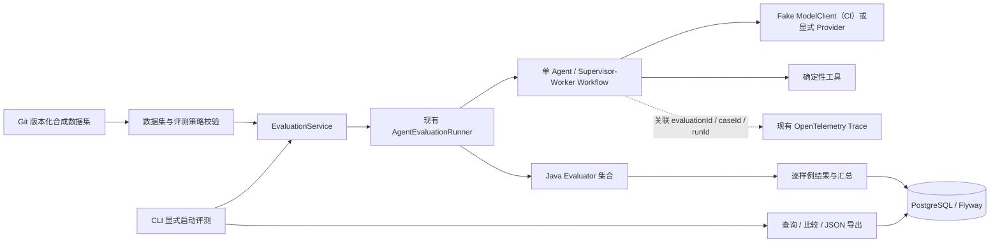

# 阶段四需求设计：可比较、可复现的 Agent 评测

> **文档状态：** 用户已确认并作为阶段四实现基线；阶段四不使用 Langfuse，也不部署新的评测平台。实际交付及验收状态以 `docs/stages/phase-04-summary.html` 为准。

## 1. 背景与阶段目标

阶段 1–3 已具备 Fake 模型确定性回归、版本化合成评测集、可选的真实模型评测 Runner、显式运行预算、JSON 报告和基础回答断言。当前缺口是跨次评测结果的持久化与可比较性：报告主要保存在本地文件中，数据集、检查项、模型配置和代码版本之间缺少统一的实验身份；真实模型运行结果也没有标准化的基线比较和评测决策摘要。

阶段四建议聚焦于**评测生命周期与质量回归决策**：保持 Agent Runtime 和模型调用协议不变，建立版本化数据集、可扩展的确定性 Evaluator、持久化评测实验与逐样例结果、可追溯的基线对比，并把无外部服务的 Fake 回归纳入 CI。真实模型运行仍由开发者显式触发，评测结果用于分析，不默认作为合并门禁。

## 2. 设计决策

### 推荐方案：项目内 Java 评测引擎 + PostgreSQL 结果存储

- 评测执行继续由 Java 代码负责，复用现有 `AgentEvaluationRunner`、单 Agent/协作 Workflow 和 `ModelClient` 注入边界。
- Git 仓库中的 JSON 数据集是输入用例的唯一版本源；每次实验记录数据集版本及内容 SHA-256，保证可识别实际运行的数据。
- 使用 Java `Evaluator` 接口实现可组合、可测试的规则。结果保存到现有 PostgreSQL，评测报告通过 CLI 查看或导出 JSON；PostgreSQL 是实验运行历史的事实来源，导出文件只是交换/留档格式。
- Trace 继续走现有 OpenTelemetry 链路，通过 `evaluationId`、`caseId`、`runId` 关联，不新增 Trace 后端。
- JUnit 中通过注入 Fake ModelClient 与确定性工具执行 CI 必过回归；命令行评测只调用已配置 Provider，并继续要求显式启用开关。真实 Provider 评测保持手动启用，不让 PR/main CI 读取 Provider 密钥、产生费用或发送真实任务数据。

选择理由：当前项目已有 Java 执行器、PostgreSQL/Flyway 和 OpenTelemetry；复用这些边界可得到共享且持久的评测结果，而不增加一套独立数据库、服务或运行平台。Langfuse 明确不纳入阶段四范围。

### 主要替代方案

| 方案 | 优点 | 取舍 |
|---|---|---|
| 只继续使用本地 JSON 报告 | 改动最少，易于离线查看 | 难以跨开发环境查询与比较；文件散落不适合作为长期实验历史 |
| 引入 Langfuse 等评测平台 | 提供 UI、数据集管理和实验比较 | 增加平台部署/托管、数据外发审查与运维工作；用户已明确本阶段不考虑 Langfuse |
| Java 评测引擎 + PostgreSQL（推荐） | 复用现有技术栈、权限边界和数据库；易于用现有测试覆盖 | 需要维护少量评测结果表与 CLI 查询/导出；不提供 Web UI 和协作标注工作台 |

## 3. 架构与数据流



### 主要组件职责

- **DatasetLoader / DatasetValidator：** 读取受版本控制的用例文件，校验 schema、唯一 case ID、评测配置与引用完整性；不执行动态代码。
- **EvaluationService：** 创建 Evaluation Run，记录评测身份和预算，调用现有 Runner，保存逐样例结果及最终状态。
- **Evaluator：** 针对执行结果做单一确定性检查，返回有名称、有版本的分数；不得隐式发起模型调用或网络访问。
- **EvaluationRepository：** 使用 PostgreSQL 事务保存实验元数据和结果。逐样例写入采用 `(evaluation_id, case_id)` 唯一键，支持安全重试和查询。
- **EvaluationComparator：** 在相同数据集哈希及相同检查项版本条件下比较两次实验，给出指标变化和回归项；条件不匹配时拒绝生成“可比较”结论。
- **CLI 与 JSON 导出：** 提供显式运行、历史查询、基线比较、单实验详情和导出。导出文件不替代数据库记录。

## 4. 功能需求

### 4.1 数据集与评测策略

1. 继续以 Git 管理合成数据集，定义稳定 `datasetId`、`datasetVersion`、`caseId` 和格式版本；数据集内容不得包含生产用户数据、密钥或凭据。
2. 每个 case 可声明：输入、预期 Workflow 类型/路由、预期工具及参数约束、回答结构或明确的必需/禁止短语、资源预算，以及适用的 Evaluator ID。
3. 数据集加载时校验重复 ID、未知 Evaluator、空输入、非法断言和超限预算；校验失败则整批在调用模型前拒绝。
4. 每次实验保存数据集版本与规范化文件的 SHA-256。相同版本号但哈希不同必须视为不同输入，并显示差异风险。
5. 保留当前 v1/v2 样例语义；实现时先检查实际格式与兼容边界，再决定新增版本，不重写历史评测事实。

### 4.2 Evaluator 与评分

首批内置 Evaluator：

- Agent Run 是否成功、失败类别是否符合预期。
- 实际工具名称与预期工具集合是否匹配；需要验证参数时只比较显式指定的字段或 JSON Schema 条件，不在报告中复制完整敏感参数。
- 单 Agent / 协作路由、计划 Worker 集合与 case 预期是否匹配。
- 结构化输出是否为合法 JSON，以及字段/Schema 断言是否成立。
- 现有必需/禁止短语回答断言。
- 调用次数、工具次数是否超过 case 和总实验预算。

每个 Evaluator 有稳定 `evaluatorId` 和 `evaluatorVersion`，逐项输出 `PASS`、`FAIL`、`UNKNOWN` 或 `NOT_APPLICABLE`，并附机器可读的短原因。必需数据缺失、步骤中断或结果无法判定时必须使用 `UNKNOWN`，禁止默认当作通过。

本阶段不把 LLM-as-a-Judge 作为自动门禁：它引入额外费用、模型偏差及重复运行波动。人工语义质量结论可作为评测结果的独立备注/评分字段，但不得伪装为确定性断言。

### 4.3 实验身份、运行和持久化

每次实验至少记录：

- `evaluationId`、创建/结束时间和状态（`CREATED`、`RUNNING`、`SUCCEEDED`、`FAILED`、`CANCELLED`、`PARTIAL`）。
- 应用 Git commit、dataset ID/version/hash、Evaluator ID/version 清单。
- Agent 模式、Provider 名称、模型名、允许记录的非敏感运行配置指纹；不得记录 API Key、认证头或 Secret 值。
- 每个 case 的 `caseId`、关联 `runId`/`traceId`（可获得时）、状态、分数、错误类别、模型/工具调用数、耗时、Token 用量（接口未提供时为 `null`）、费用（无单价时为 `null`）。
- 总数、通过率、失败用例、总调用数、总耗时和 Token 汇总；部分 Token 不可用时标出统计覆盖数，不能当作精确总量。

默认只持久化评测元数据、分数和关联 ID，不重复存储完整提示词、回答或工具参数；需查看内容时由已存在的 Run 检查点及其访问边界负责。JSON 导出采用最小必要字段，默认脱敏，敏感值不得写入应用日志。

评测 case 状态至少包括 `PENDING`、`RUNNING`、`SUCCEEDED`、`FAILED`、`SKIPPED`、`INDETERMINATE`；Run 状态与 case 状态须可互相追溯。评测任务继续使用现有模型调用/工具调用上限与总 Deadline；增加或统一评测级总预算配置，整批执行不得因逐 case 重置预算而突破限制。失败样例应记录并继续处理其他可独立执行样例；用户取消、Deadline 或系统错误按定义落终态，不丢失已保存的逐样例结果。

### 4.4 比较与回归决策

1. CLI 可比较两个已完成实验。必须满足相同 dataset ID/version/hash、相同 evaluator 清单版本和兼容的执行模式；否则仅显示差异，不计算通过/回归结论。
2. 比较报告按 Evaluator 展示分数变化、回归/改善 case、Run 成功率、工具选择正确率、预算使用、调用次数、Token 可用率和耗时分布。
3. 真实模型耗时和输出可能非确定；报告应展示每次观测与样本数，不将小样本延迟差异描述为性能提升或统计显著性。
4. 数据集中的明确断言可定义 fail-on-regression 策略；没有业务基线的语义质量、成本和延迟不设置伪造阈值。
5. CI 运行 Fake/确定性测试及评测数据集自校验。真实 Provider 评测不运行于普通 PR/main CI；手动真实评测必须显式启用、指定模型和有界预算，并能将结果与已选基线比较。

### 4.5 CLI 能力

沿用现有 CLI，不建设 Web UI 或 HTTP API。建议命令（最终命名可在实现计划中按当前命令解析器微调）：

- `/eval run <datasetId> [--mode single|collaborative]`：执行显式配置的真实 Provider 评测，并继续要求 `AGENT_EVAL_ENABLED=true`；Fake ModelClient 仅用于自动化测试。
- `/eval list [limit]`：查看实验 ID、状态、数据集/版本、模型、结果摘要。
- `/eval show <evaluationId>`：查看逐样例结果和失败检查。
- `/eval compare <baselineId> <candidateId>`：比较兼容实验并列出回归项。
- `/eval export <evaluationId> <path>`：导出脱敏 JSON 报告。

启动失败、配置错误和结果比较失败应返回稳定错误，不暴露密钥或模型供应商异常正文。

## 5. 非功能要求

- **持久化：** 使用 Flyway schema 迁移；在 PostgreSQL 中对实验状态更新和逐样例结果写入保持事务一致性。重复保存同一 case 结果要幂等，不重复累计总数。
- **可恢复：** 实验崩溃后不得自动重发已经开始且结果未知的真实模型调用；已确认终态的 Run 可同步终态，仍在运行的安全恢复边界可沿用现有 Run 恢复语义，模型调用结果未知的 case 标为 `INDETERMINATE`，不在原实验中自动重跑。用户需通过新建实验明确重跑。已完成的 case 结果可保留。
- **并发：** 不同实验可由不同进程运行；单个实验 ID 不允许两个执行者同时推进。使用数据库条件更新/租约或版本条件，依据现有 RunStore 模式选择最小实现。
- **预算：** 验证每 case 与全局模型/工具调用上限、总 Deadline、可选费用估值上限。供应商未提供用量时记未知。
- **数据安全：** 只使用合成或批准脱敏数据；输出参数化 SQL，报告/日志不包含 Provider 密钥与敏感工具参数；评测结果遵守现有 Run 数据保留设置，当前自动清理仍关闭。未收到数据保留决策前不自动删除评测历史，并在运维说明中披露它与关联 Run 可能持续占用数据库空间。
- **可观测：** 日志和 Trace 关联 `evaluationId`、`caseId`、`runId`；这些高基数 ID 不加入 Prometheus 标签。
- **资源放置：** 先检查本机/Colima/CI 当前资源；Testcontainers PostgreSQL 在本机或 GitHub Actions 验证。L5 只做有界部署/数据库只读或受控 smoke，不部署评测平台、不跑大批真实模型评测。

## 6. 验收范围

### 自动化测试

- Dataset schema 校验：有效版本、重复 case、未知 Evaluator、无效断言、预算上限和内容哈希。
- 各内置 Evaluator 的通过、失败、未知/不适用边界。
- Fake ModelClient 驱动完整实验：状态迁移、逐样例结果、预算累计、继续独立样例、Deadline/取消和中断语义。
- PostgreSQL/Testcontainers：Flyway 创建、实验与 case 结果持久化、唯一约束/幂等保存、并发 claim/版本冲突、事务回滚、查询/比较与导出一致性。
- Comparator：完全兼容可比较；数据集哈希、Evaluator 版本或模式不一致时拒绝错误比较。
- CLI：命令参数、真实模型双重启用条件、报告脱敏和稳定错误处理。
- CI 不读取模型密钥、不访问真实模型、不生成费用；评测数据集校验及 Fake 回归均通过。

### 建议验收命令

```bash
mvn --batch-mode --no-transfer-progress clean verify
```

并运行项目中现有的 Prometheus 规则、镜像摘要和 Kustomize 检查；是否部署或执行 L5 smoke 由实现变更范围决定，执行前重查资源。验收报告必须记录实测测试数、失败/跳过数和外部运行状态。

### 阶段通过标准

1. 现有 Run/Workflow/恢复行为无回归；既有 CLI 功能保持可用。
2. 评测数据在模型调用前完成验证，版本与哈希进入实验记录。
3. Fake 实验结果、Evaluator 分数和评测预算可持久化、查询和导出。
4. 仅对输入与评分契约兼容的实验生成基线比较；回归用例可定位到 case 和 Evaluator。
5. PostgreSQL 并发写入与中断恢复行为由集成测试验证，未知模型调用不会自动重放。
6. CI 全程不调用真实 Provider、不读取真实密钥；真实评测明确 opt-in 且有总预算。
7. 阶段总结 HTML 在验收通过后生成，说明相对阶段三的遗留问题、实现、选型、实测结果、限制，并附阶段四实际架构图和执行流程图；README 的阶段文档索引同步更新。

## 7. 明确不纳入阶段四

- Langfuse、其他托管/自建评测平台或新的常驻评测服务。
- Web UI、HTTP API、生产认证授权、跨租户共享评测门户。
- 默认 CI 中真实模型调用、LLM-as-a-Judge 自动门禁或未确认的预算阈值。
- 生产数据自动采集成评测集；未完成数据分类和模型数据出境决策前只使用合成数据。
- 改写 Agent 控制循环、增加模型供应商、引入 Agent 框架、MQ、向量库或长期记忆。
- 宣称少量样例能证明模型整体质量、生产 SLO 或统计显著的性能提升。

## 8. 阶段三现有边界对阶段四的影响

- 固定 Fake 样例已经适合持续 CI，但不能代表真实模型质量；阶段四须明确区分确定性控制流回归和真实模型观察。
- 当前真实评测报告存在本地文件，运行输入也会进入 PostgreSQL Run 历史；阶段四要把共享实验元数据存储到 PostgreSQL，并避免重复复制敏感正文。
- 当前数据集已版本化，人工评分字段存在，但未形成统一实验比较与质量门禁；阶段四应复用数据格式能力并增加稳定 evaluator/实验标识。
- 未提供业务质量阈值、数据分类、保留期限和单价；阶段四不得据此配置生产质量承诺或精确成本门禁。
- 单节点 L5 不适合额外部署一套评测平台；本方案复用现有服务，所有重型 CI/Testcontainers 工作按项目资源放置规则执行。
